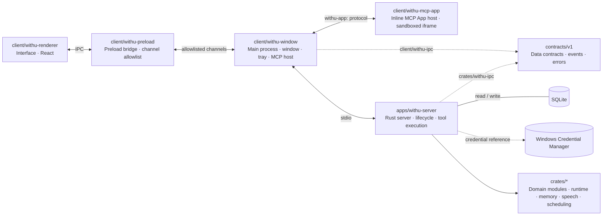

<div align="center">

# Withu

### A local-first desktop companion agent

Conversations, reminders, schedules, drafts and memories stay on your own machine

English · [中文](README.md)

<p>
  <a href="LICENSE"></a>
  <a href="https://github.com/Chaneyiii/WithU"></a>
</p>

</div>

***

## Overview

Withu is a desktop companion that runs entirely on your machine. Electron handles the window and interaction, a Rust server owns persistence and tool execution, data lives in a local SQLite database, and models are called through providers you configure yourself.

Reminders, schedules, drafts, memories and every tool call are recorded locally and can be viewed, edited and deleted from the interface. The model only proposes; writing anything requires your explicit approval on an approval card.

## Features

- **Chat**: streaming replies with the current time and timezone injected into the system prompt.
- **Reminders, schedules and drafts**: written after approval, with rescheduling, cancellation and deletion.
- **Proactive reminders**: system notifications at the scheduled time, with quiet hours.
- **Memory**: explicit saving and deletion, with semantic retrieval.
- **Voice calls**: Doubao full-duplex realtime voice.
- **MCP Apps**: third-party apps run inline from their own origin, released on hide and rebuilt on return.
- **Local first**: data and keys stay on your machine; API keys are stored in Windows Credential Manager.

## Quick start

Requires Windows 10/11 x64, Node.js 20 or newer, Rust with Cargo, and Git.

```powershell
npm ci
npm run build
npm start
```

On first launch, open **Settings → General** and fill in the provider endpoint, model name and API key under "Model & Voice".

## Project layout



## Security and privacy

- API keys live only in Windows Credential Manager; the database stores reference IDs.
- Inline MCP Apps run in their own origin and CSP, with no same-origin access and no network capability.
- Data stays on your machine; network access requires explicit configuration.

## License

Released under the [Apache License 2.0](LICENSE).

Copyright © 2026 Withu contributors
