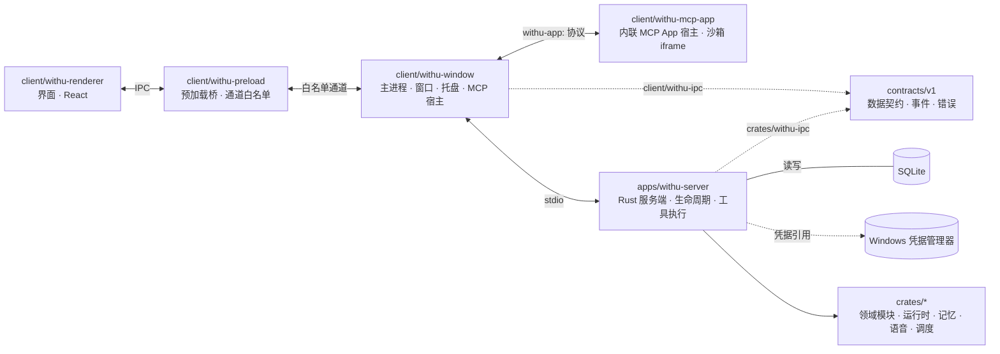

<div align="center">

# Withu

### 本地优先的桌面陪伴 Agent

对话、提醒、日程、草稿与记忆，都保存在你自己的机器上

[English](README.en.md) · 中文

<p>
  <a href="LICENSE"></a>
  <a href="https://github.com/Chaneyiii/WithU"></a>
</p>

</div>

***

## 简介

Withu 是一个运行在本机的桌面陪伴应用。Electron 负责窗口与交互，Rust 服务端负责持久化和工具执行，数据保存在本机 SQLite 数据库中，模型通过你自己配置的服务商调用。

提醒、日程、草稿、记忆以及每一次工具调用都记录在本机，可以在界面里查看、修改和删除。模型只负责提出建议，真正写入需要你在审批卡上点一次允许。

## 核心能力

- **对话**：流式回复，系统提示中包含当前时间与时区。
- **提醒、日程与草稿**：通过审批卡确认后写入，支持改期、取消与删除。
- **主动提醒**：到点弹出系统通知，可设置安静时段。
- **记忆**：显式保存与删除，支持语义检索。
- **语音通话**：豆包全双工实时语音。
- **MCP App**：第三方应用以内联面板的形式运行在独立源中，可隐藏释放、恢复重建。
- **本地优先**：数据与密钥都留在本机，API Key 保存在 Windows 凭据管理器。

## 快速开始

需要 Windows 10/11 x64、Node.js 20 及以上、Rust 与 Cargo、Git。

```powershell
npm ci
npm run build
npm start
```

首次启动后，进入 **设置 → 通用**，在「模型与语音」中填写服务商地址、模型名称与 API Key。

## 项目结构



## 安全与隐私

- API Key 只保存在 Windows 凭据管理器，数据库中只保存引用 ID。
- 内联 MCP App 运行在独立源与独立 CSP 中，没有同源权限，也没有网络能力。
- 数据保存在本机，联网行为需要显式配置。

## 许可

本项目以 [Apache License 2.0](LICENSE) 发布。

Copyright © 2026 Withu contributors
