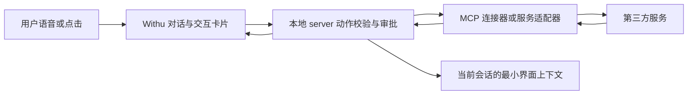

# Withu v3 产品与架构权威文档

- 版本：v3.8-draft
- 日期：2026-10-25
- 状态：v3 开发的唯一规划依据。本文档取代 v1、v2 的产品 PR、架构文档、P0/P1 计划、测试基线和工程报告。
- 取代范围：`product-direction-pr.md`、`product-direction-pr-2026-10-08.md`、`ARCHITECTURE-V2-CODEX-INSPIRED.md`、`ARCHITECTURE.md`、`OFFICIAL-DOCS-PR-DECISIONS-2026-10-07.md`、`PERSONAL-AGENT-RESEARCH-2026-10-08.md`、`HUMAN-EVALUATION-STAGE-5.md`、所有 `STAGE-*.md`、`TASK-*.md`、`P0.*-REPORT.md`、`UNSLOTH-*.md`。上述文件转为历史材料，不再具有指令效力。
- 调研与研报收录方式：见附录 A–F。附录是本文件的证据与背景部分，不构成独立指令；正文与附录冲突时以正文为准。
- 本次修订（v3.8，2026-10-25）：§5 全章按 Demo Phase 1–2 冻结 GUI 重写——以现有 GUI 为唯一标准（用户指令），废止旧「三层布局 + 六项导航 + 侧栏模式切换器」规划；§1.5、§6 与附录 E 同步。v3.7 增补的调研（§4.10 Intelligent UI、§4.2.1 与附录 B.21–B.24 记忆系统）保持有效；其中交互内容的呈现形态已按当前 GUI 改为浏览器抽屉（§5.6）。第三方服务及依赖集成仍须逐项验证，不表示已接入或已验收。

---

## 0. 文档定位与使用规则

### 0.1 为什么合并成一份

v1、v2 期间产品方向经历了多次实质调整，文档分散在 PR、架构、研究记录、阶段报告和工程报告里，导致同一问题存在多处互相矛盾的表述。本次合并的目的不是省事，而是让**签名检查只需要检查一个文件**：任何一条决策只能在本文件出现一次，其他地方不允许重复定义。

### 0.2 权威顺序

1. 用户在对话中明确确认的决定。
2. 本文件正文 §1–§9。
3. 本文件附录中的官方文档原文引用。
4. 第三方研究与研报结论（附录 A、C、D），仅作背景与判断依据。
5. v1、v2 的任何代码、报告或历史文档，均不构成产品依据。

### 0.3 三条硬规则

- **文档唯一**：产品决策只在本文出现。发现旧文档与本文冲突，以本文为准并删除或标记旧文档，不允许两者并存。
- **代码不继承文档**：v1、v2 的 P0/P1 结论、测试通过报告、工程验收报告在 v3 中一律不成立。v3 的完成状态只能由 v3 自己的回放和验收证明。
- **第三方研究不是产品事实**：调研报告里的市场判断、竞品能力、下载数据、融资估值都不自动成为 Withu 的需求。

---

## 1. 产品定位（v3 锁定）

### 1.1 一句话定位

Withu 是一个面向普通个人用户的**关系型 personal agent**。它以语音和 presence 为主入口，在类似视频通话的主舞台中提供陪伴、倾听、安慰、共情、鼓励与娱乐，并逐步形成稳定的长期关系；同时保留与 Dots、Muse 同量级的基础事务能力，在用户明确委托时处理生活事务。

### 1.2 三条不可让渡的底线

1. **不是聊天壳**。Withu 必须具备任务执行能力。如果它只能提供情绪价值，用户打开任意一家 LLM 供应商的网页加一段 prompt 即可替代，Withu 不成立。
2. **情绪价值优先，专业能力保留**。启动默认进入 Comfort，承接倾诉与陪伴；Cowork 提供处理代码、文件与专业事务的工作台。两种模式属于同一个 Withu，用户从 Comfort 交办的事务不需要强制切换 Cowork。
3. **不是摄像头应用**。视频通话感来自 2D 动画与 3D avatar 的视觉在场、眼神与表情反馈，以及实时轮流说话。当前范围不规划摄像头输入与用户视频存储。

### 1.3 与竞品的关系

Withu 的基础能力类别与规模对齐 Dots、Muse 这一档 personal agent（对话、个体记忆、检索整理、日程提醒、草稿、受控外部动作、连接器/MCP、多步骤任务、后台执行、通知、审批）。这是**能力类别与规模的对齐**，不是逐项功能对等声明，也不代表已实现。

Withu 的差异化不在能力清单，而在两点：

- **情绪价值**：陪伴、倾听、安慰、共情、鼓励、娱乐。
- **长期关系体验**：记得用户经历、形成共同话题、稳定人格、主动关心。

代码与专业工作能力保留但降为次要方向，参照 Claude Cowork 的定位方式（见 §4.5）。

### 1.4 用户群体

首发不把年龄、独居状态或照护需求作为门槛。目标用户是希望获得持续情绪支持、表达空间或稳定交流关系的普通个人用户，重点服务在某些时刻需要有人倾听、有人陪伴的人。

### 1.5 明确排除（不进入 v3，也不作为后续候选）

安全联系人、家人/监护协作、照护监督、危机升级、情绪趋势告警、四类风险事件、适老档案、情绪球、固定课程/活动菜单，以及 Muse/Meta 专属的账户中心、支付钱包和 Secure Vault。这些概念超出 Withu v3 的 personal agent 功能语义或只属于来源产品，不在 v3 恢复，也不列入 P1 候选。Goals、Feed、Ideas、Search 不属于此排除清单，其 GUI 处置以 §5.5.1 为准：搜索由全局搜索弹窗承接，Goals/Ideas 当前无导航入口（server 能力保留），Feed 页已由灵感页取代。

---

## 2. 核心决策 R01–R14

### R01：Presence 是第一窗口

首屏是视频通话/视频会议式的 presence stage，不是工作台、项目页或工具菜单。用户首先看到 Withu 的视觉存在、听到声音，能随时开始或打断。记忆、设置、隐私、授权从次级抽屉进入。

Presence 由 2D 动画与 3D avatar 组成，通过眼神、表情和说话状态建立视觉在场。静态头像仅作降级显示。不采集用户摄像头。

### R02：语音优先，文字为补充

ASR、理解、TTS、VAD、回声处理、打断与重连构成一条 realtime duplex session。文字输入、实时字幕和完整 transcript 用于可访问性、纠错与回顾。语音不是文字输入框旁的附属按钮。

### R03：用户主动对话为主

用户主动开启互动是默认入口。进入后 Withu 通过声音、停顿、眼神、表情表现出更有生命力的回应。回合内 Withu 可以选择倾听、回应、问一个必要问题、共同安静、处理事务或自然结束，不要求每次都提出计划或活动。

### R04：低频主动性，且分优先级

三类主动性必须由用户明确开启，支持频率、时间窗口、安静时段与一键暂停：

优先级为 **重要日期/日程提醒 > 主动问候 > 主动分享话题**。

原因是 Withu 的临场感依赖用户在场，用户不打开应用时无法建立互动。与用户真实生活日历绑定、错过有实际代价的提醒，是唯一能在用户不在场时仍然成立主动性；纯分享型话题最容易构成打扰，频率应最低。

一次机会只做一次自然开场。无回应、拒绝或打断不会被解释为危险、孤独或长期偏好。应用运行但窗口隐藏时可用应用通知；完全退出后本地 server 不再生成新问候或执行日程。普通问候不自动拨打电话、发短信或强制播报。通知设置采用 §8.3 的官方参考规则，不臆造统一频率数值。

### R05：可控的个人记忆与事务上下文

保存用户允许保存且对后续互动或已委托事务有帮助的信息：称呼、表达偏好、声音偏好、用户经历，以及任务目标、日程、进度和必要偏好。

关系记忆、当前会话状态、事务上下文分层管理。当前情绪与当前意愿只在当前会话优先，旧状态不能覆盖新表达。共同话题只能来自用户明确参与过的对话或共同完成的事务，不能由模型制造。

用户可以自然语言纠正和删除；删除必须阻止后台摘要、缓存和候选恢复。记忆由应用持有，provider 只返回候选。供应商文档不替 Withu 决定记忆写入（见附录 B §B.2）。

### R06：克制的能动性与事务能力

用户明确提出事务目标后，Withu 可以在关系回合中制定计划、调用受控连接器并回报结果。基础生活事务能力包括：日程、提醒、信息检索、内容整理、消息草稿、预约、购物。代码与专业工作能力降为次要方向。

Withu 不因识别到某种情绪就自行创建任务、发消息、购物、预约或修改外部数据。

首发实现本地日历与本地提醒，以及信息检索、内容整理、消息草稿。外部日历和其他外部服务通过 MCP 开放接口接入，不为每个服务预先建立固定产品入口。预约与购物可通过受控 MCP/连接器接入，继续遵守逐动作审批。

### R07：审批与外部动作

采用 Claude Cowork 的审批语义（官方原文见附录 B §B.11）：

- **Manual（默认）**：需要动作时暂停，说明动作、目标、影响范围与预计结果，用户选择 Allow 或 Deny。
- **Auto（可选）**：只读动作可继续；写入、删除与外部副作用由规则做安全判断，不安全动作阻断或退回逐项询问，连续阻断后退回 Manual。

永久删除、购买、付款、发消息、发布内容、预约确认、账户变化等不可逆或高影响动作必须显式 Allow。连接器可设 `Always allow`、`Needs approval`、`Blocked`，但不能越过上述强制审批。

Withu 必须显示计划、当前动作、执行结果与失败原因，允许中途纠偏、取消与撤回。一次模糊同意不能扩大到未说明的动作或更大数据范围。

**版本提示（2026-10-09 复核）**：Claude 官方正在把 Cowork 与 Chat 合并为单一体验——"Claude Cowork is now just Claude. Ask for what you need, and Claude decides whether that's a quick answer or a task."（原文见附录 B §B.5）。合并后的新体验里，消息框的权限设置只提供 `Auto` 与 `Manual`（默认）。Withu 只保留这两个模式：`Manual` 是默认，`Auto` 是用户主动选择后的加速模式。新版 Claude 已移除的 `Skip` 不进入 Withu 的产品设置、数据模型、IPC 或验收用例。

这条版本提示同时说明了一件事：**Claude 的方向是"Cowork 不作为独立模式存在"，而不是"Cowork 被删除"**。Withu 采纳同样的能力观（§4.5），并通过同一对话侧边栏中的 Comfort / Cowork 模式选择器组织交互（§5.5）。

### R08：单一稳定关系身份

**用户面对的始终是一个 Withu。** 声音、视觉载体、语气可配置，但不把多个 agent、模型、provider、specialist 或 skill 暴露给普通用户。provider 切换不能改变关系身份、记忆权限、打断语义或主动性边界。

**内部执行可以是团队。** 这与"单一关系身份"不冲突：团队是执行结构，不是关系结构。用户永远只在跟 Withu 说话，看到的计划、进度、审批和结果都是 Withu 给出的；specialist 不发言、不拥有记忆、不直接面对用户。

这一节修正了此前"不引入 Primary + Specialist 团队结构"的错误判断。概念来源与官方依据见 §4.7 与附录 B §B.12：Claude 官方把同一件事分成两层——**subagent**（各自独立 context，结果回传给主 agent）与 **agent team**（独立 session、共享任务清单、互相直接通信，有 team lead）。Cowork 文档中的 "Sub-agent coordination"、"Coordinates multiple workstreams in parallel"、"may coordinate multiple sub-agents working simultaneously" 就是这套结构的产品表述。

Withu 的采用边界：

- **Cowork 默认具备团队编排能力** Primary coordinator + Specialists；实际派生取决于任务复杂度与可并行性，短任务仍由 Primary 直接完成。进入 Cowork 不等于每次都启动多个 worker。
- **Comfort 中的明确事务也可调用同一编排层**。按官方 "Claude automatically delegates tasks based on the task description in your request... and current context" 的语义，Primary 根据事务判断是否派生 specialist，不以切换 Cowork 作为能力前提。普通倾诉与陪伴回合不派生。
- **relationship turn 不启用**。情绪支持回合不派生 specialist。理由是 R05 与 R09：陪伴质量取决于回合连贯与在场感，把倾诉拆给多个上下文会破坏关系连续性。
- **用户不可见 specialist，但可中断**。用户可以随时打断或取消整个任务，specialist 的部分产物必须能整体丢弃（§4.3 的删除与竞态规则同样适用于团队中间产物）。

### R09：尊重退出与安静

结束、静音、打断、暂不回应、删除都是真实状态，不是失败。Withu 不能用连续追问、情绪施压、奖励或任务完成感挽留用户，也不能把使用依赖作为产品目标。

### R10：通用隐私、权限与内容边界

用户可查看、纠正、删除个人记忆，撤回音频、通知、连接器权限。外部动作按审批模式执行。模型自身的内容边界作为通用产品行为处理，不衍生额外的用户档案、联系人或监督设置。

### R11：摄像头不是前提

用户应能只用头像、声音和字幕完成全流程。v3 不规划摄像头输入、用户视频存储或相关设置。

### R12：本地优先的部署现实

Withu 当前不具备云端服务部署能力，因此产品形态必须适配 server 本地部署。这条决策改变的是部署拓扑，不是能力清单——见 R13 与 §4.4。

### R13：本地 server，不是本地功能削减

Withu 仍然是 client + server 架构，只是 server 跑在用户自己的机器上。这与"厂商把 server 放在云上、client 发请求"是同一种拓扑，差别只在 server 的位置。**不能因为 server 本地化就推断记忆、后台任务、工具执行、审批、定时任务必须降级。**

生命周期边界必须精确区分：server 随 client 启动；server 独立于 renderer 和主窗口；client 完全退出时，server 执行 graceful shutdown，释放本地服务端口、音频设备、子进程和模型句柄后退出。v3 不把 Withu 变成用户退出后仍常驻的系统服务。

职责划分：

| 层 | 位置 | 职责 |
|---|---|---|
| Withu Client | Electron renderer / presence UI | 呈现、字幕、presence 视觉、麦克风采集与播放、用户输入 |
| Withu Server | 随 Withu Client 启动的本机服务进程；独立于 renderer/window，但绑定 Withu 应用生命周期 | agent 编排（含 specialist 团队）、关系记忆、任务与定时调度、工具执行、审批裁决、ASR/TTS 会话管理、持久化、审计与删除墓碑 |
| Model | 本地或云端，按用户配置 | LLM 推理；ASR/TTS 可本地亦可云端（R14、§4.6） |

推论：

- **后台任务是可实现的，但只在 Withu 应用运行期间持续**。本地 server 独立于 renderer/window，因此切换模式、关闭主窗口或重载前端不会杀掉任务；用户选择“退出 Withu”时，client 先通知 server 完成收尾，server 取消未完成的运行中任务、释放本地端口与模型句柄后退出。v3 不做脱离 Withu 应用的 OS 常驻服务，也不在用户完全退出后继续运行任务。
- **不引入能力降级条款**。此前 §4.4 整节写的"本地优先带来的语义降级"删除。Claude 官方自己就有 device-local 执行形态（附录 B §B.13），说明本地执行不必然牺牲后台能力。
- **真正的约束只有两处，且都是物理事实**：LLM/ASR/TTS 依赖用户自备（本地模型或 API Key），以及用户完全退出 Withu 后 server 也退出、无法继续执行。这两点如实告知用户，但不写进产品能力清单。

### R14：语音后端可配置，默认云端优先

ASR 与 TTS 分别支持云端 API 和用户下载的本地开源模型。Withu 内置适配与实时会话能力，不假定用户已经安装模型权重。

每项语音服务优先使用用户配置的云端后端；没有配置云端时，默认使用已安装并启用的本地模型。用户可自定义默认模型，也可明确选择本地后端。云端与本地都未就绪时，显示配置或下载入口，不虚报语音可用。连接故障不能冒充“未配置”，不能静默改用其他云服务。

Settings 的模型配置采用聚合配置（§4.8），语音页面引用已有 provider 与凭据。TTS 模型支持音色设计时才显示高级音色设置；不支持则不显示。下载目录首批模型名单由用户后续提供，当前不锁定型号、体积与硬件数值。

VAD、实时轮次控制、barge-in、播放取消与音频清理由 Withu speech session 统一管理；本地或云端后端替换不能破坏这些语义。

---

## 3. v3 代码策略

### 3.1 版本定位

- `withu-AI`（含 `E:\Orbit\app` 等）是 v1，面向老年陪伴场景，已终止。
- `withu-desktop-v2` 是 v2，当前规划完成后不再继续开发。
- v3 是新代码库，从 v1、v2 中**复用迁移**可用实现。

### 3.2 迁移原则：手术刀式，不做兼容迁移

v3 可以复用 v1、v2 的代码资产，但**不做向后兼容迁移**。具体含义：

- 复用是**逐块挑选 + 直接改写**，不是整目录搬运后修修补补。
- 不保留 v1/v2 的旧路由、旧 RPC 名、旧表结构、旧配置格式作为兼容层。
- 不写"如果检测到旧数据则…"的过渡分支。v3 的数据从零建立。
- 每一刀都要精准且刀口完整：搬进来的模块要么完全契合 v3 契约，要么不带进来。半适配状态不允许存在。

理由：v2 的核心问题是外壳（Unsloth 训练工作台）与 v3 产品方向不兼容。如果做兼容迁移，等于把工作台的历史包袱带进 v3，并在其后花费数轮清理。

### 3.3 明确不继承的内容

以下在 v3 中**一律不成立**，不作为验收依据、不作为起点、不作为参考实现：

- v1、v2 的 P0、P1 计划与门槛定义。
- v1、v2 的全部测试文件（`TASK-*`、`STAGE-*`、`P0.*`、`ROUTINE-*`、`APPROVAL-*`、`MEM-*` 等回放用例）。
- v1、v2 的工程报告与验收报告（`*-REPORT.md`、`*-SUMMARY.md`、`HUMAN-EVALUATION-*`）。
- Unsloth 训练类功能：训练工作台、模型目录、数据集选择、配方工作室、HF 认证、显存切分等。

v3 的完成状态只能由 v3 自己定义的回放与验收证明（见 §7）。

### 3.4 可复用资产的判定

v1、v2 中下列实现具备复用价值，迁移时按 v3 契约重写：

- Rust core 的分层记忆对象、证据链、删除墓碑、版本冲突处理。
- 审批状态机与任务状态机。
- provider adapter 的结构化候选与错误分类。
- 关系回合生命周期、取消与清理语义。

判定标准：该实现是否表达了一个**与产品方向无关的工程约束**（如删除不可复活、取消必须幂等）。若是，则迁移并重写；若它编码了旧产品语义（如照护监督、四类风险事件），则丢弃。

### 3.5 仓库要求

v3 从第一天起纳入 git 版本控制。v2 当前不是 git 仓库（`git status` 报 `not a git repository`），且存在 8 个 `target-stage*` 编译产物目录与临时文件。v3 不复制这种状态。

### 3.6 工程文件命名规范

v3 的命名参考 Apple 平台工程的职责命名与 xAI / OpenAI 开源 agent 项目的 crate/package 组织方式：名称表达**职责、边界和生命周期**，不表达内部临时实现或营销概念。

- **产品层**：`Comfort`、`Cowork`、`Presence`、`Withu Server`、`Withu Client`。模式名使用 PascalCase，UI 文案使用标题大小写或中文本地化。
- **服务端领域**：`withu-server`（可执行入口）、`withu-runtime`（agent loop 与任务生命周期）、`withu-memory`、`withu-speech`、`withu-orchestrator`、`withu-approvals`、`withu-connectors`、`withu-scheduler`、`withu-audit`。Rust crate / package 使用 kebab-case，源码模块使用 snake_case。
- **客户端桥接**：`withu-preload`、`withu-ipc`、`withu-window`；IPC 通道使用 `withu:<domain>:<verb>`，例如 `withu:speech:start`、`withu:task:events`、`withu:approval:decide`。禁止继续使用 `muse:*`、`museDesktop`、`dictation` 作为产品接口名。
- **状态与事件**：领域对象使用名词（`SpeechSession`、`TaskRun`、`ApprovalRequest`、`MemoryCandidate`、`SpecialistRun`）；事件使用过去式或状态变化表达（`speech.partial`、`task.paused`、`approval.requested`、`server.shutdown.complete`）。
- **文件与配置**：用户数据目录采用 `withu/` 命名空间；状态文件使用 `withu-state-v1.json`，导出文件使用 `withu-data-export.json`。不使用 `shell-state`、`scene`、`Muse` 等视觉原型遗留词。
- **命名取舍**：不把 provider 名写进核心领域类型，不用 `AgentManager`、`Utils`、`Helper`、`Misc` 这类无法说明边界的泛名；provider 适配器放在 `providers/<provider_id>` 下，模型名称只出现在配置或目录数据中。

参考依据：OpenAI Codex 的 `codex-cli` / `codex-rs` 分层、xAI Grok Build 的 `crates/codegen/xai-grok-shell` 与 `crates/...` 分层、Anthropic Claude Code 的插件/agent scope 分层。它们共同的可复用原则是：运行时、协议、工具、沙箱和 UI 入口分层命名；Withu 不复制这些项目的品牌或内部实现。

---

## 4. 架构基线

### 4.1 分层与运行时

```text
Withu Client (Electron renderer)                    [窗口生命周期]
  presence stage: 2D + 3D avatar / 字幕 / 通话控制
  response surfaces: 原生交互卡片 / 隔离的 MCP App / 媒体与网页呈现
  麦克风采集 -> 扬声器播放
        |  IPC / 本机 HTTP
        v
Withu Server (随 Client 启动的本机服务)               [独立于 renderer/window]
  speech_session      ASR / TTS 后端(本地或云) + VAD + barge-in + turn-taking
  relationship_state   关系记忆 / 当前状态 / 关系摘要 / 证据 / 删除墓碑
  initiative_policy    低频问候 / 重要日期提醒 / 话题分享
  task_orchestration   Primary coordinator
                         └─ Specialist subagents (独立 context, 结果回传)
  approval_policy      Manual / Auto 裁决 + 强制审批白名单
  tools                本地日历 / 提醒 / 文件 / 检索 / MCP 连接器
  app_sessions         界面资源 / 动作路由 / 状态版本 / MCP Apps 能力协商
  scheduler            本地定时任务 (Withu 运行期间生效)
  audit                最小操作事实 + schema version
```

读法：一个回合从客户端的麦克风进入，经 server 的 speech_session 转成文本，进入 relationship_state 判定这是关系回合还是事务；若走事务，由 Primary coordinator 决定是否派生 specialist，产出计划后停在 approval_policy，直到用户 Allow 或 Deny；执行结果回到同一个回合给用户，最后按规则层决定是否写入关系记忆。

现有 stdio JSON-RPC、Tauri/Electron bridge、Rust core、SQLite、provider adapter、审计与删除墓碑的结构可复用，但产品领域重定义为 `speech_session`、`relationship_state`、`initiative_policy`、`task_orchestration`（含 specialist 团队）、`approval_policy`、`scheduler`。`presence_session` 作为 UI 概念保留在客户端层，不再是服务端的运行时单元。

### 4.2 数据模型

分层对象及其字段语义（逻辑对象名可调整，语义必须保留）：

| 对象 | 最小字段 | 更新规则 |
|---|---|---|
| 稳定事实/明确偏好 | `id`, `kind`, `subject`, `content`, `source_evidence_ids`, `observed_at`, `confidence`, `valid_from/to`, `status`, `version` | 只有带来源的候选经规则提交后生效 |
| 当前状态 | `session_id`, `topic`, `emotion/intent`, `user_stated`, `observed_at`, `source_turn_id`, `version` | 当前明确表达立即覆盖对话上下文 |
| 情绪观察 | `turn_id`, `modality`, `observed_signal`, `source_ref`, `captured_at`, `retention` | 只记录可观察证据；语音韵律等派生特征默认会话内短暂存在，不把推断写成事实 |
| 情绪假设 | `session_id`, `hypothesis_id`, `valence`, `arousal`, `affect_candidates[]`, `support_need_candidates[]`, `confidence`, `abstention`, `evidence_refs[]`, `model_version` | 只能作为当前回合候选；显式用户表达和用户纠正优先，未确认的情绪不进入长期记忆 |
| 支持计划 | `turn_id`, `primary_action`, `secondary_option`, `permission_needed`, `language_constraints`, `presence_cues` | 每回合最多一个主要支持动作；先满足倾听/确认/陪伴，再在用户许可后给建议或执行事务 |
| 回应结果 | `turn_id`, `action`, `user_feedback`, `next_turn_signal`, `outcome`(`improved`/`unchanged`/`misread`/`unknown`) | 只用于当前会话校正；“回应后更好”不能反推模型正确识别了情绪 |
| 关系摘要 | 时间范围、来源集合、有效期、版本 | 新证据修正，过期后不注入当前回合 |
| 证据片段 | `id`, `turn_id`, `speaker`, `captured_at`, `text_ref`, `redaction`, `deleted_at` | 不把模型推测写成用户原话 |
| 可恢复事项 | 已接受目标、接受证据、条件、状态、版本 | 只有明确接受后保留 |
| 事务任务 | `task_id`, `goal`, `steps`, `impact`, `status`, `policy_version`, `authorization_version`, `created_at` | 计划不产生外部效果 |
| 编排团队 | `task_id`, `primary_id`, `specialists[]`(`specialist_id`, `role`, `tool_allowlist`, `context_ref`, `depends_on[]`, `status`, `retry_count`), `dispatch_reason`, `concurrency_limit`, `cancel_token` | specialist 只写自己的 context，不写记忆与授权；依赖、重试、取消由 Primary/Server 管理 |
| 审批记录 | `approval_id`, `task_id/step_id`, `mode`(`manual`/`auto`), `decision`, `scope`, `policy_version`, `expires_at`, `decided_at` | Allow/Deny 只覆盖列明动作与数据范围 |
| 连接器 | `connector_id`, `capabilities`, `permission_state`, `credential_ref`, `last_checked_at` | 工具级偏好不越过产品高影响规则 |
| 语音后端 | `backend_id`, `kind`(asr/tts), `mode`(local_model/cloud_api), `provider_ref`, `model_ref`, `credential_ref`, `selection_policy`, `voice_capabilities`, `enabled`, `health` | 默认选择按 R14；VAD 属于本地会话控制，不作为用户配置的模型 provider |
| 聚合模型配置 | `config_version`, `providers[]`, `credential_refs`, `defaults`(llm/asr/tts), `model_overrides`, `speech_preferences` | Settings 管理同一配置源，server 校验并加载；凭据不进入视图缓存、日志或导出 |
| 会话与项目索引 | `conversation_id`, `mode`, `project_id?`, `title`, `last_activity_at`, `task_refs`, `draft_ref` | Comfort/Cowork 列表由同一 server 索引筛选；切换模式不复制会话或任务 |
| 交互回复块 | `block_id`, `message_id`, `kind`, `surface_id?`, `fallback_text`, `source_refs[]`, `schema_version` | 文字与界面块可混排；交互数据来自真实工具结果，模型不能伪造搜索结果、播放状态或完成态 |
| 界面会话 | `surface_id`, `conversation_id`, `server_id?`, `tool_call_id?`, `resource_uri?`, `resource_hash?`, `capabilities`, `state_revision`, `selection_refs`, `lifecycle` | server 持有会话与动作范围；历史记录只恢复静态摘要和必要引用，重新打开不自动重放动作 |
| 界面动作 | `action_id`, `surface_id`, `source`(click/voice/app), `action_type`, `target_ref`, `expected_revision`, `approval_ref?`, `idempotency_key`, `result_ref` | 点击与语音进入同一校验/审批路径；过期界面、被撤权连接器和重复请求不能继续产生副作用 |
| 本地语音模型 | `model_id`, `task`(asr/tts), `source_url`, `sha256`, `size`, `license`, `hardware_hint`, `install_path`, `state` | 目录条目由产品提供，权重由用户下载；校验失败不得启用 |
| Server 生命周期 | `server_id`, `pid`, `bind_address`, `port`, `started_at`, `client_session_id`, `shutdown_requested_at`, `shutdown_completed_at`, `exit_reason` | 随 client 启动；独立于 renderer/window；graceful shutdown 后释放端口与资源 |
| 删除墓碑 | 目标类型/id、删除版本、时间、来源、同步保护 token | 防止后台候选、缓存、离线同步复活 |

### 4.2.1 记忆存储与检索实现决议

Withu 的记忆分为两层：**Withu canonical memory（权威记忆）**和**derived context index（派生检索索引）**。

- **权威记忆**由 `withu-memory` 与本地持久化层持有。稳定事实、明确偏好、当前状态、情绪观察/假设、关系摘要、证据、可恢复事项、版本和删除墓碑都以 §4.2 的字段和 §4.3 的竞态规则为准。provider、检索索引或外部记忆服务不能直接写入这些对象。
- **当前回合对象**（当前情绪、支持计划、回应反馈、原始或派生语音证据）只服务于当前会话，默认不进入长期语义索引；用户明确确认后，才由规则层决定是否形成稳定事实或关系摘要。
- **派生索引**只负责减少上下文装载和改善召回，不能成为关系身份、授权、审批或删除状态的第二事实源。索引结果必须带回 `memory_id`、版本和证据引用，组装上下文前再次经过 Withu 版本、权限和删除墓碑检查。
- **检索分两条路径**：精确路径用于用户查看、纠正、删除和证据回溯；语义路径用于在有限范围内找共同话题、已确认偏好和事务经验。语义召回不能覆盖用户明示，也不能因为相似度高而自动写入记忆或发起主动行为。

OpenViking 的虚拟目录、L0/L1/L2 渐进加载、按目录/用户/项目限定检索、会话归档与 `memory_diff` 审计适合成为派生索引的实现参考。它不能直接替换 Withu 的 canonical memory：OpenViking 的自动抽取是异步的，内置类型和 Markdown 文件模型没有表达 Withu 的情绪候选、支持计划、证据版本、删除不可复活和当前状态覆盖规则；其 `forget`/文件删除也不能自动满足 §4.3 的后台竞态要求。

`claude-code-best/claude-code` 提供了另一类重要但低于官方资料的工程证据。固定快照中的 `src/memdir`、`docs/context/project-memory.mdx`、`docs/features/auto-dream.md` 和 `src/services/compact/sessionMemoryCompact.ts` 展示了索引文件、主题记忆、按需召回、记忆漂移校验、后台整理和会话压缩的可实现组织方式（详见附录 B.23）。它不能替换 OpenViking 的基础设施评估，也不能被写成 Anthropic 官方 Claude 的内部实现；在 Withu 中只作为非官方工程参考。

v3 采用以下集成决议：

1. 首先在 `withu-memory` 内实现可替换的 `MemoryIndex` 接口，保持 v3 规划的 Rust/SQLite（或经验证的本地 SQL 持久化实现）、证据链、删除墓碑和规则层为唯一权威；不因引入 OpenViking 或其他索引项目改写产品记忆语义。
2. 可以把 OpenViking 作为**可选的本机派生索引进程**接入：Withu 只投影经过规则层确认的记忆摘要和已授权的 Cowork 项目/经验，查询时接收带 URI 的候选，再由 Withu 校验版本、作用域和删除状态。OpenViking 不直接接收未确认的情绪假设、原始音频、完整倾诉内容、provider 凭据或关系审批数据。
3. 如果许可证、Windows 打包、启动/退出、模型依赖和删除回放验证不能通过，则退回 Withu 自有索引实现；OpenViking 的 L0/L1/L2、目录作用域、会话归档和增量 diff 机制可以在 Rust/SQLite 中重写，不复制其实现代码。
4. 暂不把 OpenViking 作为 v3 的必装依赖或 canonical memory 替换。仓库当前以 AGPL-3.0 发布，直接链接、修改或随 Withu 分发前必须单独完成许可证和发行形态评估；不能把“本机 HTTP 进程”自动当作已经规避义务。

**SQL 板块的独立参考**：AliSQL 不负责定义 Withu 的关系记忆语义，但作为 SQL 存储板块的重点工程参考，进入 v3 的 SQL engine evaluation。重点核查其事务隔离、崩溃恢复、历史查询、Binlog/Redo 持久化、大事务提交和 HNSW 向量索引对 Withu schema、任务状态、记忆索引和审计查询的启发。当前正文保留 Rust/SQLite 作为实现基线；是否使用 AliSQL、SQLite 或其他本地 SQL 引擎，必须通过 GPLv2/分发边界、Windows 打包、资源占用、启动/退出、备份恢复和真实查询基准后再决定。

建议的投影映射如下：

| OpenViking context type | Withu 可投影的范围 | 明确不投影 |
|---|---|---|
| `profile` / `preferences` | 用户确认的称呼、偏好、边界、声音选择 | 模型推断的性格、未经确认的情绪与心理标签 |
| `entities` / `events` | 用户确认的经历、共同完成的事务、明确日期与项目关系 | 单轮猜测、未确认的第三方隐私、已删除证据 |
| `cases` / `trajectories` / `experiences` | Cowork 项目内的任务经验，按项目作用域检索 | Comfort 的关系记忆、审批决定、provider 凭据 |
| `identity` / `soul` / `skills` | Withu 自身人格配置和 Cowork 工作技能的只读派生视图 | 让外部索引修改 Withu 人格、权限或产品规则 |
| `sessions` / 原始消息 | 受保留策略约束的审计或恢复来源 | 默认长期保存完整倾诉、原始音频和声学特征 |

这项决议保留 OpenViking 最有价值的检索工程，同时让用户查看、纠正、删除和关系安全规则继续由 Withu 控制。

### 4.3 删除与后台竞态

1. 写入删除墓碑并递增对象版本。
2. 查询与上下文组装立即排除目标对象及对应证据。
3. 撤销或重算依赖它的当前状态、摘要、可恢复事项。
4. 后台候选提交时检查读取版本、墓碑、当前状态版本；不匹配则丢弃或重算。
5. 审计只记录最小操作事实（操作类型、对象 ID、时间、操作者、schema version、结果），不复制被删正文。

"不要再提这个话题"是交互边界；"删除这件事"是数据操作。后者不能用同义标签变相保留事实。

### 4.4 部署拓扑：client + 本地 server

R13 的直接展开。Withu 保持 client/server 拓扑，server 部署在用户机器上。

**为什么这不是能力降级。** 业界 personal agent 的通行形态是 client 发请求、厂商 server 承接：Claude 的云端 Cowork 会话跑在 Anthropic 的服务器上，Dots 有 Cloud Computer，Cue 每个 agent 有自己的 computer，Muse 给每个用户一台 Secure VM。这些产品的能力清单建立在"厂商愿意替用户维持一个持续在线的运行时"之上，而不是建立在"server 在云端"之上。厂商把 server 放在云上是为了替用户承担运行成本、开机和可用性责任。

Withu 把同一套运行时放在用户自己机器上，并让它跟随桌面 client 的应用生命周期：

- 记忆、任务、审批、工具、审计、定时调度全部由本地 server 持有，能力项一项不少。
- server 与 renderer/window 解耦，因此切换 Comfort/Cowork、关闭主窗口或前端重载时，任务和语音会话不会因窗口销毁而消失。
- 用户选择完全退出 Withu 时，client 负责发送 shutdown handshake；server 必须停止新任务、取消或持久化可恢复状态、释放端口/音频设备/模型句柄，再退出。v3 不做应用退出后仍运行的 OS 常驻服务。
- 代价是用户要自己承担一台机器的运行成本、开机和应用运行期间的可用性。这是部署事实，要在设置与首启引导里说清楚，但不构成产品功能降级。

**DeepTutor 的实证。** [HKUDS/DeepTutor](https://github.com/HKUDS/DeepTutor)（40k+ stars）是完全本地运行的同类 agent 产品，架构可直接类比（读取于 2026-10-09，详见附录 B §B.14）：

- 官方 README 明确是 client/server：Next.js 前端 + Python 后端，`deeptutor start` 同时拉起两者，前端默认 `127.0.0.1:3782`，后端默认端口 `8001`。
- LLM、embedding、search 全部走用户自配 provider（`deeptutor init` 提示填 provider / base URL / API key / model），与 Withu 的 provider 策略同构。
- 它同时提供 Docker 一键运行（`ghcr.io/hkuds/deeptutor`，127.0.0.1:3782 端口）与 PyPI / 源码安装，说明"本地 server + 完整 agent 能力"是成熟可行的形态。
- 它甚至有比 Withu 更重的运行时概念：Content Workspace 隔离、sandbox subprocess、CLI Apps、MCP Services 存储。这些在本地 server 架构下都能跑，说明 DeepTutor 用实践回答了"本地化会不会导致这么多内容降级"——不会。

**Claude 官方的对照。** Claude 现在有两种 Cowork 执行形态（附录 B §B.13）：云端会话跑在 Anthropic 服务器的隔离沙箱；**device-local 会话的 agent loop 与代码执行就跑在用户设备上**（"The agent loop runs natively on the device"），代码在平台 hypervisor 隔离的 Linux VM 内执行。Anthropic 自己承认本地形态是完整形态，不是残缺形态。Withu 的方向与它一致。

**真正需要如实告知的两点**：

1. 模型（LLM/ASR/TTS）由用户自备（本地模型或 API Key），Withu 不代付。
2. 客户端与本地 server 都关闭时，无法执行任何事。这是物理事实，不是产品取舍。

不得使用"云端继续运行"或"关闭 Withu 后仍在后台运行"这类表述，也不得因此删减能力项或写入降级条款。

### 4.5 代码与专业工作能力：对齐 Claude Cowork

参照 [Get started with Claude Cowork](https://support.claude.com/en/articles/13345190-getting-started-with-claude-cowork)、[Claude Cowork architecture overview](https://support.claude.com/en/articles/14479288-claude-cowork-architecture-overview)、[Organize your tasks with projects in Claude Cowork](https://support.claude.com/en/articles/14116274-organize-your-tasks-with-projects-in-cowork)（均读取于 2026-10-09，三页均标注 Updated this week / over 2-3 weeks ago）。官方原文见附录 B §B.5、§B.11、§B.13。

Claude 把专业工作做成了**同一个 agent 的顺带能力**，而非独立产品。这支持 Withu"稍稍弱化而非砍掉"的判断。对齐要点：

- **能力不分离，模式可切换**。官方正在合并 Cowork 与 Chat："Claude Cowork is now just Claude. Ask for what you need, and Claude decides whether that's a quick answer or a task." Withu 的 R06（关系回合内嵌入事务）与此一致：用户在同一处开口，事务能力始终可用。Withu 通过对话侧边栏的 Comfort / Cowork 模式选择器组织不同交互，**不是**常驻侧栏中的第二个 Cowork 产品页；Cowork 仍是同一个 Withu 在工作。
- **多步骤与子 agent 编排**：官方 "Sub-agent coordination: Claude breaks complex work into smaller tasks and coordinates parallel workstreams to complete them." 以及 "Coordinates multiple workstreams in parallel if appropriate."、"For complex tasks, Claude may coordinate multiple sub-agents working simultaneously." 这直接对应 §R08 与 §4.7 的团队结构。
- **专业产出物**：官方支持 Excel 公式表格、PowerPoint、格式化文档；"Generate polished deliverables like Excel spreadsheets with working formulas, PowerPoint presentations, and formatted documents." Withu 保留能力但不作为主卖点。
- **直接本地文件访问**："On desktop, Claude can read from and write to your local files without manual uploads or downloads." 与 Withu 的本地部署天然契合，且 Withu 的运行时就在本地（§4.4）。
- **Projects 作为工作区单元**：官方 Projects 提供"their own files, context, instructions, and memory"，"you can organize related tasks into persistent, self-contained workspaces"。Withu 采用同一形态承载事务工作区（§5.5），而不是自造概念。
- **全局指令与文件夹指令**：官方区分 global instructions（每个会话都适用）与 folder instructions（选中本地文件夹时的项目上下文）。Withu 对应为常驻人格设定（关系身份）与 Cowork 工作区 instructions，两者作用域不同，不混用。
- **定时任务**：官方 `/schedule` 支持云端定时任务，"Scheduled tasks run in the cloud, with no device online." Withu 的定时调度由本地 server 执行（§4.4），能力等价；优先级与授权仍受 R04 约束。
- **plugins 打包 skills / connectors / sub-agents**：官方 "Each one bundles skills, connectors, and sub-agents into a single package." 这确认了 sub-agent 作为可打包、可配置单元的地位，与 §4.7 的角色定义方式一致。

查询准则：涉及代码与专业工作能力的具体问题，先查 Anthropic 官方文档与官方 git 仓库，再查 OpenAI 与 xAI；三家都没有答案时，说明问题本身有问题，不得以"我们需要这个功能"的方式引入新需求。

### 4.6 Presence 语音技术要求

后端选择规则见 R14。ASR 与 TTS 可以分别选云端或本地，默认模型由用户自定义。选中的云端配置必须支持对应服务；只配置 LLM 的 API Key 不等于已经配置 ASR/TTS。云端配置存在但鉴权失败、模型不支持或服务不可用时，给出原因与切换入口，不自动上传到另一家服务。

本地目录提供开源模型下载直链与可核实的元数据：任务类型、文件格式、下载体积、许可证、来源与校验值、支持平台以及硬件要求。只使用来源能证明的值，不凭参数规模推测内存或显存需求。用户下载后完成校验、安装、选择和启用；未安装不显示“可用”。首批条目等待用户提供名单，不预填未经确认的型号。

云端接入复用 §4.8 的 provider 配置。已知服务使用适配器提供的默认 endpoint；自定义服务可在高级配置填写 endpoint 与模型。OpenAI-compatible 只表示协议兼容声明，必须验证其是否真的支持所需的 ASR/TTS 接口。

实时会话要求：

- speech session 统一处理 VAD、轮次切换、barge-in、回声处理、partial/final transcript、TTS 流式播放、取消与资源清理。
- 用户打断时立即停止播放并取消未完成合成，清理音频队列；未播放内容不能算作用户已接受事项。
- 状态至少区分 `idle`、`listening`、`thinking`、`speaking`、`interrupted`、`reconnecting`、`degraded`、`ended`。正常网络等待呈现真实的处理状态，断连或不可用时才进入重连/降级状态。
- 不能把“已播放”报告为“用户已听见”，也不能在未识别时假装听懂。
- 后端切换清理旧会话，保留关系身份、记忆权限与用户偏好；音色参数按模型能力重新校验，不把旧模型专有参数传给新模型。

历史遗留的按下说话式 dictation 实现只可参考设备释放与输入生命周期。它们是一套按下说话式 dictation，不具备上述完整实时会话能力，不能作为 v3 语音验收结论。

### 4.7 Agent 编排团队：Primary + Specialists

§R08 的架构展开。Withu Server 内的编排层采用两级结构，与 Claude 官方的 subagent / agent team 划分同构（附录 B §B.12）：

```text
Withu Server
  └─ Primary coordinator            # 唯一对用户说话；持有关系上下文、审批裁决、最终输出
       ├─ Specialist (subagent)      # 独立 context；只处理被派发的子任务；结果回传
       ├─ Specialist (subagent)
       └─ ...
```

角色分工：

- **Primary coordinator**：唯一持有关系记忆读取权、审批裁决权与最终输出权。specialist 不能直接写记忆、不能直接执行外部动作、不能向用户发消息。它只能返回结构化结果候选，由 Primary 复核后决定是否提交。
- **Specialist (subagent)**：独立 context window，独立系统提示，独立工具白名单。适合"会产生大量中间输出、需要特定工具限制、或可以独立完成"的子任务（对应官方 "The task produces verbose output you don't need in your main context"、"You want to enforce specific tool restrictions or permissions"）。

与 Claude 的差异（有意为之）：

- **团队协作在 server 内完成**。支持共享任务清单、任务领取与依赖、受控 worker 消息、结果回传、失败重试、并发治理和取消传播；消息携带任务与版本范围，不能越过工具权限、审批或记忆边界。不复制 tmux 多窗口交互，用户仍通过 Primary 获取结果。工程机制参考 ZCode，具体证据与采用边界见附录 B §B.17。
- **用户可见的是任务级透明度，不是 agent 级对话**。Cowork 模式显示计划、阶段、当前 specialist 数量、阻塞原因和待审批动作；不显示 specialist 独立人格、名称或可直接发送消息的输入框。这是对 R08 的兑现。
- **派生与否由任务决定**。多步骤、可并行或会产生大量中间输出的事务可派生；短任务直接完成。Comfort 与 Cowork 都能调用同一事务编排层，切换模式只改变呈现方式。倾诉与陪伴回合不派生 specialist。
- **并发治理**。参考 ZCode 的单一并发上界函数、provider/model 请求桶与自适应限流机制；上界同时受本机资源、provider 限额与预算约束，超出排队，429/过载触发降速。ZCode 的具体常数作为源代码参考，不直接宣称适合 Withu 所有本地模型。

**这是执行结构，不是关系结构。** 关系身份、记忆归属、审批裁决、主动性边界全部仍在 Primary 与 Withu Server（§4.2、§R05、§R07）。specialist 的部分产物在用户中断或取消时整体丢弃，并受删除墓碑约束（§4.3）。

### 4.8 Provider 聚合配置与工程语义

采用一个用户级配置源管理 LLM、ASR、TTS 的 provider、模型与默认选择。Settings 提供表单，用户添加提供商与 API Key 即可；已知 provider 的 endpoint、协议和模型能力由适配器补齐，自定义 endpoint 留在高级配置。配置文件驱动 runtime 的方式参考 Codex，但 Withu 自有配置格式，不承诺读取或兼容 Codex 的文件。

- 配置层保存 provider 定义、默认模型与凭据引用；密钥保存在本机凭据存储，不进入关系记忆、前端持久缓存、日志或导出。表单测试结果由 server 返回。
- Settings 修改经 server 校验后原子提交并递增配置版本。Comfort、Cowork、speech session 和 specialist 使用同一解析结果；不在每个页面重复保存 API Key。
- 运行中的任务记录所用配置版本，更新影响后续调用，不把同一个请求途中改投另一家 provider。项目指令不能覆盖用户级凭据或 endpoint。
- ASR/TTS 页面引用已配置 provider，分别选择默认模型和后端；支持音色设计的 TTS 才显示相应高级项。配置来源与后端健康状态分别表达。

官方配置原文与采用理由见附录 B §B.18。以下其他工程语义保留：

| 领域 | 决议 | 来源 |
|---|---|---|
| 结构化输出 | provider 返回符合 schema 的候选；模型拒答作为可检测状态 | OpenAI Structured Outputs（首选）、Anthropic strict tool use、xAI strict arguments |
| 记忆归属 | 应用持有状态，provider 不拥有 Withu 记忆 | Anthropic memory tool（client-side） |
| 上下文压缩 | compaction item 视为 opaque，原样回传，不编辑不重排 | xAI Context Compaction |
| 后台任务 | 可轮询的异步任务模型，有可观察状态与失败结果 | OpenAI Background mode |
| 流式回合 | 增量数据只表部分输出；仅 provider 终态 + 规则通过才发 complete | 三家共同语义 |
| 工具执行 | 模型提出候选，规则层校验，应用执行 | OpenAI function calling、Anthropic memory tool |
| 限流重试 | 429 使用 exponential backoff | xAI Rate Limits |
| 拒答 fallback | 仅用于该文档定义的 refusal 场景，不扩展为通用故障转移 | Anthropic Refusals and fallback |
| 质量基线 | 验收含 red-team 场景与人工复核 | OpenAI Safety best practices |

### 4.9 情绪理解与回应编排

Withu 不承诺从文本、声音或表情“读出用户真实内心”。在科学和产品上，系统只能从当前回合获得带噪声的观察，形成可修正的情绪假设；**用户明确说出的感受、需要和纠正始终高于模型推断**。情绪分析的目标不是给用户贴标签，而是在不确定性下选择更合适、更尊重用户自主性的回应动作。

#### 4.9.1 输入证据与优先级

每个回合按以下顺序组装证据，优先级从高到低：

1. **用户明示**：用户说“我很难过”“我只是累了”“别给建议”等，直接作为当前回合状态和支持偏好处理。
2. **语言与对话上下文**：当前话语、前后转折、否定、反讽、事件和用户刚刚的请求。不能只看最后一句。
3. **语音副语言**：语速、停顿、音高变化、音量、重启和说话中断，用于提示紧张、疲惫或激动的可能性。它们是线索，不是情绪事实。
4. **互动行为**：反复修改、长时间沉默、打断 TTS、拒绝建议、主动换话题和回应后的反馈。它们只说明交互状态，不说明人格或长期心理特征。
5. **已确认的关系上下文**：用户主动保存的偏好、边界和经历，用来决定称呼、话题和回应方式；不得用旧情绪覆盖当前表达。

v3 不采集用户摄像头。即使未来增加视觉输入，也不能把微笑、皱眉或“面无表情”当作单一情绪的可靠读数。所有观察都带有 `source_ref` 与时间范围；原始音频与派生特征按语音设置和删除规则处理。

#### 4.9.2 Laya 决策层

`withu-affect` 是 server 内的情绪决策适配层，优先使用开源 [Laya](https://github.com/NandhaKishorM/laya) 做低延迟、结构化候选判断，再交给 Withu 的关系规则和配置模型生成回应语言。Laya 只回答固定问题，不生成安慰话术：

- `affect_candidates`：悲伤/失落、焦虑/担忧、愤怒/受挫、羞愧/自责、孤独/想被陪伴、轻松/喜悦、混合或不清楚；允许多个候选并保留概率，不要求单一标签。
- `valence` 与 `arousal`：当前体验的正负方向和激活程度，用序数分数表达，不解释为临床量表。
- `support_need_candidates`：倾听、情绪确认、安慰陪伴、共同安静、分散注意、建议、现实事务帮助、暂时停止互动。
- `noul` 问题：用户是否明确提出某个需要、是否拒绝建议、是否要求继续/停止、是否表达了需要立即帮助的字面信号。
- `confidence` / `answer_confidence` / `abstention`：低置信或互相矛盾时必须进入澄清或中性回应，不能强行选标签。

Laya 的 `choice`、`score`、`noul` 适合把多个判断放在一次结构化前向推理中；Withu 不把仓库 README 的速度或准确率直接当作产品指标。Laya 文档明确指出置信度需要在自己的留出数据上校准，且“confidence orders decisions; it does not establish that a decision is correct”。因此 Withu 必须按语言、模态、输入长度和设备建立校准集，记录模型版本、校准版本和拒答率；没有通过校准前，只能把 Laya 当候选排序器。

Laya 在本地 `withu-affect` worker 或等价的本地推理适配器中运行，不进入 renderer，不把原始文本、音频或概率上传给 Laya 维护者。Laya 不可用时，server 可以用已配置的 LLM 按同一 schema 产生候选，但必须标记来源和较低的可比性；不能静默声称仍在使用 Laya。情绪决策模型的替换不改变关系身份、记忆权限、审批和主动性规则。

#### 4.9.3 从观察到回应的十步流程

1. **捕获**：speech session 提交 final transcript，并保留必要的局部 partial、韵律摘要、当前会话上下文和用户主动反馈。
2. **分离事实与推断**：先抽取用户原话和事件事实，再生成 `affect_hypotheses`；模型不能把“听起来很难过”写入用户记忆。
3. **明示优先**：用户说出的情绪、需要、边界和纠正覆盖相冲突的模型候选；系统不得反驳“你其实是……”。
4. **多候选判断**：Laya 同时评估情绪候选、valence、arousal、支持需要、是否要建议和是否应澄清；输出候选分布而非单一真值。
5. **一致性与拒答**：对文本、声音、互动信号做一致性检查。置信不足、信号冲突、反讽/玩笑/转述不清或上下文不足时，选择中性反映并问一个低负担问题，例如“我不确定你现在更想让我听着，还是一起想办法，你想选哪个？”
6. **确定回应目标**：把“识别情绪”和“决定怎么帮”分开。优先判断用户此刻要的是被听见、被确认、陪伴、安静、分散注意、建议还是事务执行；没有证据时不主动升级为建议或任务。
7. **选择一个主要动作**：每回合先做一件最重要的事，避免一边安慰、一边长篇解释、一边连续追问。动作可为反映与确认、共情陪伴、共同安静、征得同意后给建议、提供两个可选下一步，或在用户明确委托后进入事务流程。
8. **生成受约束的回应**：LLM 只负责自然语言表面。规则要求回应不诊断、不假装确定、不用“我完全理解”替代确认、不把验证感受写成同意事实、不用夸张积极话术覆盖痛苦，并在需要时明确“我可能理解错了”。
9. **执行 presence**：根据支持计划调整 TTS 的节奏、停顿、音量和打断策略，驱动 2D/3D presence 的倾听、思考、回应和共同安静状态。不得模拟哭泣、恐慌或依赖性动作来操纵用户。
10. **回收反馈**：下一轮优先读取用户明确反馈、是否继续、是否纠正和是否改变话题；将结果标为改善、无变化、误判或未知。误判时先道歉并修正当前状态，不为修复错误而连续追问，也不把结果自动写入长期记忆。

#### 4.9.4 回应动作规则

| 当前证据 | 首选动作 | 禁止的捷径 |
|---|---|---|
| 明确表达悲伤/失落，低到中等激活 | 简短反映、承认分量、陪伴或询问是否想继续说 | 立刻列解决方案、强迫积极、用“都会好起来”结束 |
| 明确焦虑/担忧，高激活 | 降低语速与信息量，确认最迫近的担心，提供两个可选的当下步骤 | 把焦虑诊断为疾病、连续追问原因、未经同意做呼吸训练 |
| 愤怒/受挫，事实仍不清 | 承认影响和不公平感，先问想倾诉还是处理，必要时帮助整理事实 | 把愤怒当作危险人格、附和伤害他人的计划 |
| 羞愧/自责 | 非评判地复述事件与感受，区分行为评价和人的价值，询问是否愿意一起看下一步 | 空泛夸奖、道德说教、声称“这不是你的错”而不核对事实 |
| 孤独/想被陪伴 | 保持在场、共同话题或共同安静，尊重用户结束互动 | 暗示 Withu 是唯一关系、制造依赖、以通知追踪回应 |
| 轻松/喜悦/如释重负 | 自然同步积极情绪，让用户决定继续分享、娱乐或转入事务 | 抢走话题、夸大亲密关系、强行转成生产力任务 |
| 情绪候选冲突或置信不足 | 透明表达不确定性，提供最多两个易回答的澄清选项，或先中性倾听 | 直接命名为唯一真实情绪 |
| 用户明确要做事务 | 先承认情绪，再按 R06/R07 处理计划、审批与执行；情绪分析不替代用户授权 | 以“关心”为由自动创建任务、发消息或执行外部动作 |

这套流程不提供心理诊断、危机评估分数或用户情绪排行榜。若用户明确表达自伤、他伤或立即危险，进入通用安全响应与人工/当地资源建议规则；不依靠情绪分类器猜测风险，也不新增“安全联系人”等产品设置。

### 4.10 Intelligent UI：对话内交互界面的评估与接入设计

本节回应用户新增的 Intelligent UI 方向。**评估结论是可以接入 Withu 的本地 client/server 架构**：把回复从纯文字扩展为文字加可交互界面，并通过既有工具与审批链执行动作。它不是新的对话模式或独立工作台。确切的 OpenAI 发布名称和日期本轮未得到可访问的官方正文确认；已核实的技术依据是 OpenAI Apps SDK 官方示例、ChatKit Widgets/Actions，以及 Claude 官方 MCP Apps 文档和 MCP Apps 稳定规范，见附录 B.21。不能把这些依据写成已确认某个同名新品发布。

#### 4.10.1 三种界面来源与能力边界

| 服务实际提供的能力 | Withu 呈现与执行方式 | 评估结论 |
|---|---|---|
| 普通 MCP/API 返回结构化数据，没有 UI 资源 | `ResponseCard`：Withu 自有卡片、列表、表格、图表、表单、日历或媒体控制模板；操作经 server 调用对应工具 | 首批优先跑通。模型可选择已注册组件并填写受约束的声明式布局，数据取自真实工具结果；不运行模型临时生成的任意 HTML/JS |
| MCP server 提供标准 MCP Apps UI 资源 | `AppSurface`：Withu 作为 MCP Apps host，读取声明的 UI 资源，在隔离 iframe 中加载，使用 AppBridge 双向通信 | 支持标准协议与能力协商；普通 MCP 连接成功不等于 UI 兼容，必须验证 `io.modelcontextprotocol/ui` 与资源格式 |
| 服务只提供普通网页或官方播放器 | 经验证的官方播放器可在媒体区域显示；普通网页由 Electron 主进程管理的 `BrowserSurface` 承载，按适配器实际能力交互 | 不把普通网站冒充 MCP App。网页区域与 AppSurface 分开；登录、播放、DRM 和自动化能力分别验证，不能仅凭能打开 URL 宣称能完成操作 |

OpenAI Apps SDK 是在 ChatGPT 中运行应用的开发路径；Withu 要实现的是自己的 host。推荐将标准 MCP Apps 作为外部交互应用协议，借鉴 ChatKit 的受约束组件和 typed actions，用现有 React/Electron GUI 呈现。无需替换整套聊天组件，也无需为了本地 host 部署 Withu 云端或向 ChatGPT 暴露本地 server。用户选用哪个 LLM provider，与能否显示交互界面是两个独立问题。

MCP 负责工具与资源通信，不自带某个平台的账号权限、搜索 API 或播放授权。Withu 可为有正式 API 的服务编写本地 MCP 适配器；只有网页能力时，可评估受控浏览器适配器，但其可靠性和可操作范围需另验收。LLM 的 API Key 也不等于第三方连接器或播放器已经登录。

#### 4.10.2 统一执行链路



1. **判断是否需要界面**：用户明确搜索、比较、选择、填写、查看图表或播放内容时才提供相应界面。普通倾诉沿用 §4.9，不因识别到情绪就打开娱乐、购物或任务卡片。
2. **核实服务能力**：server 读取连接器声明和实际健康状态，确认搜索、详情、选择、播放/打开、登录、费用等操作是否存在。缺少功能时说明实际可做的部分，不生成虚构按钮或假结果。
3. **调用工具并挂接界面**：按 R07 校验执行；普通工具结果映射为原生模板，MCP Apps 工具通过 `_meta.ui.resourceUri` 关联 `ui://` 资源，资源由同一 server 的 `resources/read` 获取，HTML 类型为 `text/html;profile=mcp-app`。
4. **建立界面会话**：将界面与 `conversation_id`、消息、连接器、工具结果和状态版本绑定。语音中的“第二个”“换一个”“继续”只能指向当前有效界面的对象 ID 和版本；有多个界面或目标歧义时先确认。
5. **统一处理操作**：点击与语音形成同一个 typed action，server 校验目标、参数、版本、连接器权限和幂等键后执行。UI 的 `tools/call` 不能绕过 R07；`visibility` 决定工具可见性，不代替授权。UI-only 工具限于它绑定的 MCP server。
6. **核实结果后更新**：搜索、选择、登录、播放/暂停等状态分别来自工具或客户端实际事件。工具受理不等于执行完成，播放请求返回不等于已出声/出画面，外部链接打开也不等于播放成功。
7. **回填有限上下文**：模型只需要当前选择、必要筛选项、操作结果和可继续的动作。UI 的消息、页面文字和 `updateModelContext` 都标记为工具/界面来源，不能当作用户新授权或覆盖系统规则；当前上下文更新不自动写长期关系记忆。
8. **关闭与恢复**：收起只改变布局；关闭界面停止它的播放器、资源订阅和前端监听，是否取消独立事务按任务契约处理。历史卡片重新打开先校验连接和权限，不自动恢复播放、重提交表单或重做外部动作；删除对话按 §4.3 清除界面引用与候选。完全退出按 §4.4 释放所有浏览视图、连接器子进程、附属本地端口和音频资源。

这里的统一审批覆盖 Withu 发起的工具调用和代理操作，不能声称能拦截第三方网页的一切行为。用户在官方页面手工登录、点击和提交是用户自己的操作；浏览器代理若要代用户点击购买、发送或其他高影响按钮，必须先进入 R07 并在最终提交前核对目标和权限。服务页面自己显示的“已确认”或 UI 回传的“用户允许”不构成代理授权。

#### 4.10.3 媒体服务示例：搜索与播放分别验收

用户说“我想看某个平台上的电影”时，Withu 可在回复下方显示搜索与筛选卡片，返回真实标题、封面、内容 ID、可用性和来源；用户可点选，或说“播放第二个”。这既适用于 Comfort，也适用于 Cowork，不要求为了生活事务切换模式。

| 实际核实结果 | 后续安排 |
|---|---|
| 有可用搜索能力与允许内嵌的官方播放器/媒体接口 | 返回真实候选；用户选定后在同一卡片内进入播放区域，提供实际支持的播放/暂停/进度控制与展开 |
| 能检索，但只有官方网页播放入口 | 卡片展示结果；在同一 Withu 窗口展开隔离网页区域，前提是目标环境实测支持登录和播放。若不支持，显示“在官方页面继续” |
| 没有已验证的专用连接器 | 若已有获准的浏览器工具，可用官方网页路径并单独验证；否则提供官方入口并说明未接入，不能声称通过某平台 MCP 完成搜索与播放 |
| 需要用户登录、会员权限、单片购买或额外授权 | 分别显示所需条件；账号登录交给用户，购买/付款/订阅继续按 R07 显式审批，普通播放委托不包含付费授权 |

本轮没有验证爱奇艺的官方 MCP server、搜索 API、可内嵌播放器和 Electron DRM 播放兼容性，因此爱奇艺不进入已支持服务清单，也不被作为首批实施依赖。它只是能力评估场景，不据此扩大功能名单。

MCP Apps 的 `frameDomains` 只是 host 允许嵌入哪些域，不能覆盖网站自己的 `X-Frame-Options` 或 CSP `frame-ancestors`。普通网页区域可使用独立 WebContentsView 评估，不能移除网站限制；DRM 内容仍需目标环境支持相应 CDM/密钥系统。长视频数据不进入模型上下文，也不以整部影片 base64 的方式经过回复 JSON；媒体由获准的播放器/流媒体路径传输，工具链只交换控制和状态。

#### 4.10.4 与语音、presence 和关系体验的协同

媒体播放时 Withu 保留可见的麦克风、字幕与停止控制，presence 转为安静陪伴，普通进度更新不触发 TTS。用户对 Withu 说话时先降低或暂停媒体音量；Withu 回答结束后按用户操作与播放器能力恢复。播放声音不得被 ASR 当作用户授权；先实测回声处理和播放回路区分，分离不可靠时临时切为按住说话或点击唤起的命令入口，并如实呈现当前语音状态。

原生播放器优先提供直接控制事件；外部页面不能控制音量/暂停时不虚报成功。用户说“暂停电影”和“结束对话”是不同动作；页面中的语音、字幕、对白和广告不会成为新的用户指令。Withu 是否提供建议继续播放由用户当前意愿决定，不将观看时长或点击量作为关系质量指标。

#### 4.10.5 隔离与接入代价

Withu 自有模板属于产品 UI；外部 MCP App 和网页属于不可信服务内容。AppSurface 参考规范和官方 basic-host 的独立 origin sandbox proxy 与受限 iframe，按资源声明设置 CSP、权限与消息来源校验。外部内容不能获得 `window.withuDesktop`、Node.js、本地文件、provider 密钥或关系记忆；普通网页区域使用独立 webContents/session，权限由主进程管理，不接入产品 preload。连接器 OAuth token/API Key 由适配器和本机凭据存储持有，不注入模型、回复 JSON 或 iframe；官方网页的正常登录 session 留在它自己的隔离浏览区域，不复制到模型或其他连接器。

界面和服务只接收完成当前操作所需的参数与结果，不默认接收倾诉内容、情绪假设、完整对话或长期记忆。麦克风继续由 Withu speech session 持有，外部界面不继承录音权限；v3 的无摄像头范围同样适用于 AppSurface 和 BrowserSurface。

这项能力可由本地 server 承载，但需要新增回复块协议、组件注册表、AppBridge 与资源隔离、界面状态/动作路由以及语音媒体协调，**不是添加一个 iframe 就完成**。首批先验收一个 Withu 自有交互场景和一个标准 MCP App；特定媒体网站在其真实能力验证后接入。ChatKit 的整套 UI 不作为新的 GUI 底座，第三方 app 的主题通过 host context 尽量适配，无法完全本地化的品牌和视觉如实保留来源。

---

## 5. GUI 规划

### 5.1 当前 GUI 的定位（冻结基线）

Withu 桌面 GUI 为自研的 React + Electron 桌面外壳，经 v3 Demo Phase 1–2（T02–T08）逐轮按用户视觉验收演进为当前形态。

**自 2026-10-25（v0.3.1go3）起 GUI 冻结**：本章所述即权威基线，后续能力阶段不做 GUI 结构性改动，开发只做接线。用户已确认（2026-10-25）：方向文档与 GUI 冲突时，以现有 GUI 为准；本章据此重写，旧的三层布局规划（常驻图标栏 + 对话列表侧边栏 + 主舞台、六项常驻导航、侧栏内模式切换器与侧栏搜索框）全部废止，不再保留。

### 5.2 当前 GUI 资产与复用边界

GUI 已完成对接与清洗并随 v0.3.1go3 交付（打包自检 `--withu-check` 通过）。资产位于本仓库：`client/withu-renderer`（React/Vite 渲染层）、`client/withu-window`（Electron 主进程、自绘标题栏与窗口控制）、`client/withu-preload` / `client/withu-ipc`（沙箱桥接，`withu:<domain>:<verb>` IPC 通道）。

后续阶段可复用、只在其内接线不重构的资产：窗口外壳与自绘窗口控制、顶部标题栏（模式切换器与全局搜索）、常驻导航栏（nav-rail）、明暗主题与 CSS 变量体系、消息流与 composer、悬浮情绪球与活动面板、ResponseCard 与模型弹层（含思考强度 Effort 控件）、底部浏览器抽屉（灵动岛工具栏 + Chromium webview）、日程页、灵感页、资料库页、Settings 六页签、通知单元、Tooltip 与图标体系、Electron 打包与自检链路。

对接边界：§6 步骤 4–14 的能力成果一律落入上述既有界面；确需新界面或改版式的，先经用户决策并更新本章，再实施。

（本节取代旧的接口盘点表；原始外壳的历史证据归档于附录 E。）

### 5.3 历史外壳残留清洗（已完成）

按语义清洗规则（保留通用能力并转为 Withu 资产；仅服务 Muse/Meta 账户、支付钱包、Secure Vault 的内容删除）完成的清洗已随 v0.3.1go 系列交付验收：`muse:*` 通道与 `museDesktop` 桥全部改为 `withu:*` / `withuDesktop`；存储键、默认名、导出文件名、界面文案、图标与打包元数据全部转为 Withu；Wallet、Vault 与外部品牌依赖未进入产品可见区域。如后续发现新残留，按同一语义规则处理。

### 5.4 一处需要处置的历史遗留

`E:\Orbit\withu-plus\webui\vendor\hatch\index.html` 是一个 53MB 的历史壳层编译 bundle，`webui/scripts/check-shell.mjs` 用硬编码 SHA256 锁定它不被修改。它与 v3 GUI 无关。

用户已确认：所有历史壳层的编译产物、bundle、vendor 均不在 v3 使用范围内。v3 不迁移、不依赖、不修改该文件，在仓库清理阶段移除；不得进入构建、依赖或运行路径。

### 5.5 全局布局与对话模式

应用为两层布局：**常驻导航栏 → 主舞台**；顶部为自绘标题栏，独立于两层之外。

| 区域 | 内容（冻结基线） |
|---|---|
| 顶部标题栏 | 左上角品牌触发器兼 **Comfort/Cowork 模式切换器**（图标 + 下拉菜单，tooltip 为 "chat here" / "work here"）；全局搜索按钮；右侧自绘窗口控制（最小化/最大化/关闭） |
| 常驻导航栏 `.nav-rail` | 常规分组：**对话 / 日程 / 灵感 / 资料库**；会话分组：**最近对话（Comfort）/ 最近任务（Cowork）**，仅列当前模式的会话，行悬停提供置顶（pin）与删除；底部：**设置** 与通知单元（白色圆铃 + 未读数角标） |
| 主舞台 | 左上角位置面包屑（对话页为会话名：悬停显示会话信息卡、双击重命名；其他页为页面标题）；顶部渐隐虚化层；页面内容 |

模式语义固定为：

| 模式 | 顶栏 tooltip | 副标题 | 首要场景 |
|---|---|---|---|
| Comfort | chat here | **陪你说话，也接住你的情绪** | 陪伴、倾听、安慰、共情、鼓励、娱乐与自然交办事务 |
| Cowork | work here | **专业的事，交给专业团队办** | 代码、文件处理、多步骤工作与专业产物 |

切换入口在顶部标题栏左侧。切换时导航第一项文案在「对话 / 工作」间切换，会话分组随之切换为该模式的列表。启动默认进入 Comfort。两个模式共享关系身份、用户级配置、记忆归属、审批与通知授权；项目上下文只作用于相应项目，不把全部工作材料注入情绪对话。模式切换不创建第二个 agent、不打开第二窗口、不复制任务，也不因切换而取消正在运行的任务。

#### 5.5.1 导航、会话列表与搜索

- 常规导航固定四项：**对话（工作）/ 日程 / 灵感 / 资料库**；不设 Search、Goals、Ideas 导航项。
- 搜索入口为顶部搜索按钮与 `Ctrl+K` 的**全局搜索弹窗**，经 server `searchQuery` 检索对话与库等内容；常驻导航内不再放搜索框。
- 最近对话 / 最近任务：按模式过滤各自的会话；悬停行提供置顶与删除，置顶会话排最前。
- **Goals 与 Ideas**：server 数据能力保留，当前无 GUI 入口；是否恢复入口由用户另行决策，不作为默认规划。
- **灵感页**（原 Feed 位）：话题灵感生成器——提示词卡片、「找个灵感」换牌、城市贴纸堆（可拖拽摆放）。它不是主动性 feed 的展示页；主动性内容统一经通知单元与活动面板呈现（§8.3）。
- **日程页**：本地日历与提醒的操作页——右侧周视图（锁定列宽/行高，窗口变宽增加日期列）与左侧今日面板（待办清单/日程页签、分组勾选、我的日历开关），新建走弹窗内嵌日期日历与时间选择。

#### 5.5.2 Comfort 与 Cowork 主舞台

**Comfort**：消息流 + composer + 悬浮情绪球（presence）+ 右侧活动面板（活动 / 审批 / 即将发生 / 身份 四页签，身份页含 Soul/Memory 入口）+ Withu-Live 通话卡片 + 底部浏览器抽屉（§5.6）。语音与 presence 状态在既有界面上呈现，不另画 Comfort 外壳。

**Cowork**：与 Comfort 共用同一导航与主舞台骨架；差异为导航第一项文案（工作）、最近任务列表与工作 composer（底部统计卡）。工具块、审批与产物按 ZCode 的设计语言在既有消息流与活动面板中呈现（源码参考映射见附录 B §B.17），不替换应用外壳，不新增 specialist 聊天入口。

审批沿用「显示具体工具、动作参数与变更预览」的呈现方式，行为按 R07：只提供 Manual/Auto 与逐动作 Allow/Deny。计划、进度、失败原因、取消与产物入口必须接 server 真状态，不显示伪造百分比。

#### 5.5.3 Settings：六页签

沿用 Settings 外壳，页签固定为：

| 页签 | 内容 |
|---|---|
| 通用 | 外观（明暗主题）、语言等通用偏好 |
| 动态 | 主动更新开关与暂停、每日更新上限、静默时段（应用内时间选择）、时区（跟随系统自动写入）、通知预览 |
| 连接器 | 聚合模型配置：提供商添加 / API Key / 测试 / 保存，LLM·ASR·TTS 默认模型与手动模型标识，思考强度（Effort 控件） |
| 权限 | 审批模式与连接器三态 |
| 设备 | Withu Server 运行状态（§4.4） |
| 帮助与支持 | 帮助内容、关于 WithU；数据控制并入本页 |

密钥仅存 Windows 凭据管理器、界面不回显（R14、§4.8）。本地模型下载管理不在 Demo 范围；正式版如恢复，落在连接器页内，不新增独立应用。实时打断、轮次控制与音频清理是会话行为，不设面向用户的工程开关。

#### 5.5.4 模式与任务的交互

| 场景 | 行为 |
|---|---|
| Comfort 中明确委托事务 | 当前回合给出计划、审批、执行与回报；需要团队时调用同一编排层。可提供「在 Cowork 中继续」，不强制切换 |
| Comfort 中倾诉或希望陪伴 | 承接情绪与关系回合，不派生团队、不自动创建目标或任务 |
| Cowork 运行中切回 Comfort | 任务在应用运行期间继续；Comfort 不被普通进度播报打断，需要决定时按用户通知设置呈现 |
| Cowork 中表达情绪 | 同一个 Withu 先接住表达，再按当前意愿处理事务，不把倾诉拆给团队 |
| 保存定时任务 | 记录明确授权、时间/时区与通知条件；仅在本地 Withu 应用运行期间执行；日程与提醒统一由日程页和活动面板「即将发生」呈现 |
| 取消任务 | 停止派发并传播取消；未提交候选作废，已写入文件或已完成外部动作如实列出，不能声称取消自动撤销全部效果 |
| 完全退出 Withu | 执行 §4.4 的 shutdown 与资源释放；切模式、隐藏窗口和完全退出是三个不同动作 |

### 5.6 Intelligent UI 的呈现与 GUI 对接安排

主入口是**助手回复中的 ResponseCard**：先显示简短回应，卡片承载状态与操作，具备 ready / loading / login / approval / failed / expired / closed / unavailable 八种状态与对应文案；卡片内操作经 typed action 走统一执行链路（§4.10.2），server 保持权威状态。

**MCP App 与幕布类交互内容在底部浏览器抽屉打开**（替代在回复流内嵌 App 会话）：消息内保留提示卡（「已在下方抽屉浏览器里打开」+ 打开按钮）；App 卡片就绪时抽屉自动弹出一次，之后由提示卡或指示条唤起。抽屉两态：

| 状态 | 形态 |
|---|---|
| 收起 | 消息输入框上方一根指示条（tooltip「打开抽屉」），点击展开 |
| 展开 | 灵动岛工具栏（前进 / 后退 / 刷新 ｜ 地址栏，可直接搜索 ｜ 全屏 ｜ 收起）+ 真实 Chromium webview；起始页为像素花园；全屏时铺满主舞台，收起自动退出全屏 |

抽屉由 Electron 主进程管理，只在对话页出现，导航切换自动收起；不覆盖常驻导航、搜索、审批与退出控制。抽屉同时是通用浏览入口（用户可直接访问网页）：外部普通网页与 MCP App 共用该承载区；登录与高影响动作仍走可信 host 控件与 R07 审批，第三方页面自己画的确认按钮不构成 Withu 的审批结果。

host 形态对应关系：MCP Apps 规范的 `inline` 由抽屉承载取代（回复流内不再挂 App 会话）；`fullscreen` 对应抽屉全屏形态；`pip` 不做（维持原决议）。是否支持仍由 host 与 app 协商，不宣称任意 app 都可展开。

卡片顶部提供服务来源、简洁状态和必要操作，正常使用时不暴露 JSON-RPC、sandbox、模型路由等实现细节。用户可随时收起抽屉返回文字对话、关闭卡片或取消事务。选择、筛选、翻页、刷新和本地播放控制可以直接走 typed action，不必每一次都调用 LLM；需要解释、理解新的语音意图或规划任务时才回到 Primary。回复界面在 Comfort 中可直接完成生活事务，普通检索和播放不因有界面就派生 specialist；复杂任务仍按 §4.7 判断。

---

## 6. 实施顺序

每一步完成后必须有 v3 自己的回放与验收，不引用 v1/v2 的通过记录。

GUI 冻结基线（2026-10-25，v0.3.1go3，用户视觉验收通过）：步骤 4–14 的能力接线一律落在 §5 所述既有界面内，不进行 GUI 结构性改动；确需新界面的，先经用户决策并更新 §5。

1. **建立 v3 仓库与骨架**：git 初始化，确定 v3 目录结构，按 §3.4 挑选迁移 v1/v2 的 Rust core 实现。
2. **GUI 对接与清洗（已完成，2026-10-25 / v0.3.1go3）**：GUI 经 Demo Phase 1–2 完成对接、清洗与用户视觉验收后冻结；导航、布局、页面与控件以 §5 当前所述为准，残留清洗结论见 §5.3。
3. **Withu Server 生命周期**：把 server 做成随 client 启动、独立于 renderer/window 的本机服务进程；跑通 client <-> server IPC、持久化、审计与 graceful shutdown。用户完全退出 Withu 时 server 停止新任务、释放端口和资源并退出（§4.4）。
4. **presence 主舞台**：2D 动画 + 3D avatar、眼神/表情状态、实时字幕、通话控制。不采集摄像头。
5. **语音闭环（fake provider）**：用 fake ASR/TTS 跑通 ASR/VAD/TTS/实时字幕/打断/重连/清理的端到端回放，验证 duplex 会话语义而非模型质量。
6. **聚合配置与语音后端接入**：按 §4.8、§5.5.3 统一 provider 与密钥配置，落实云端优先/未配置云端则本地、用户默认模型与能力驱动的音色设置；下载目录等待用户提供名单。接入真实 ASR/TTS 后测量延迟、打断、识别、回声与资源清理。
7. **情绪理解与关系回应闭环**：按 §4.9 接入 `withu-affect`、Laya 候选判断、校准/拒答、支持计划、presence 行为和用户反馈回收；先验证误判时能停下并修正，再进入长期关系记忆。
8. **关系回应契约与最小关系记忆**：稳定人格、可保存/纠正/删除的记忆闭环、删除不可复活；未经用户确认的情绪假设不写入长期记忆。
9. **Primary coordinator 与审批**：先跑通 Primary 的计划预览、审批、取消、审计和结果回报，再接入 §4.7 的 specialist 派发与团队协作。
10. **生活事务闭环**：信息检索、内容整理、本地日历/提醒、消息草稿。
11. **Cowork 主舞台与团队**：Cowork 与 Comfort 共用导航与主舞台骨架，模式差异按 §5.5.2（第一项文案、最近任务、工作 composer）；工具块、审批与产物面板按 ZCode 设计语言在既有界面呈现。按 §4.7 实现任务与团队机制，参考附录 B §B.17 的生命周期与并发治理。项目（Projects）当前无 GUI 入口，是否恢复由用户另行决策。
12. **高影响动作**：预约、购物接入，默认 Manual，逐动作显式 Allow。
13. **低频主动性**：授权问候、重要日期/日程提醒、话题分享（按 R04 优先级），小规模体验评估。
14. **代码与专业工作能力**：按 §4.5 对齐 Cowork 语义，独立评估优先级。

Intelligent UI 增补按以下依赖安排，嵌入上述阶段，不提前启动代码开发：完成 server 生命周期、流式回复和工具/审批契约后，先做一个自有原生交互场景（如搜索结果选择或本地日程编辑）；再接标准 MCP App 与隔离/恢复回放；媒体控制在语音链路完成后验证；特定第三方服务最后按真实 API/播放器/登录能力接入。第一批验收不以爱奇艺或任何固定厂商为前提，见 §4.10、§5.6。

---

## 7. 验收与指标

### 7.1 回放基线

v3 至少覆盖：用户打断 TTS、多人同时说话、ASR 修正、网络重连与降级、重复问候、拒绝与安静、记忆纠正/删除、provider 与语音后端切换、只读检索、内容整理、日程/提醒、消息草稿、预约与购物的审批、取消、重复执行、失败回报。

新增（因 R08/R13/R14 与 §5.5 引入）：

- **本地 server 生命周期**：客户端窗口关闭或 renderer 重载后任务继续；用户完全退出 Withu 时收到 shutdown handshake，server 停止新任务、取消运行中任务、释放端口/音频设备/模型句柄并退出；不能在应用完全退出后继续运行。
- **specialist 团队**：Cowork 任务派生 specialist、进度摘要正确、用户取消时中间产物整体丢弃、并发上限生效、specialist 无法直接写记忆或执行外部动作。
- **relationship turn 不派生 specialist**：倾诉回合不出现任务、不出现计划、不跳转 Cowork。
- **情绪理解与回应**：显式表达覆盖推断；Laya 低置信/冲突时进入澄清或中性倾听，不输出确定情绪标签；支持计划一次只选择一个主要动作；用户纠正后当前状态立即修正且不写入长期记忆。
- **情绪回应结果**：覆盖悲伤、焦虑、愤怒、羞愧/自责、孤独、积极情绪、混合/不确定和明确事务委托；验证先确认/陪伴，后建议/行动；不得出现诊断、过度肯定、强迫积极或依赖暗示。
- **Laya 运行边界**：记录 Laya/LLM 来源、模型版本、校准版本、`answer_confidence`、abstention 和最终用户纠正；未校准阈值不能作为上线门槛。Laya 不可用时明确降级来源，不伪报模型状态。
- **语音后端切换**：本地模型 <-> 云 API 切换后，关系身份、声音偏好、记忆、权限不变；云端延迟时 presence 状态进入 `degraded` 而不是假装已听见。
- **聚合配置与语音默认策略**：只配置一次 provider/key，Comfort/Cowork/语音使用同一配置；云端已配置时按默认选择使用，未配置时使用本地；都未就绪显示真实状态。鉴权失败不当作未配置、不自动换云服务。用户可改默认模型；高级音色设计只在模型支持时出现。
- **导航与两模式布局**：Chat/Search/Goals/Feed/Ideas/Library 与底部 Settings 的常驻图标栏保持现有布局；切换器位于列表侧边栏上方，搜索框原位置不变。Comfort 沿用现有对话列表与主舞台，Cowork 显示“新对话、项目、最近”及 ZCode 主舞台设计。
- **Comfort 与 Cowork 互通**：事务不依赖模式切换才获得团队能力；切换保留草稿、会话与运行状态，隐藏 composer 不误收语音片段。倾诉不派生团队，取消不伪称撤销已完成副作用。
- **保留页面对接**：Goals/Feed/Ideas/Search 接真实 server 数据，创建目标与通知均有明确授权，页面保留不能代替执行完成证明。
- **交互回复与协议兼容**：普通 MCP 结构化结果能显示原生卡片；标准 MCP App 完成能力协商、资源读取、握手、工具结果、动作回传和 teardown；无 UI 能力的服务继续提供文字或原生卡片，不能伪报兼容。
- **语音与界面状态一致**：点击与语音引用同一对象和版本；旧卡片、重复 action、撤权连接器和模糊“第二个”不会执行错误动作；第三方 UI 消息不能被提升为人类授权，所有动作仍通过 R07。
- **界面隔离与恢复**：跨 server 工具调用、未声明域访问、读取 host bridge/密钥/记忆均被阻止；历史恢复不重放动作，关卡片释放播放与监听，完全退出释放浏览视图、附属端口和子进程。
- **媒体与语音协同**：真实播放器状态驱动成功提示；播放声音不触发用户命令或审批，TTS 与媒体音频协调；内嵌/登录/DRM 不兼容时提供真实失败原因和官方入口，不能以打开链接代替播放完成验收。
- **清洗验收**：`grep -ri muse` 在 v3 源码（不含第三方依赖与离线原始素材归档）中无产品可见残留。

每条回放必须能在 v3 中独立复现，不依赖 v1/v2 的 fixture。

### 7.2 指标

体验指标同时覆盖关系与事务：自然开始语音互动的比例、用户主动返回、被打断后的舒适度、记忆准确性与可控性评价、是否感到被尊重、是否愿意保留问候授权；以及低风险事务的完成率与纠错率。

不得使用连续在线、被动播放时长、通知数量、工具调用量或用户依赖程度作为单一成功指标。

第三方综述提出的 delegation 类指标（委托任务数、确认后执行率、记忆纠正率、信任事故率等）可作为**诊断数据**采集，但 `Repeat Delegation Rate`、`Autonomous Task Duration`、`Permission Expansion Rate` 会把产品推向"更自主、更多委托"，与 R03/R06/R09 冲突，**不作为目标指标**。`Hours / Decisions Delegated per User` 不适合 Withu，因为 Withu 的核心价值是关系与情绪支撑，不是替用户卸下生活决策（见附录 C §C.3）。

---

## 8. 配置决策与工程参考

本节将已由用户明确的配置、已核实的官方规则与 ZCode 工程参考分开记录，不继续把已解决项列成待答问题。

### 8.1 Provider 配置已确定

聚合配置，以 Settings 的 provider/API Key 表单管理单一用户级配置源，默认模型由用户自定义；具体规则见 §4.8。Codex 官方配置文档支持“配置文件驱动、用户级 provider 定义、凭据与项目指令分离”的范式（附录 B §B.18），不据此锁定 Withu 的某一家 provider 或某个模型版本。延迟预算由实际链路测量形成工程基线，不再作为产品方向问题。

### 8.2 ASR/TTS 默认与音色已确定

按 R14 与 §5.5.3：云端优先，未配置云端则用已安装的本地模型；用户自定义默认模型，模型支持音色设计才显示高级设计。唯一明确等待用户后续提供的输入是下载目录首批模型名单，不要求用户重新回答后端策略。

### 8.3 通知：采用官方事件与授权规则

本轮读取 OpenAI Notifications、Dots Tasks and memory，以及 Claude 的定时任务官方文档。原文见附录 B §B.19。采用以下参考：

- 完成提醒可关闭、仅应用在后台时显示或始终显示；Withu 默认采用“仅后台”，审批与提问提醒分别可控，并受系统通知权限约束。
- 用户指定任务运行时间、时区，以及哪些变化值得通知；连接了服务不等于授权监控或定时提醒。
- 定时任务可查看、编辑频率、暂停、恢复、删除和手动运行。日程按用户设置的时间触发，不与主动问候合并成固定周期。
- 主动问候/话题分享默认未授权，开启时由用户明确选择接收时间或频率，并支持暂停；遵守系统勿扰与用户设置的安静时间。无回应不连续追发同一条问候，下一次仍等待已授权的时机，不追补积压问候。

**证据边界**：已读取的官方页面没有为情绪问候规定统一的“每天几次”、安静时间起止或拒绝后的退避倍数。上述具体数值不冒充官方默认值，也不额外增加一组工程参数设置。先使用用户给定时机、事件触发与不重复打扰规则；模型接口的 429 退避属于服务调用，与问候退避分开。

### 8.4 其余工程细节的权威等级与安排

本节只规定**如何判断和安排工程细节**，不新增产品功能。用户已经明确的产品决策优先于所有参考资料；对于尚未明确的工程问题，必须按以下顺序处理：

1. **先查 Claude / OpenAI 官方文档与官方仓库**，锁定 Chat/Cowork、审批、Projects、记忆边界、通知、provider、桌面/本地执行和 agent 工具的产品语义。两家表述冲突时，选择更符合 Withu 的关系身份、用户主动对话和本地生命周期约束的一方，并在附录 B 留下原文和理由。
2. **一级资料没有覆盖时，再查 xAI 官方文档与官方仓库**，主要补充流式、结构化输出、上下文压缩、语音接口、限流和 provider 适配等协议层问题。xAI 资料不能改写一级资料已经确定的权限、记忆和生命周期语义。
3. **前两级仍没有实现细节时，才查 B.16/B.24 的高质量项目**：OpenMuse 负责 personal-agent、任务活动、浏览器/文件工作和富结果；Codex、ZCode、DeepTutor、jcode、Kilo 负责 runtime、UI 工作区、进程生命周期、并发、sandbox、MCP、适配器和测试组织；WeKnora、OpenViking 与 `claude-code-best` 负责知识/记忆派生索引；AliSQL 负责 Withu SQL 板块的 engine evaluation，BqLog 负责日志工程。仓库实现不得反向定义产品模式、权限、关系记忆或默认交互。
4. **实现前形成单一 Withu 工程配置并实测**。参考项目中的常数、默认值和性能数字都必须重新验证；无法验证的内容记录为未知，不转化为新设置，也不回退为旧 v1/v2 的 P0/P1 结论。

| 事项 | 首先判断的权威来源 | 采用安排 | 低等级来源的用途与边界 |
|---|---|---|---|
| Cowork 主舞台与审批呈现 | Claude 官方 Cowork/Chat、Projects、权限文档；OpenAI 官方工具与审批语义；OpenMuse、Codex、ZCode | 先锁定同一对话内的 Comfort/Cowork、Manual/Auto、高影响动作显式 Allow、项目作用域和审批可见性；再复用 OpenMuse/Codex 的会话、任务和工具状态组织，并将 ZCode 的 workspace、工具块、参数/变更预览、composer、产物与代码面板落入 GUI | 参考项目只提供实现和布局证据；不迁入全局导航，不替换 Manual/Auto 或高影响动作审批规则 |
| server 承载与端口 | Claude 官方 device-local 执行说明；OpenAI/Codex 官方本地 runtime 语义；OpenMuse、Codex、ZCode | 先确定 client 管理本机 server、server 独立于 renderer/window、随 client 退出而 graceful shutdown；再实现回环地址、动态空闲端口、ready 返回实际地址、shutdown 确认、父进程断连清理和有界退出 | OpenMuse 的 API/worker、Codex 的 runtime/app-server、ZCode 的端口与父进程清理只作为实现证据；不引入独立 OS 服务、SSH/远端守护或应用退出后的常驻机制 |
| specialist 并发与派发 | Claude 官方 subagent/agent team 语义；OpenAI 官方 agent/runtime 资料（若覆盖相同问题） | 先确定 Primary 对用户负责、specialist 独立 context、按任务复杂度动态派发、用户可取消、specialist 不持有关系记忆和审批权；再配置并发上界、provider/model 桶、预算、限流、依赖、重试和取消传播 | ZCode 等仓库只提供并发治理和 worker 生命周期实现参考；不把其 CPU 公式或默认并发数直接当作所有本地模型的安全上界，也不以 UI 模式决定派发权限 |
| 记忆与项目作用域 | Claude/OpenAI 官方 Projects、Memory、上下文和数据控制资料；OpenViking、WeKnora 官方仓库/文档与 `claude-code-best/claude-code` 源码仅作工程参考 | 先锁定应用持有 Withu 记忆、项目上下文隔离、用户可查看/纠正/删除、删除不可复活；再借鉴 OpenViking/WeKnora 的目录与知识作用域、渐进加载、混合检索、会话归档，以及 `claude-code-best` 的索引文件、主题记忆、按需召回、漂移校验和后台整理组织方式；官方未给出情绪记忆有效期或置信度阈值时，由 Withu 的研究和实测决定，未经确认的情绪不进入长期记忆 | 这些仓库都不能替代 Withu canonical memory、证据链、删除墓碑或关系规则；OpenViking 的 AGPL-3.0、WeKnora 第三方组件和 `claude-code-best` 的非官方/许可证不确定性、依赖与本机生命周期必须单独评估，不能直接成为 v3 必装依赖，也不能复制其源代码 |
| 情绪判断工程 | 附录 A.5 的同行评审研究与原始论文；Laya 官方仓库和固定版本说明 | 先由心理学和人机情绪协同研究确定“候选假设、用户明示优先、支持需求与情绪分离、低置信拒答”；再由 Laya 生成结构化候选，由 Withu 校准、规则层、用户纠正和回应结果闭环约束 | Laya README、benchmark、置信度和其他 agent 仓库都不能替代心理学真值、临床判断或用户明示；仓库只能支持适配器、校准、降级和审计实现 |
| Intelligent UI 与交互应用 | OpenAI Apps SDK/ChatKit 官方仓库、Claude 官方 MCP Apps 文档；OpenMuse、ZCode；协议格式采用 MCP 官方稳定规范 | 先确定对话内卡片、typed actions、真实工具结果、同一审批与本地生命周期；再参考 OpenMuse 的 email/browser/PDF/plan/finance 富结果、Take control 和 ZCode workspace pane，按 §4.10、§5.6 实现原生卡片、标准 AppSurface 与经验证的网页/媒体承载 | MCP 规范和参考项目用于协议、数据流和布局，不替 Withu 定义产品方向；示例播放器不证明商业流媒体可播放，其他仓库不能推出任意网站已有 MCP、可嵌入或可自动操作 |
| SQL 数据层与向量索引 | AliSQL；OpenMuse 的 SQL lease；Codex/OpenMuse 的持久化边界 | 先确定 canonical memory、任务状态、派生索引和审计查询的 schema/事务边界；再参考 AliSQL 的事务、恢复、历史查询、向量索引和大事务组织，形成可验证的 SQL engine evaluation | AliSQL GPLv2/MySQL 代码不进入 v3 默认依赖，除非许可证、打包和真实基准评估通过；最终引擎仍由 Withu 实测决定 |
| 日志、审计与诊断 | BqLog；OpenMuse；Codex 的 receipt/tracing | 参考 BqLog 的异步/压缩/加密落盘和跨语言诊断组织，同时保留 Withu 审批审计和删除墓碑语义 | BqLog 不能替代删除墓碑、审计语义、凭据隔离或关系数据最小化 |

固定的 ZCode 快照为 `29628c9acdb81b703bbd4080c207a0e7ce5e276e`（2026-10-09 读取），新增项目的源码映射见附录 B §B.24。DeepTutor、jcode 和 Kilo 仅在实际涉及相应工程问题时查证，不把“高质量仓库”当作产品需求来源。进入实现时，所有参数收敛到单一 Withu 配置并用真实链路评估；如果源码没有提供答案，记录边界，不把研究缺口升级成产品设置或反复提问。

---

## 9. 文档维护规则

- 本文档是 v3 开发的唯一规划依据。新增决策直接改本文，不新建平行文档。
- 旧文档（v1/v2 的 PR、架构、研究记录、阶段与工程报告）不得删除，但须在文首标注"已由 withu-v3-spec.md 取代"。
- 附录内容随正文同步更新。附录与正文冲突时以正文为准，并在附录标注冲突点。
- 本次只修订文档。既有代码不代表上述功能重新获得产品授权，也不在本文的授权范围内被修改。

---

# 附录

## 附录 A：Personal Agent 研究与市场综述

### A.1 Personal agent 与普通 agent 的差异

普通 agent 的中心是一次任务：用户给出目标，系统规划、调用工具、完成或失败。评价重点是正确率、完成率、耗时、成本、权限安全。

Personal agent 的中心是一个人和一个长期关系上下文：系统记住用户允许保留的偏好，跨会话保持身份，在不同入口可被找到，并在用户授权下持续工作。评价除任务质量，还要覆盖信任、连续性、身份一致性、可撤回性、静默能力，以及用户是否愿意再次回来。

Personal agent 不等于必须高主动或高工具权限。Muse、Dots、Cue、Grok Bot 都说明"持久身份 + 跨会话上下文 + 代理行动"可以存在于同一产品中，但它们选择的是工作/事务价值。Withu 用相同的 personal agent 底座服务于关系与情绪价值，同时保留事务能力。

### A.2 竞品官方材料核对

**Meta Muse**（[ai.meta.com/muse](https://ai.meta.com/muse/)）：把 personal AI agent 定义为能代表用户采取行动的系统，而不只是回答问题；可浏览网页、连接应用、执行多步骤任务、购买、设置提醒与后台监控，并要求用户管理权限。代表"工具与事务执行优先"。

**OpenAI Dots**（[usethedots.com](https://www.usethedots.com/)）：每个人拥有一个 dot，可文字或电话沟通，在用户电脑上打开网页、填表、修改内容；用户通过 temperament 选择相处风格，dot 学习个人工作方式，完成后回报。官方原文："A dot is an AI agent that belongs to one person: you. It texts, it calls, and it works on your computer the way you would... If something needs your call, it asks."（2026-10-09 复核，页面现标注 "Powered by Astra 6 from OpenAI"。）

**Manus Cue**（[Manus 2.0](https://manus.im/blog/introducing-manus-2-0)）：每个 agent 有自己的 email、phone number、wallet、computer，可发送消息、在预算内付款、接听来电并留下摘要；多 agent 可在共享目标下协作。代表"持久身份加现实世界执行"。

**xAI Grok / Grok Bot**（[Grok](https://docs.x.ai/grok/overview)、[Grok Bot](https://docs.x.ai/grok-bot/overview)）：Grok 是多模态 assistant；Grok Bot 是带名称、职责、持久上下文与云端电脑的工作流 agent，可在后台运行、使用浏览器/文件系统/终端、保存 skill 与 routine，并在需要时请求批准。两者目前均不以情绪陪伴为首要价值。

### A.3 情绪价值的研究性拆解

本文件不把"情绪价值"当作模型语气或几句安慰话。研究给出的设计约束：

- **Bickmore & Picard (2005)**，`Establishing and maintaining long-term human-computer relationships`：长期人机关系应拆成关系建立、维护与连续互动；稳定身份、关系仪式、跨会话连续性要成为系统能力，而不是只写进 system prompt。
- **Bickmore, Schulman & Yin (2010)**，`Maintaining engagement in long-term interventions with relational agents`：长期互动需要关系策略、适当主动性与参与节奏；主动问候必须可授权、可暂停、可退避，不能把触达量当作关系质量。
- **Parmar 等 (2022)**，`Designing empathic virtual agents`：动画、声音、渲染、共情表达是可分离的设计变量；支持 2D 动画、3D avatar、声音、眼神与表情共同构成 presence，而不是把头像当装饰。
- **Rebello, Marsella & Bickmore (2024)**，`Inaccurate Empathy is Worse than Minimal Empathy`：错误的共情判断可能比克制的共情更糟；应表达不确定性、先验证用户感受，不把情绪分类或长期记忆当作事实。
- **Kory-Westlund 等 (2022)**，`Long-Term Interaction with Relational SIAs`；Broadbent 等 (2024，ElliQ)：支持研究长期社会临场与主动陪伴的价值，同时提醒主动性可能产生侵扰感、依赖与替代现实关系的风险。

据此，Withu 的情绪价值拆成可设计、可回放、可评估的能力：承接当前表达、准确而克制地验证情绪、提供安慰/共情/鼓励/娱乐、共同安静、维持关系连续性、通过视觉与声音建立临场感，以及在需要时帮助用户处理现实事务。论文支持方向的研究价值，不等于已证明 Withu 的具体话术、avatar 或长期效果。

**研究缺口**：社会临场感在中断与恢复过程中的维持/破裂机制，以及关系型 agent 的伦理与过度依附风险仍需要持续做用户研究；本轮先把“允许暂停、尊重拒绝、不给依赖暗示、误判后修正”写成工程约束，不把它们宣称为已经验证的长期效果。

### A.4 长期关系的分阶段形成

四类关系特征都属于目标范围，但不在首日一次性承诺：

1. **稳定人格**：保持称呼、声音、语气、回应节奏与边界的一致性；provider 切换不改变关系身份。
2. **记得用户经历**：只保存用户允许保留且对未来关系有帮助的经历、偏好与边界；用户可纠正和删除。
3. **形成共同话题**：从双方明确参与过的对话、共同完成的事务、反复出现的兴趣中形成，不凭模型推断制造"共同回忆"。
4. **主动关心**：在授权窗口内问候、分享话题、提醒重要日子与日程；无回应、拒绝或打断后收束。

顺序是先稳定人格与可控记忆，再形成共同话题，最后扩大主动关心的覆盖面。关系连续性是 Withu 的核心资产，而这份资产只有在用户能删除且删除真的生效时才可信——一个不敢让用户删除记忆的产品无法建立长期关系。这是 §6 中把"最小关系记忆"排在"低频主动性"之前的理由。

### A.5 情绪、情绪调节与人机情绪协同研究（2026-10-09 增补）

本节区分三类证据：心理学理论解释人如何感受和调节情绪；人机交互研究解释系统如何感知、回应和建立关系；情绪支持对话研究解释 LLM 在策略选择和长对话中哪里容易失败。它们共同支持 §4.9 的流程，但没有任何一篇论文证明模型可以直接读取“真实情绪”。

#### 心理学基础

- **Gross (1998, 2015)，Process Model of Emotion Regulation**（[1998 DOI](https://doi.org/10.1037/0033-295X.106.2.271)，[2015综述 DOI](https://doi.org/10.1080/1047840X.2014.940781)）：情绪调节发生在情绪完全形成之前和之后，可作用于情境选择/修改、注意分配、认知改变和反应调节。Withu 因此先判断用户是否想被听见、换个注意对象、重新理解事件或采取行动，不把“让用户立刻开心”当作唯一目标；建议和行动必须在用户许可后进入。
- **Lazarus (1991)，Emotion and Adaptation**：情绪与个体对事件意义的评价相关，同一个事件对不同人可以产生不同情绪。Withu 不能只根据事件关键词给用户套标签，必须保留用户自己的解释，并允许用户说“你理解错了”。
- **Rogers (1957)，The necessary and sufficient conditions of therapeutic personality change**（[APA DOI](https://doi.org/10.1037/h0045357)）：共情理解、真诚和非占有式积极关注是关系性帮助的基础。Withu 将其转成“准确反映—核对—给选择”的交互顺序，而不是模拟治疗师身份或作临床承诺。
- **Barrett 等 (2019)，Emotional expressions reconsidered**（[DOI](https://doi.org/10.1177/1529100619832930)）：面部动作与具体情绪之间不存在跨情境、跨文化的一一对应关系。即使将来增加视觉输入，微笑、皱眉和凝视也只能作为弱证据，不能覆盖用户明示；v3 当前不采集摄像头。

#### 人机情绪协同与关系

- **Picard (1997)，Affective Computing**（[MIT Press](https://mitpress.mit.edu/9780262661157/)，[Crossref](https://doi.org/10.7551/mitpress/1140.001.0001)）把情感计算定义为感知、解释和响应情感相关信号的工程领域，同时要求承认信号的不完备性。Withu 的 affect layer 只处理当前回合的决策变量，不建立人格或心理诊断档案。
- **Calvo & D'Mello (2010)，Affect Detection: An Interdisciplinary Review**（[DOI](https://doi.org/10.1109/T-AFFC.2010.1)）：情感检测需要语境、时间连续性、个体差异和多模态证据；单一面部、声音或词语分类会受数据集与情境偏差影响。Withu 因此采用多证据但不强行融合，冲突时拒答或澄清。
- **Bickmore & Picard (2005)，Establishing and maintaining long-term human-computer relationships**（[DOI](https://doi.org/10.1145/1054972.1055074)）：长期关系依赖社会对话、关系行为和持续互动，而非单次任务成功。Withu 将稳定人格、可控记忆、共同话题和克制主动性视为独立能力，并让用户可以结束互动。
- **Bickmore、Schulman & Yin (2010)，Maintaining engagement in long-term interventions with relational agents**（[DOI](https://doi.org/10.1145/1753326.1753532)）：长期互动需要关系策略与参与节奏；持续触达数量不能作为关系质量的替代指标。Withu 的低频问候由授权、时间窗口和暂停控制，不以在线时长或通知数为目标。
- **Fitzpatrick、Darcy & Vierhile (2017)，Woebot randomized controlled trial**（[JMIR文章](https://www.jmir.org/2017/2/e19/)）：短期随机对照研究显示，面向大学生的结构化聊天干预可以改善部分抑郁相关指标；这支持“对话结构与及时回应有帮助”的可能性，但研究对象、周期和干预目标都不同于 Withu，不能推出 Withu 是治疗产品。
- **Inkster 等 (2018)，An empathy-driven, conversational artificial intelligence agent (Wysa)**（[JMIR文章](https://www.jmir.org/2018/8/e10167/)）：真实用户观察研究显示用户可能把同理、可用性和匿名性视为价值来源，同时也提示自选样本、短期留存和自报结果的限制。Withu 需要用用户纠正率、误判后的恢复和长期退出意愿补充“满意度”。

#### 情绪支持对话与 LLM

- **ESConv（Zhou 等，EMNLP 2021）**（[论文](https://aclanthology.org/2021.emnlp-main.25/)）：把情绪支持拆成问题探索、情绪安慰、信息提供、建议等策略，说明“情绪识别”和“下一步帮助方式”是两个不同决策。Withu 采用 `support_need` 作为独立字段。
- **Kang 等 (2024)，Can Large Language Models be Good Emotional Supporter?**（[ACL 2024 版本](https://arxiv.org/abs/2402.13211)）：研究发现 LLM 容易偏好少数策略，策略偏好会伤害对不同用户需要的适应性，并指出单靠现成 LLM 不能保证成为好的情绪支持者。Withu 不能只写一个“共情 prompt”，必须有候选策略、拒答、用户反馈和评估闭环。
- **Madani、Saha & Srihari (2024)，Steering Conversational LLMs for Long Emotional Support Conversations**（[论文](https://arxiv.org/abs/2402.10453)）：长对话中保持支持策略本身是难题。Withu 需要每轮重新评估当前需要，并记录短期 `support_plan`，不能把首轮情绪标签固定到整个会话。
- **Zhang 等 (2025)，IntentionESC**（[ACL 2025 Findings](https://arxiv.org/abs/2506.05947)）：支持者意图与求助者情绪状态要分别建模，并映射到支持策略。Withu 将“用户想要什么帮助”放在情绪候选旁边，不把“悲伤”自动映射为“给建议”。
- **Zhang 等 (2024)，FEEL**（[论文](https://arxiv.org/abs/2403.15699)）：提出以多维评价和概率分布评估情绪支持质量，说明单一自动分数不足以代表人类判断。Withu 的验收要同时看用户明示反馈、策略适配、误判恢复和人工复核，不把 LLM-as-judge 当唯一真值。
- **Pereira、Moniz、Dias & Carvalho (2023)，Context-Dependent Embedding Utterance Representations for Emotion Recognition in Conversations**（[论文](https://arxiv.org/abs/2304.08216)）：对话上下文会影响情绪识别，单句分类会丢失重要信息。Withu 的 Laya 输入包含当前回合和受限的近期上下文，不从全文历史无界注入关系记忆。
- **Jaiswal & Mower Provost (2019)，Privacy Enhanced Multimodal Neural Representations for Emotion Recognition**（[论文](https://arxiv.org/abs/1910.13212)）：情绪表征可能泄露人口属性等隐私，即使主任务是情绪识别。Withu 默认不保存原始音频和未经确认的情绪特征，语音数据与模型日志遵守删除墓碑。

#### 研究到产品的结论

1. 情绪是动态、情境化、带主观意义的状态；Withu 只能提出假设，不能声称知道用户真实情绪。
2. “情绪是什么”与“用户希望得到什么帮助”必须分别判断；后者决定回应动作。
3. 语言内容和用户明示通常比表情或单一声学线索可靠；多模态信号冲突时应降级为澄清或倾听。
4. 共情回应不是无条件赞同；验证感受、保留事实不确定性、提供选择和尊重退出共同构成情绪价值。
5. LLM 负责自然语言表达，结构化判断、策略选择、拒答、用户纠正和隐私规则由 Withu server 控制。
6. 研究结果支持流程设计，不证明 Withu 能治疗抑郁、焦虑、孤独或替代专业帮助；产品评价重点是用户感到被准确接住、拥有选择权、误判后能恢复，以及事务交办不被情绪分析越权。

---

## 附录 B：官方文档工程决议

以下引用在 2026-10-07 至 2026-10-10 期间通过官方入口读取。结论只使用引用明确支持的工程行为；官方原文、Withu 采用决议、实现参数分别标注。文档内容、模型名称与 feature 状态可能变化，实施时须重新读取并记录日期。

### B.1 结构化证据提取（OpenAI Structured Outputs 首选）

> "Structured Outputs is a feature that ensures the model will always generate responses that adhere to your supplied JSON Schema"
> "Reliable type-safety: No need to validate and retry incorrectly formatted responses"
> "Explicit refusals: Safety-based model refusals are now programmatically detectable"

来源：[OpenAI Structured model outputs](https://learn.chatgpt.com/api/docs/guides/structured-outputs)

兼容路径：Anthropic [Strict tool use](https://platform.claude.com/docs/en/agents-and-tools/tool-use/strict-tool-use)（"Strict tool use guarantees type-safe parameters"）；xAI [Structured Outputs](https://docs.x.ai/developers/model-capabilities/text/structured-outputs)（"the `strict` flag is implicitly always `true`"）。

**决议**：关系记忆、状态候选与动作候选统一走 schema 路径。模型拒答作为结构化结果中的可检测状态，不能当作空结果或成功结果。结构化输出本身不能写入记忆、改授权或发通知。

### B.2 关系上下文（应用持有状态）

Anthropic [Memory tool](https://platform.claude.com/docs/en/agents-and-tools/tool-use/memory-tool)：

> "The memory tool operates client-side: Claude requests file operations, and your application executes them. You control where and how the data is stored through your own infrastructure."

OpenAI [Conversation state](https://learn.chatgpt.com/api/docs/guides/conversation-state)：

> "While each text generation request is independent and stateless, you can still implement multi-turn conversations by providing additional messages as parameters to your text generation request."

**决议**：本地 Rust/SQLite 持有关系记忆、状态、证据与删除墓碑；provider 只接收裁剪后的上下文并返回候选。Anthropic 的 memory tool 可作为"模型请求、应用执行"的接口语义参考，但不能替代 Withu 的分层对象、证据链、版本与删除非复活规则——官方文档未定义这些产品规则。

### B.3 上下文压缩（xAI compaction）

> "Context compaction lets you shrink those messages into a single opaque item that preserves the salient state — system prompts, attached files, prior reasoning, and a compacted record of the turns — while dropping the verbose tool output and back-and-forth."
> "Do not prune the compaction output. Treat the returned compaction item as the new 'start' of the conversation — append new user turns after it, never before."

来源：[xAI Context Compaction](https://docs.x.ai/developers/advanced-api-usage/context-compaction)

**决议**：压缩结果是 opaque item，原样传回，不编辑不重排。只能作为 provider 上下文输入，不能当作 Withu 的长期记忆、证据或授权记录。

### B.4 长任务（OpenAI Background mode）

> "Background mode kicks off these tasks asynchronously, and developers can poll response objects to check status over time."

来源：[OpenAI Background mode](https://learn.chatgpt.com/api/docs/guides/background)

**决议**：后台记忆整理、关系摘要等非即时任务采用可轮询的异步模型，有可观察状态与失败结果。后台任务只能提交候选，不能绕过授权、版本与删除墓碑检查。

**与部署的关系**：Cowork 文档描述的"关掉后继续"由其云端运行时提供。但 Anthropic 同时提供 device-local 执行形态（附录 B §B.13），DeepTutor 证明本地 server 同样能跑完整 agent 能力（附录 B §B.14）。Withu 用随 client 启动、独立于 renderer/window 的本地 server 达成应用运行期间的任务持续性；完全退出 Withu 时执行 graceful shutdown（§4.4）。

### B.5 事务任务（Claude Cowork 主行为参考）

> "Work that continues without you: In sessions in the cloud, Claude keeps working when you close your laptop or step away."
> "Manually approve (Manual), formerly 'Ask before acting.' Claude pauses and asks for approval for actions. You review each request and choose Allow or Deny."
> "Claude Cowork is now just Claude. Ask for what you need, and Claude decides whether that's a quick answer or a task."
> "On desktop, web, and mobile, chat and Cowork share one home, so you start both from the same place. Find the message box and select 'Cowork,' then describe your task. To go back to a regular conversation, select 'Chat.'"
> "Sub-agent coordination: Claude breaks complex work into smaller tasks and coordinates parallel workstreams to complete them."
> "Coordinates multiple workstreams in parallel if appropriate."
> "For complex tasks, Claude may coordinate multiple sub-agents working simultaneously."
> "Generate polished deliverables like Excel spreadsheets with working formulas, PowerPoint presentations, and formatted documents."
> "On desktop, Claude can read from and write to your local files without manual uploads or downloads."

来源：[Get started with Claude Cowork](https://support.claude.com/en/articles/13345190-getting-started-with-claude-cowork)

补充来源（Projects）：

> "Projects in Claude Cowork let you group related tasks into dedicated workspaces with their own files, context, instructions, and memory."
> "you can organize related tasks into persistent, self-contained workspaces"

来源：[Organize your tasks with projects in Claude Cowork](https://support.claude.com/en/articles/14116274-organize-your-tasks-with-projects-in-cowork)

补充来源（plugins）：

> "Plugins customize how Claude works for your role, team, and company. Each one bundles skills, connectors, and sub-agents into a single package."

来源：[Use plugins in Cowork](https://support.claude.com/en/articles/13837440-use-plugins-in-cowork)

交叉边界（OpenAI [Tasks and memory](https://learn.chatgpt.com/docs/dots/tasks-and-memory)）：

> "Asking your dot to draft replies doesn't give it permission to send them."

**决议**：采用"在 Withu 运行期间继续工作 + 到审批点暂停"作为事务任务的主行为语义。OpenAI 的"草稿不等于外部写入"作为动作分级校验。Withu 的本地 server 独立于 renderer/window，但用户完全退出 Withu 后执行 shutdown，释放端口和资源并停止任务（§4.4）。

### B.6 语音主链路

OpenAI [Realtime API](https://learn.chatgpt.com/api/docs/guides/realtime)：

> "Build a speech-to-speech voice agent with the Realtime API."
> "Use the Realtime API when the interaction should feel conversational and immediate. This is the best starting point for voice agents that need barge-in, low first-audio latency, natural turn taking, and realtime tool use."

xAI [Speech to Text](https://docs.x.ai/developers/model-capabilities/audio/speech-to-text) / [Text to Speech](https://docs.x.ai/developers/model-capabilities/audio/text-to-speech)：

> "Transcribe audio files into text with a single API call, or stream audio in real time over WebSocket."
> "Convert text into spoken audio with a single API call."

**参考边界**：流式、partial/final、实时轮次与取消作为语音适配契约参考。Withu 默认后端策略以 R14 为准：云端优先，未配置云端则本地；模型用户自定义，能力决定是否提供高级音色设计。下载目录等待用户提供首批名单。

### B.7 流式回合

Anthropic [Streaming messages](https://platform.claude.com/docs/en/build-with-claude/streaming)：`"stream": true` 以 SSE 增量返回。

OpenAI [Streaming responses](https://learn.chatgpt.com/api/docs/guides/streaming-responses)：可在上文生成完成前处理输出开头。

xAI [Streaming & Synchronous Requests](https://docs.x.ai/developers/tools/streaming-and-sync)：推荐 Streaming Mode。

**决议**：provider-neutral 的增量事件合同。增量数据只表示部分输出；只有 provider 明确终态且 Withu 规则通过，才发 complete。断流、取消、预算耗尽不能伪装完成。

### B.8 工具执行

OpenAI [Function calling](https://learn.chatgpt.com/api/docs/guides/function-calling)：模型 "determines that... it needs to call one of the tools we made available to it"。

 Anthropic Memory tool：模型请求，应用执行。

**决议**：模型输出只创建候选 tool call；Withu 规则层再次检查授权、参数、数据范围、外部影响与预算后，才由应用执行。供应商的 tool calling 文档不替 Withu 决定产品授权。

### B.9 质量与边界测试

OpenAI [Safety best practices](https://learn.chatgpt.com/api/docs/guides/safety-best-practices)：

> "We recommend 'red-teaming' your application to ensure it's robust to adversarial input."
> "Wherever possible, we recommend having a human review outputs before they are used in practice. This is especially critical in high-stakes domains."

**决议**：v3 验收含 adversarial/red-team 场景与人工复核，重点检查关系回应、权限边界、事务参数与外部动作结果。

### B.10 限流与拒答

xAI [Rate Limits](https://docs.x.ai/developers/rate-limits)：429 时 "Implement exponential backoff to handle this gracefully."

Anthropic [Refusals and fallback](https://platform.claude.com/docs/en/build-with-claude/refusals-and-fallback)：`fallbacks` 设为 `"default"` 时，API 会对 declined request 重试到 Anthropic 推荐的 fallback 模型。

**决议**：429 用指数退避并记录重试次数与最终状态；不得把重试当作用户已同意。Anthropic 的 fallback 仅用于该文档定义的 refusal 场景，不扩展为通用网络故障转移。

### B.11 Claude Cowork 审批模式（读取于 2026-10-09）

官方历史资料曾描述三模式；新版体验只保留 Manual 与 Auto：

- **Manual**（原 "Ask before acting"）：Claude 暂停并请求批准，用户选择 Allow 或 Deny。
- **Auto**：只读工具自动批准；写入/删除工具由 Claude 判断（"reviews each action for safety (such as checking for data exfiltration or prompt injection) and automatically blocks anything it determines to be unsafe"）；被阻断时寻找更安全的方式或直接询问；连续阻断后回到逐步询问（"If Claude keeps running into blocks, it switches back to asking you your permission for each step"）。官方说明 Auto 会消耗更多用量额度。
- **Skip**（原 "Act without asking"）：旧版三模式中的历史项；不暂停，也没有自动检查；"Only use this when you completely trust every action, connector, file, app, etc. involved in the task." 新版 Claude 已移除，Withu 不采用。

其他相关官方表述：

- 永久删除文件需显式允许："Claude requires your explicit permission before permanently deleting any files."
- 高影响动作建议："For work with real consequences—money, messages sent as you, important files—stay close and review what Claude does or consider switching back to Manually approve."
- 连接器权限三态："Always allow"、"Needs approval"、"Blocked"。
- 新版体验："If you have the new Claude experience, the permission setting in the message box offers Auto and Manual (default)." 即 `Skip` 在新版中已移除。
- Cowork 与 Chat 已合并："Claude Cowork is now just Claude. Ask for what you need, and Claude decides whether that's a quick answer or a task."

**Withu 采用决议**见 §R07。官方产品行为是工程参考，不是 Withu 已实现的功能，也不把 Claude 的 Auto 安全判断转化为 Withu 已具备的安全保证。Withu 的权限枚举只有 `manual` 与 `auto`；历史 `skip` 不进入产品契约。

### B.12 Subagent 与 Agent Team（读取于 2026-10-09）

来源：[Create custom subagents](https://code.claude.com/docs/en/sub-agents)、[Orchestrate teams of Claude Code sessions](https://code.claude.com/docs/en/agent-teams)

Subagent 原文：

> "Subagents are specialized AI assistants that handle specific types of tasks. Use one when a side task would flood your main conversation with search results, logs, or file contents you won't reference again: the subagent does that work in its own context and returns only the summary."
> "Each subagent runs in its own context window with a custom system prompt, specific tool access, and independent permissions."
> "Claude automatically delegates tasks based on the task description in your request, the `description` field in subagent configurations, and current context."
> "Use the `main conversation` when: The task needs frequent back-and-forth or iterative refinement / Multiple phases share significant context..."
> "Use `subagents` when: The task produces verbose output you don't need in your main context / You want to enforce specific tool restrictions or permissions / The work is self-contained and can return a summary."

Agent team 原文：

> "Agent teams let you coordinate multiple Claude Code instances working together. One session acts as the team lead, coordinating work, assigning tasks, and synthesizing results. Teammates work independently, each in its own context window, and communicate directly with each other."
> "Before you set up a team, check whether a lighter option does the job."
> "Agent teams add coordination overhead and use significantly more tokens than a single session. They work best when teammates can operate independently. For sequential tasks, same-file edits, or work with many dependencies, a single session or `subagents` are more effective."
> "Agent teams are most effective for tasks where parallel exploration adds real value."
> "The lead's entry always carries the agent type `team-lead`."
> "Agent teams are disabled by default. Enable them by setting the `CLAUDE_CODE_EXPERIMENTAL_AGENT_TEAMS` environment variable to `1`"

**Withu 采用决议**（§R08、§4.7）：

1. 采用 **Primary coordinator + Specialist subagent** 结构。specialist 独立 context、返回结果给 Primary，不直接面对用户。
2. 派生与否**由 Primary 动态判断**，对齐 "Claude automatically delegates tasks based on... and current context"；不固定禁用，也不默认强制。
3. **补齐团队协作能力，但控制交互复杂度**。官方明确 "Agent teams add coordination overhead and use significantly more tokens than a single session"，且 "Before you set up a team, check whether a lighter option does the job." Withu 的任务清单、受控消息、依赖、重试、并发和取消见 §4.7，不复制 tmux 多窗口交互。
4. **不向用户暴露 specialist 交互界面**。Claude Code 允许用户在分屏里直接和 teammate 对话；Withu 只让用户与 Primary 交互（R08）。
5. Cowork 默认具备团队能力，Comfort 明确事务也可使用；是否实际派生由任务决定，relationship turn 不派生（R08）。

### B.13 Claude Cowork 执行环境：云端与 device-local（读取于 2026-10-09）

来源：[Claude Cowork architecture overview](https://support.claude.com/en/articles/14479288-claude-cowork-architecture-overview)（页面标注 Updated this week）

> "Cowork sessions run in the cloud by default: the agent loop and code execution run on Anthropic's servers, and sessions and files are saved to the member's Claude account."
> "**Local execution remains available for existing desktop deployments: the agent loop and code execution run on the member's device**, as described below."
> "**The agent loop runs natively on the device.** This includes Claude's conversation handling, file reads and writes in connected folders, web fetches, and local plugin MCP servers."
> "**Code execution runs in an isolated virtual machine (VM).** Shell commands and any code Claude writes execute inside a dedicated Linux VM, isolated from the host operating system by the platform's hypervisor (Apple Virtualization.framework on macOS, Hyper-V on Windows)."
> "If the desktop app is offline, a session in the cloud can't reach the device."

Cloud session 的关键属性（供对照，非 Withu 目标）："No access to your network by default."、"The sandbox can't reach private, internal, link-local, or cloud-metadata addresses"、"Short-lived credentials only."、"Every stored record is scoped to your organization and account."

**Withu 采用决议**（§4.4、R13）：

1. 官方证据表明 agentic 能力（对话处理、文件读写、web 抓取、本地 MCP、代码执行）**在 device-local 形态下是完整的**，不是残缺形态。因此"server 本地"不构成能力降级理由。
2. Withu 的本地 server 采用与 Claude local session 相同的两段式隔离思路：agent 编排与工具执行跑在本机；需要隔离的执行（shell / 代码）在受限环境中运行，不给宿主全权限。
3. Claude 的 local session 受"桌面应用必须开着"限制（"Tasks you started on your computer before October 6 stay there so you can finish them"、"If the desktop app is offline, a session in the cloud can't reach the device"）。Withu 的本地 server 独立于 renderer/window，但绑定 Withu 应用生命周期：关闭主窗口不影响任务；完全退出 Withu 时执行 graceful shutdown，释放端口和资源并停止任务（§4.4、§6 第 3 步）。
4. 网络出口策略、凭据短生命周期、租户隔离等云端属性在 Withu 单用户本地场景下不适用，但"代码执行不在宿主全权限下运行"这一条仍适用。

### B.14 DeepTutor 的本地运行架构（读取于 2026-10-09）

来源：[HKUDS/DeepTutor](https://github.com/HKUDS/DeepTutor)（Apache-2.0，约 41k stars，v1.6.14，2026-10-08 发布）、[docs-for-user/AGENT_SETUP.md](https://github.com/HKUDS/DeepTutor/blob/main/docs-for-user/AGENT_SETUP.md)。非官方文档站点，但为项目自身仓库与官方安装指南。

README 原文（运行形态）：

> "Needs **Python 3.11–3.14** and a **Node.js 20+** runtime on PATH (the packaged Next.js standalone server is spawned by `deeptutor start`)."
> "`deeptutor start` # starts backend + frontend; keep the terminal open"
> "`deeptutor init` prompts for backend port (default `8001`), frontend port (default `3782`), LLM provider / base URL / API key / model, an optional embedding provider for Knowledge Base / RAG, and an optional search provider for Web Search."
> "After `deeptutor start`, open the frontend URL printed in the terminal — by default http://127.0.0.1:3782"
> "They all share one runtime-home layout: private settings live in `data/user/settings/` under the directory you launch from (or under `DEEPTUTOR_HOME` / `deeptutor start --home` if you set one explicitly)."

Docker 形态原文：

> "docker run --rm --name deeptutor -p 127.0.0.1:3782:3782 -v deeptutor-data:/app/data ghcr.io/hkuds/deeptutor:latest"

语音形态原文（README 浏览器麦克风段落）：

> "**Browser microphone transcription:** OpenAI-compatible STT adapters forward browser audio to the provider without local conversion. The native DashScope and Volcengine STT adapters convert browser WebM/Opus to 16 kHz WAV..."

AGENT_SETUP.md 原文：

> "LLM provider, exact model ID, and any custom/local endpoint."
> "The JSON contains a variable name, not a literal key."

**Withu 采用决议**（§4.4）：

1. DeepTutor 证明**"本地 server + 完整 agent 能力"是成熟可行形态**：Next.js 前端 + Python 后端双进程、本地端口、provider 全自配、Docker 与裸机两种部署、provider 目录可查询（`deeptutor config providers` 输出 provider ID、默认 endpoint 与 API 格式 JSON）。Withu 的部署与 provider 策略可直接类比。
2. DeepTutor 的语音走 **provider STT 适配器**（OpenAI-compatible 与厂商原生两条路），不做内置 ASR 权重。这与 R14 的"后端可插拔、由用户选择"一致，进一步说明强制内置本地 ASR 不是 personal agent 的必要条件。
3. DeepTutor 的凭据处理方式是"配置文件里存环境变量名，不存明文 key"。Withu 采用同一原则（§4.2 的 `credential_ref`）。
4. DeepTutor 的能力范围（多 agent harness、MCP services、CLI apps、sandbox、Content Workspace、LightRAG/GraphRAG、partner IM channels）远超 Withu 的规划范围。这说明本地架构不构成能力上限，也说明 §1.3 的"能力类别对齐 Dots/Muse"是产品选择，不是技术限制。
5. **不引用 DeepTutor 作为产品对标**：它是学习/研究向 agent，与 Withu 的情绪价值方向无关。此处只引用其架构可行性证据。

### B.15 `doubaoime-asr` 的 ASR 适配价值与边界（读取于 2026-10-09）

来源：[yangmoling/doubaoime-asr](https://github.com/yangmoling/doubaoime-asr)（仓库 README 实际安装说明中的 clone 地址为 `starccy/doubaoime-asr`；需以项目维护者最终仓库为准）。该项目不是豆包官方 SDK，而是：

> "通过对安卓豆包输入法客户端通信协议分析并参考客户端代码实现，**非官方提供的 API**。"
> "本项目仅供学习和研究目的"
> "不保证未来的可用性和稳定性"

它提供的工程能力值得参考：

- `transcribe_stream`：异步流式结果，区分 `INTERIM_RESULT` 与 `FINAL_RESULT`。
- `transcribe_realtime`：接收 PCM 音频异步迭代器，适合接本地麦克风采集。
- 事件类型包含 `TASK_STARTED`、`SESSION_STARTED`、`VAD_START`、`INTERIM_RESULT`、`FINAL_RESULT`、`SESSION_FINISHED`、`ERROR`。
- 支持标点、16 kHz 单声道配置，并提供实时麦克风示例。

**Withu 采用决议**：

1. **可以作为 ASR adapter 研究样本**。它对 partial/final transcript、VAD 事件、实时 PCM 输入的封装，能帮助验证 `withu:speech:event` 事件合同和 speech session 生命周期。
2. **不作为 Withu 默认 provider、产品直链或首发依赖**。原因是协议逆向、服务端随时变化、非官方授权、凭据自动注册与缓存，且项目免责声明明确不保证稳定性。
3. **不把“实时”误认为“完整语音会话”**。它只负责把音频变成 ASR 事件；VAD 的完整策略、barge-in、TTS、回声抑制、turn-taking、审批和关系状态仍由 Withu Server 负责。
4. **凭据必须隔离**。如果未来作为用户自定义 provider 实验接入，凭据只能进 `credential_ref`，不能进入日志、导出或关系记忆；设置页必须显示“非官方服务、可能失效、由用户自行承担风险”。
5. 更稳妥的首发路径仍是：本地开源 ASR 模型或正式的云 STT API；`doubaoime-asr` 只进入开发测试矩阵，不进入默认目录。

### B.16 可参考的高质量项目与 agent 仓库（读取于 2026-10-11）

本节是 Withu v3 的工程参考清单。它同时包含 personal-agent 产品、agent runtime、知识/记忆基础设施、持久化和日志组件；“列入清单”只表示已经核查并可作为某个工程板块的参考，不表示 Withu 必须采用该项目、已经接入该项目或获得其代码再分发权。具体证据和采用边界见附录 B.24。所有仓库仍需逐目录、逐许可证、逐依赖审查。

| 仓库 | 核实到的内容 | Withu 学习边界 |
|---|---|---|
| [CopilotKit/openmuse](https://github.com/CopilotKit/openmuse) | MIT 许可的 Alpha personal-agent 应用；包含 React Native/Web client、Hono API、durable task worker、持久化 Chromium worker、文件/PDF、邮件/日历、Goals、Ideas、Activity、审批、记忆、Rich Threads 和内嵌结果 | 作为 personal-agent 主体、Comfort/Cowork 事务承载、任务活动、浏览器/文件工作、富结果和恢复语义的主要工程样本；不把其 CopilotKit Intelligence、Google/Parallel/TypeSafe 依赖或 Alpha 现状直接当作 Withu 运行时 |
| [1jehuang/jcode](https://github.com/1jehuang/jcode) | README 提供本地 agent 的 provider 配置、运行与本地 embedding 对比；默认强调本机开发与性能测量 | 学习本地运行时、provider 配置、启动/升级和性能基准组织方式；不直接复制其产品语义 |
| [xai-org/grok-build](https://github.com/xai-org/grok-build) | Rust terminal agent；README 列出 MCP、skills、plugins、hooks、headless、sandbox；代码按 crate 分层 | 学习 Rust workspace、agent runtime、MCP、sandbox、headless entry point 的职责分层 |
| [anthropics/claude-code](https://github.com/anthropics/claude-code) | Anthropic 官方公开仓库；当前主要提供插件、命令、agents 扩展、hooks、示例 settings、MDM/安全配置和脚本，核心产品 runtime 不在仓库中 | 官方文档与产品语义仍是权限、Cowork、记忆和审批的一级依据；仓库用于学习插件/扩展格式、配置边界和安全示例，不把其缺失的核心 runtime 自行补成官方实现 |
| [claude-code-best/claude-code](https://github.com/claude-code-best/claude-code) | 非官方复原/扩展项目；包含源码级的文件记忆、选择性召回、漂移校验、Auto Dream、KAIROS 和 Session Memory 组织 | 仅作为非官方工程实现参考；不能证明 Anthropic 内部实现，不能复制源代码，不能把其 Sonnet/feature flag/路径规则写成 Withu 产品要求 |
| [openai/codex](https://github.com/openai/codex) | OpenAI 官方本地 coding agent；`codex-rs` 为 Rust workspace，包含 agent loop、app-server、MCP、审批/沙箱、provider/config、历史和平台适配 | 学习 Cowork 的本地 agent runtime、审批/沙箱、配置分层、协议和可测试边界；代码能力仍属于 Cowork，不改变 Comfort 的关系语义 |
| [zai-org/ZCode](https://github.com/zai-org/ZCode) | 已读取共享 UI、server core、退出清理及并发治理源码；公开范围与证据见 §B.17 | Cowork 主舞台的设计复用与其余工程实现参考；保留 Withu 全局外壳和用户确定的权限/配置语义 |
| [Tencent/WeKnora](https://github.com/Tencent/WeKnora) | MIT 主项目的本地/私有知识框架；包含 RAG、混合检索、多模态解析、知识图谱/Wiki、记忆与整理、Agent、MCP、Skills、RBAC、审计、任务队列和可替换模型/存储 | 学习知识检索、文档整理、派生记忆索引、MCP/Skills、任务队列和本地部署；不替换 Withu canonical memory、关系记忆规则或审批裁决 |
| [alibaba/AliSQL](https://github.com/alibaba/AliSQL) | 基于 MySQL 8.0.44 的 GPLv2 分支，提供 DuckDB 分析引擎、HNSW 向量索引、Native Flashback、大事务与 Binlog 优化 | 作为 Withu SQL 存储板块的重点工程参考，核查事务、崩溃恢复、历史查询、向量索引和大事务 I/O；是否作为实际 SQL 引擎必须另行完成许可证、打包和基准评估，不链接或复制 GPLv2/MySQL 衍生代码 |
| [Tencent/BqLog](https://github.com/Tencent/BqLog) | Apache-2.0 的跨平台、跨语言高性能日志系统；支持异步日志、崩溃恢复、压缩文件、可选加密、多语言 wrapper 和多平台 | 学习 server/client 的结构化日志、崩溃前落盘、压缩/加密和跨语言诊断组织；不让日志替代 Withu 的审计事件、删除墓碑或隐私保留策略 |

共同可迁移原则：本地运行时与 UI 解耦、provider adapter 可替换、工具调用经过权限层、代码/命令执行进入 sandbox、长任务有可观察状态、任务可以恢复/取消、索引与 canonical 数据分离、日志和审计分层。共同不可迁移原则：品牌名称、内部 API、未经许可证核查的代码、外部云服务默认依赖、面向 coding-only 产品的默认交互，以及把基础设施的存在误写成用户功能。

#### B.16.1 Withu 板块与仓库背书矩阵

| Withu 板块 | 首要参考项目 | 参考内容 | 仍由 Withu 自己裁决的部分 |
|---|---|---|---|
| Personal-agent 主体与常驻工作 | OpenMuse | Chat、Activity、Goals、Ideas、后台任务、浏览器/文件工作、Rich Threads | Comfort 的情绪关系、presence、主动性和两模式信息架构 |
| Comfort 对话与关系记忆 | Claude/OpenAI 官方资料；OpenMuse；`claude-code-best` | 记忆边界、跨会话组织、用户可见状态、索引/主题文件和漂移检查 | 情绪假设、支持计划、关系身份、删除墓碑和用户明示优先级 |
| Cowork agent loop、审批与沙箱 | Claude 官方 docs/repo；Codex；ZCode；OpenMuse | Manual/Auto、工具预览、审批、任务恢复、sandbox、工作区和 worker 生命周期 | Withu R07、Comfort/Cowork 切换、specialist 是否派生及本地资源上界 |
| Intelligent UI 与富结果 | OpenMuse；MCP Apps 官方规范；ZCode | 对话内卡片、浏览器/文件/PDF/计划结果、Take control、workspace pane | MCP 权限、真实工具结果、动作审批和外部网站可行性 |
| 知识检索、文档整理与派生索引 | WeKnora；OpenViking；`claude-code-best` | 混合检索、文档解析、知识图谱、可编辑/回滚内容、渐进加载和选择性召回 | Withu canonical memory、关系/项目作用域、情绪隐私和精确删除 |
| SQL 数据层与向量索引 | AliSQL；OpenMuse 的 SQL lease；Codex/OpenMuse 的持久化边界 | 事务、崩溃恢复、历史查询、向量索引、大事务提交、任务 lease 和 schema 组织 | SQL 引擎选型、GPLv2 分发边界、Windows 打包、资源预算、备份恢复和最终 schema 仍需 Withu 实测 |
| 本地 server、任务 worker 与恢复 | OpenMuse；Codex；ZCode | API/worker 分离、动态端口、SQL lease、父进程断连、graceful shutdown | Withu client/server 生命周期、Windows 打包和完全退出释放资源 |
| 日志、审计与诊断 | BqLog；OpenMuse；Codex | 异步/压缩/加密日志、结构化事件、执行 receipt 和 tracing | 审批审计、删除最小化、敏感字段屏蔽与关系数据不入日志 |

该矩阵的目的，是让每个大工程板块先有可检查的高质量项目证据，再决定是否需要 Withu 自定义；没有参考项目覆盖的部分必须显式标为产品决策或研究缺口，不能悄悄扩展成默认功能。

### B.17 ZCode：Cowork 主舞台与工程实现参考（读取于 2026-10-09）

仓库：[zai-org/ZCode](https://github.com/zai-org/ZCode)，固定快照 `29628c9acdb81b703bbd4080c207a0e7ce5e276e`。本轮只读克隆并检查源码，未安装依赖、未启动或验收 ZCode 应用。以下是源码与 README 证据，不是 Withu 已实现声明。

README 原文：

> “ZCode 是 AI 编程工作台，提供桌面应用、浏览器界面和终端 Agent。本仓库包含客户端、后端服务、共享 UI，以及 Agent CLI 与运行时源码。”

> “该命令同时启动 Web 开发服务器（默认 `http://localhost:5173`）和后端（默认 `http://localhost:3030`）；浏览器访问前者。`/ws` 和一般 `/api` 请求代理到本地后端，`/api/v1/oauth/token` 单独代理到当前配置的产品服务。”

源码证据与映射（下列路径以此固定 commit 为准）：

| 源码位置 | 核实到的实现 | Withu 用途 |
|---|---|---|
| `packages/ui/src/app-shell/WorkspaceShellLayout.tsx` | 组合 workspace header、会话区、可展开 side pane 与 terminal，布局与 pane 生命周期分层 | 复用 Cowork 主舞台布局与展开面板；不迁移其全局 sidebar |
| `packages/ui/src/v4/V4WorkspaceChatArea.tsx`、`V4ChatPane.tsx`、`SessionPane.tsx`、`ConversationComposer.tsx` | 以 workspace/session 绑定会话，保留草稿输入；公开文件/计划/工作流/子任务等面板回调；隐藏 pane 不消费一次性 composer 请求 | Cowork 会话、输入、产物入口和模式切换后的草稿/输入归属 |
| `packages/ui/src/PermissionDialog.tsx`、`ToolCallBlocks/` | 按 edit/execute/MCP/search/skill 等工具类型预览动作和参数 | 审批呈现；Withu 仍只采用 R07 的权限语义 |
| `packages/zcode-server-cli/src/server-core/http.ts` | 默认回环监听、`port: options.port ?? 0`，监听后读取实际端口；退出时关闭 WebSocket，等待后终止残留连接 | 动态端口、ready 信息、网络资源清理；回环部署不等于完成全部访问控制 |
| `packages/zcode-server-cli/src/server-core/core.ts`、`parentDisconnect.ts` | 幂等 shutdown，停止心跳与活动订阅、关闭 HTTP、释放服务资源、发送 `shutdown-ack`；父进程 IPC 断连也触发清理 | 绑定 client 生命周期、退出确认和孤儿进程防护；不迁入独立系统服务 |
| `apps/zcode-cli/packages/bootstrap/src/app/workflow-concurrency-ceiling.ts` | 并发上界集中实现 `max(1, min(16, availableParallelism() - 2))`，请求值钳制在上界内 | 参考“单一上界”的实现组织，数值不是 Withu 全平台默认承诺 |
| `apps/zcode-cli/packages/dynamic-workflow/src/engine/concurrency.ts` | provider key 的 AIMD 控制、请求级准入、429/过载降速、连续成功逐步增速、Retry-After 冷却 | provider/model 请求桶与自适应治理，补本机模型资源和预算边界 |
| `packages/ui/src/settings/MemorySettingsSection.tsx` | 项目记忆开关、本地范围列表与 viewer | 参考项目记忆可见性；此组件未提供可直接采用的情绪记忆 TTL/置信度阈值 |

参考源码可从 [固定 commit](https://github.com/zai-org/ZCode/tree/29628c9acdb81b703bbd4080c207a0e7ce5e276e) 按上述路径定位。`DESIGN.md` 的密度、层次、主题与语义 token 指南作为 Cowork 内部设计参考，最终接入 Withu 现有视觉标准。

公开范围必须按实际代码判断。`NOTICE.md` 明确原文：“本仓库随附的 Computer Use 包为不可用占位实现，调用会返回不可用错误，不提供系统截图或操作能力。”不能因界面存在入口就认定完整 computer use 可复用。第一方代码根 LICENSE 为 Apache-2.0；实际迁移时保留适用许可和第三方声明，不迁入品牌、账户、订阅、服务地址、遥测或远端依赖。

### B.18 Codex 聚合配置参考（官方原文，读取于 2026-10-09）

来源：[Config basics](https://developers.openai.com/codex/config-basic/)、[Configuration Reference](https://developers.openai.com/codex/config-reference/)。

> “Codex reads configuration details from more than one location. Your personal defaults live in `~/.codex/config.toml`, and you can add project overrides with `.codex/config.toml` files.”

Configuration Reference 的 provider 字段说明原文：

> `model_providers.<id>`: “Custom provider definition.”
> `model_providers.<id>.base_url`: “API base URL for the model provider.”
> `model_providers.<id>.env_key`: “Environment variable supplying the provider API key.”

同页关于作用域的原文：

> “Project-scoped config can’t override machine-local provider, auth, host-owned app request metadata, notification, configuration profile selection, or telemetry routing keys.”

**采用理由与边界**：用户要求类似 Codex 的配置驱动模式；采用用户级 provider 配置与作用域分离，Settings 只是配置入口，server 是唯一解析与执行方。Codex 此处文档主要描述其模型 provider 配置，不直接证明 ASR/TTS 聚合能力；统一 LLM/ASR/TTS 是用户确定的 Withu 决策，也不照搬 Codex 的层级数量和字段全集。

### B.19 通知与定时规则（官方原文，读取于 2026-10-09）

OpenAI [Notifications](https://developers.openai.com/codex/notifications)：

> “Open Settings to choose whether turn-completion alerts appear never, only while ChatGPT is in the background, or always.”
> “Separate controls let you turn permission and question notifications on or off.”

OpenAI [Dots Tasks and memory](https://developers.openai.com/codex/dots/tasks-and-memory)：

> “Tell it which results deserve an update and which decisions need your input.”
> “When it should run, including the time zone and any end date.”
> “Which changes deserve a notification.”
> “Connecting Slack or another source alone doesn’t create a monitoring task.”

Claude [Schedule recurring tasks in Cowork](https://support.claude.com/en/articles/13854387-schedule-recurring-tasks-in-cowork)：

> “How frequently the task will run (hourly, daily, weekly, on weekdays, or manually)”
> “Pause a scheduled task”
> “Resume a paused task”
> “Delete a scheduled task”

**采用边界**：采用事件提醒、接收条件、用户排程与暂停规则；官方任务运行频率选项不等于情绪问候推荐频率。OpenAI 的后台通知规则更贴近 Withu 本地桌面场景，Claude 的编辑/暂停机制用于定时任务。Meta Muse 官方入口本轮抓取得到页面外壳，未获得支持问候频率/安静时间数值的正文，因此不据此引用其默认值。已读取的页面均未建立统一情绪问候频率、quiet hours 或拒绝退避数值，§8.3 的克制策略属于 Withu 自主实现，不伪装成三家一致规定。

### B.20 Laya：结构化情绪候选判断器（读取于 2026-10-09）

来源：[NandhaKishorM/laya](https://github.com/NandhaKishorM/laya)，固定快照 `1adc59f7e371deb601fcfa18a14e25db238addcc`，许可证为 Apache-2.0。本节记录仓库公开 README 与代码结构的工程事实，不把作者自报 benchmark 当作独立心理学证据。

仓库 README 的核心定位是：

> “Multilingual, non-autoregressive System 1 decision engine.”

> “Laya evaluates typed questions (`choice`, `score`, `noul`) over any state ... in a single forward pass.”

已核实到的能力和边界：

- `Router` 可以按语言选择 English、multilingual 或 typed-decisions checkpoint；仓库提供 Python 包、HTTP 服务、ONNX 路径和 `laya-ts` 目录。Withu 首选本地 server worker/适配器，不在 renderer 运行。
- `choice` 返回选项分布，`score` 返回有序级别，`noul` 返回命题为真的概率；每个答案同时有 `confidence`、`answer_confidence` 和可选的概率明细。它适合并行回答“当前主要候选情绪是什么”“激活程度属于哪一档”“用户是否明确拒绝建议”等固定问题。
- README 的 `min_confidence` 是调用方策略：低于阈值时保留原始答案并标记低置信/abstention。README 同时明确阈值必须在自己的留出数据上拟合，出厂模型可能过度自信。Withu 不直接复制任何示例阈值。
- README 给出 100+ 语言、模型大小、速度和准确率等自测数字；这些数字取决于硬件、版本、输入长度、精度和任务，不构成 Withu 延迟或情绪准确率承诺。长文档、窗口聚合和 batch 的概率也不能直接当作整段对话的校准概率。
- Laya 是判断器，不是心理量表、诊断器、治疗模块或回应生成器；它不能证明用户处于某种心理状态，也不能决定是否发送通知、执行事务或写入记忆。

Withu 的集成契约：

1. `withu-affect` 向 Laya 提供脱敏后的当前话语、有限近期上下文和已获准的声学摘要；原始音频不发送给外部 Laya 服务。
2. 每个问题都带 `question_id`、候选说明、schema 版本、Laya checkpoint、语言、输入模态和校准版本；server 保存决策审计所需的最小元数据。
3. 只有通过 Withu 留出集校准且满足当前语言/模态适用范围的 `answer_confidence` 才能触发自动回应策略；否则进入 §4.9 的澄清、共同安静或中性倾听。
4. Laya 与配置 LLM 的结果冲突时，显式用户表达优先；其余冲突交给规则层保守合并，不把某个模型的高分当作真值。
5. Laya 版本、权重、许可证和模型来源进入 v3 依赖清单；替换模型需要重新做语言、公平性、误判恢复、隐私泄露、CPU/内存和启动失败回放。

Laya 的 Apache-2.0 许可证允许在满足许可证条件的前提下使用，但 Withu 不复制仓库代码或模型品牌。若首发包不携带权重，Settings/首次运行必须如实显示待下载或不可用；本地 worker 退出不影响 Comfort/Cowork 的核心对话，只会触发 §4.9 的保守降级。

### B.21 Intelligent UI 调研：对话内交互、MCP Apps 与媒体承载（读取于 2026-10-10）

#### B.21.1 名称与证据范围

用户将想加入的能力称为 OpenAI“Intelligent UI 智能界面”。本轮检索该名称，并直接访问 OpenAI Apps SDK、ChatKit 和 MCP Apps in ChatGPT 官方文档入口；`developers.openai.com` 返回 403，`platform.openai.com` 返回 Cloudflare 阻断，`learn.chatgpt.com` 未连接成功，因此**没有核实到该名称对应的独立产品、确切发布时间和新的 API**。检索摘要不作为正文证据，也不能据此断言这个名称不存在。

可读取且实际查证的依据是 OpenAI 官方 GitHub 仓库的源码/文档、Claude 官方 MCP Apps 文档，以及 MCP 维护者的稳定规范。以下是与用户所描述交互效果对应的技术路径，不把 Apps SDK、ChatKit 和 MCP Apps 三者合并成一个同名新品。MDN 和 Electron 原始文档用于浏览器/媒体行为判断。

| 资料 | 本轮固定快照/原始入口 | 实际读取范围 |
|---|---|---|
| OpenAI Apps SDK examples | [固定 commit](https://github.com/openai/openai-apps-sdk-examples/tree/18cc38e78a968712c357bacdc3c79fead5bfc6b4) | `README.md`、`mcp_app_basics_node/README.md`、`mcp_app_basics_node/src/server.ts`；界面与工具关联、host API 和 MCP Apps 注册方式 |
| OpenAI ChatKit JS | [固定 commit](https://github.com/openai/chatkit-js/tree/22613848a656077a408788f028c7727e38d10449) | `README.md`；完整聊天组件、内嵌 widgets、streaming、工具与工作流整合 |
| OpenAI ChatKit Python | [固定 commit](https://github.com/openai/chatkit-python/tree/dacc133c280b39b9334d06ea73f0f1c199e59927) | `docs/concepts/widgets.md`、`docs/concepts/actions.md`；受约束组件、typed action、服务端授权与状态更新 |
| OpenAI ChatKit advanced samples | [固定 commit](https://github.com/openai/openai-chatkit-advanced-samples/tree/9729a1c05411f10bd02c2a0780b23c443d5415d6) | `README.md`；FastAPI 自管后端与 React 前端示例、页面上下文、选择与操作回填 |
| Claude MCP Apps | [Get started with MCP Apps](https://claude.com/docs/connectors/building/mcp-apps/getting-started) | 正文：对话内 UI、本地示例连接、跨 host 注册与 OpenAI Apps SDK 迁移 |
| MCP Apps 稳定规范与 SDK | [固定 commit](https://github.com/modelcontextprotocol/ext-apps/tree/82221c0c8ce7661efa6771c9d461511b1650495f) | `specification/2026-01-26/apps.mdx`（Stable）、`README.md`、`src/app-bridge.ts`、`examples/basic-host/` 的 README、bridge/隔离相关源码，以及 `examples/video-resource-server/README.md` |
| 普通网页与媒体机制 | [Electron WebContentsView](https://www.electronjs.org/docs/latest/api/web-contents-view)、[MDN X-Frame-Options](https://developer.mozilla.org/en-US/docs/Web/HTTP/Reference/Headers/X-Frame-Options)、[MDN Encrypted Media Extensions](https://developer.mozilla.org/en-US/docs/Web/API/Encrypted_Media_Extensions_API) | 独立 webContents、网站嵌入限制和加密媒体密钥系统/CDM 机制；不能推出具体商业平台在 Electron 中可播放 |

#### B.21.2 官方原文与可采用结论

OpenAI [Apps SDK examples README](https://github.com/openai/openai-apps-sdk-examples/blob/18cc38e78a968712c357bacdc3c79fead5bfc6b4/README.md)：

> “Those results can include extra metadata—such as inline HTML—that the Apps SDK uses to render rich UI components (widgets) alongside assistant messages.”

同一 README 的 kitchen-sink 示例明确包含 `callTool`、`setWidgetState`、`requestDisplayMode`、`openExternal`、`sendFollowUpMessage`。仓库的 [MCP App Basics](https://github.com/openai/openai-apps-sdk-examples/blob/18cc38e78a968712c357bacdc3c79fead5bfc6b4/mcp_app_basics_node/README.md) 进一步给出标准 SDK 的 `app.callServerTool()`、`app.updateModelContext()`、`app.openLink()`、`app.requestDisplayMode()`，源码用 `registerAppTool`/`registerAppResource` 和 `_meta.ui.resourceUri` 注册界面与工具。

**判断**：这证明对话回复中的可操作界面和工具通信具有官方实现参考；不是模型把截图当真实应用，也不是一个普通网页地址就成为可交互工具。Withu 使用自己的 host，不默认承诺所有依赖 `window.openai` 的旧 Apps SDK 应用未经适配即可运行；标准 MCP Apps 优先。

OpenAI [ChatKit Widgets](https://github.com/openai/chatkit-python/blob/dacc133c280b39b9334d06ea73f0f1c199e59927/docs/concepts/widgets.md)：

> “Widgets are structured UI elements the assistant can stream into the conversation. They let you render forms, cards, lists, or other interactive components instead of plain text.”

> “Widget layouts use a strict, simplified JSX dialect that only allows specific components and props.”

OpenAI [ChatKit Actions](https://github.com/openai/chatkit-python/blob/dacc133c280b39b9334d06ea73f0f1c199e59927/docs/concepts/actions.md)：

> “treat `action.payload` as untrusted input that must be validated and authorized before you persist anything.”

**判断**：智能呈现可以来自受约束的组件与真实数据，不必让 LLM 任意生成可执行网页。点击事件与消息是不同输入，动作需要校验授权并同步状态。ChatKit advanced samples 有自管后端示例，因此不能说 ChatKit 一定要求 Withu 自建云端；但 Withu 已有 GUI，采用其模式即可，不引入整套 ChatKit UI 替换 Museee 底座。

Claude [Get started with MCP Apps](https://claude.com/docs/connectors/building/mcp-apps/getting-started)：

> “An MCP App is interactive UI that your MCP server renders inside a Claude conversation, such as an interactive chart or map.”

> “An MCP App can run in Claude and in other hosts that support MCP Apps from one codebase.”

**判断**：Withu 可以成为另一个合规 host。Claude 文档提供本地连接示例；云端发布到 ChatGPT/Claude 和本机 Withu 承载是两个部署问题。Withu 不需要把本地 server 公网化来实现自己的交互界面，也不照搬 Claude 的专属 sandbox 域名。

MCP [SEP-1865 稳定规范](https://github.com/modelcontextprotocol/ext-apps/blob/82221c0c8ce7661efa6771c9d461511b1650495f/specification/2026-01-26/apps.mdx)：

> “As an extension, MCP Apps is optional and must be explicitly negotiated between clients and servers through the extension capabilities mechanism (see Capability Negotiation section).”

> “All View content MUST be rendered in sandboxed iframes with restricted permissions.”

已核实的协议约束：扩展标识为 `io.modelcontextprotocol/ui`；工具元数据 `_meta.ui.resourceUri` 指向 `ui://` 资源，host 通过 `resources/read` 读取 `text/html;profile=mcp-app`；`visibility` 区分 `model`/`app`，app 只能调用同一 server 连接上允许 app 访问的工具；host 和 app 协商 `inline`/`fullscreen`/`pip`；资源 CSP 限制连接、资源及嵌套 iframe 的域；界面初始化、输入/结果通知和 `ui/resource-teardown` 构成生命周期。SDK 提供 AppBridge 和 React hooks，但官方 basic-host 仍是参考实现，不能当作已经完成的 Withu host。

**判断**：原生卡片与外部 UI 的权限机制不能混用。工具 metadata、`readOnlyHint`、UI 自报的动作名称都不能替代 Withu 的真实动作分类和 R07。`_meta` 或结构化数据是否进入模型由 host 的上下文组装决定，不能因为字段名就假定敏感数据一定不可见。

#### B.21.3 爱奇艺示例与播放可行性评估

普通 MCP 有工具不等于该平台有官方 MCP，也不等于工具能播放内容。内嵌播放器、普通网页、视频流是不同能力；网站的嵌入限制、用户账号、会员和 DRM 需要各自处理。本轮没有访问用户账户、没有播放商业影片、没有安装第三方连接器，也未证明爱奇艺存在满足此链路的官方接口。

官方 ext-apps 的 video-resource 示例使用 MCP resource 的 base64 blob 播放示例视频，证明的是 UI 和二进制资源展示机制；不能据此承诺爱奇艺等商业长视频可用，也不将该演示的整段传输方式作为长视频架构。Withu 的工程安排是控制/元数据走工具链，内容播放走被允许且经验证的媒体路径。

#### B.21.4 研究结论与建议顺序

1. **值得接入**：用户可以把“问—读—跳应用—手工操作”缩短为“说需求—在回复中选择—继续说”，契合 Withu 的语音入口和事务基础能力，Comfort 即可使用。
2. **以协议与状态为基础**：先建立真实结果、回复块、typed action、选择引用、版本、审批和关闭/恢复规则，再增加外部界面。LLM 负责理解与适配，不能代替服务状态。
3. **自有组件与标准 MCP Apps 并存**：普通工具也能获得 Withu 的交互卡片；标准 app 在隔离环境运行；网页仅在确实需要时承载。界面能力不与某家 LLM、平台名单或支付生态绑定。
4. **先做通用验证，再选服务**：一个自有交互场景、一个合规 MCP App、一个允许播放的测试媒体分别验收；商业平台在能力核实后进入连接器清单。本轮不生成新的服务白名单承诺。
5. **保留资料不确定性**：Intelligent UI 同名发布仍待可读官方发布材料核对；通用实现路径的可行性不依赖这项名称核对。当前工作产物是评估与设计，不是功能完成证明。

---

### B.22 OpenViking 记忆系统调研与 Withu 采用决议（读取于 2026-10-11）

#### B.22.1 资料范围与版本

本轮读取 [volcengine/OpenViking](https://github.com/volcengine/OpenViking) 主仓库固定快照 `4c9a755bff4d31fd9bd9a3be1a19a6054ef3cea5`，包括 README、`docs/en/concepts/01-architecture.md`、`02-context-types.md`、`03-context-layers.md`、`07-retrieval.md`、`08-session.md`、`09-transaction.md`、`11-multi-tenant.md`、`15-acl.md`、配置文档，以及 Claude/Codex memory plugin 示例。仓库 README 当前将项目描述为：

> “OpenViking is an open-source context database for AI agents — one filesystem for everything an agent knows: knowledge, memory, and skills.”

仓库根目录 `LICENSE` 和 `pyproject.toml` 标明项目许可证为 **AGPL-3.0**，运行时以 Python `>=3.10` 为基础；README 的本地部署路径是独立的 `openviking-server`，客户端通过 HTTP/SDK/CLI 访问。README 同时说明本地配置可以选择本地存储和本地模型路径，但实际所需的 embedding、VLM、rerank、向量后端和硬件开销必须由 Withu 在目标机器上重新验证。

本节是第三方工程调研，不改变 §4.2 的产品数据权威性，也不表示 OpenViking 已经加入 v3 依赖。

**规格与现有代码必须分开理解**：只读检查当前 `withu-plus/runtime/crates/withu-memory/src/lib.rs` 可见，已有原型的 `MemoryStoreImpl` 通过 `serde_json` 写入单个 JSON 文件，尚不是本文规划的 v3 SQLite/服务端实现。该原型和 v1/v2 的测试、报告一样，只能提供迁移线索，不能证明 v3 的记忆能力已经实现；v3 以本文的 canonical memory 契约、删除竞态和验收清单为准。

#### B.22.2 OpenViking 的记忆设计

OpenViking 把 `resource`、`memory`、`skill` 统一为可浏览的 `viking://` 虚拟文件系统：

- **Memory 是交互和任务执行中学到的长期知识**，默认位于用户或 peer 命名空间；内置 `profile`、`preferences`、`entities`、`events`、`identity`、`soul`、`cases`、`trajectories`、`experiences` 类型，也支持自定义模板。
- **会话生命周期是 Create → Interact → Commit**。`commit()` 先归档消息，再在后台异步生成摘要和抽取记忆。文档明确写出，已有记忆会参与抽取；一次提交可能新增、合并、更新、删除或跳过记忆，并写出 `memory_diff.json` 记录实际变更。
- **内容分层是 L0/L1/L2**：目录 `.abstract.md` 是短摘要，用于快速相关性判断；`.overview.md` 用于重排和导航；L2 是原始详情，按需读取。摘要是目录级 sidecar，不是每个普通文件都生成一对摘要。
- **检索不是无范围的单一向量池**。`find()` 直接做向量召回；`search()` 可以利用会话内容做意图分析，生成带 `context_type`、`intent`、`priority` 的 TypedQuery，再按允许的 URI、类型、权限和层级召回，可选 rerank。
- **作用域是数据模型的一部分**。用户、peer、project/目录和 account 作用域影响记忆归属与检索；普通用户只能读取自己的用户/peer 记忆，资源 ACL 主要针对共享资源。
- **会话归档是来源层**。消息、摘要、工具片段和记忆 diff 形成可读的历史目录；这使得记忆抽取可以异步处理，不阻塞当前对话。

这些机制解决的是“上下文如何组织、分层、召回和演化”，并不自动解决 Withu 的“哪些内容允许成为关系记忆、如何处理情绪假设、删除如何阻止后台候选复活”。

#### B.22.3 与当前 Withu 设计的对照

| 维度 | 当前 Withu v3 | OpenViking | 判断 |
|---|---|---|---|
| 权威数据 | Rust/SQLite 的分层对象、证据链、版本与删除墓碑 | URI 下的 Markdown/上下文文件与索引 | Withu 继续做 canonical source；OpenViking 只能是派生索引或可选后端 |
| 记忆形成 | provider 只返回候选；规则层验证来源、版本和用户纠正后才提交 | session commit 后异步抽取，允许合并/更新/删除 | 可借鉴异步抽取与 diff，但必须包在 Withu candidate gate 之后 |
| 情绪状态 | 当前会话短期对象；情绪假设不进入长期记忆 | 没有 Withu 的 `affect_hypotheses`、`support_plan` 和回应反馈契约 | 不直接映射；默认不写入 OpenViking |
| 关系记忆 | 用户经历、明确偏好、共同话题和稳定边界，可查看/纠正/删除 | profile/preferences/entities/events 等类型 | 可做确认后投影，仍由 Withu 决定是否持久化 |
| Cowork 经验 | 专业任务上下文与项目隔离，不能污染 Comfort 关系 | cases/trajectories/experiences 适合任务经验 | 适合投影，但必须保持 project scope 与审批隔离 |
| 检索 | 精确查看/纠正/删除 + 受限语义召回 | find/search、意图分析、向量召回、rerank、L0/L1/L2 | 直接借鉴分层和检索规划，结果回到 Withu 做权限/版本复核 |
| 删除 | tombstone、依赖级联、后台版本检查，禁止复活 | `forget`/文件删除和 memory diff | OpenViking 删除不能单独满足 §4.3，需由 Withu 先写墓碑并驱动索引清理 |
| 生命周期 | server 随 client 启动，完全退出时清理 | 通常独立 HTTP server，任务/存储可跨进程持续 | 可作为受 Withu 管理的可选子进程；必须实现 ready、健康、graceful shutdown 与孤儿清理 |
| 隐私 | 原始音频、情绪派生特征和凭据不进入长期关系记忆 | 支持用户/peer/ACL、可选 at-rest encryption，但配置与部署责任在使用方 | Withu 的更严格数据边界优先，不能因索引支持多租户就扩大收集 |

#### B.22.4 可直接借鉴的机制

1. **URI/目录作用域**：为 `comfort` 关系记忆、`cowork` 项目记忆、`conversation` 来源和 `experience` 经验提供稳定引用；这比把所有内容扁平放进一个向量表更容易审计和删除。
2. **L0/L1/L2 渐进加载**：先把短摘要和目录范围放入上下文，确认相关后再读详情；降低 token、延迟和无关经历泄露。Withu 的 L0/L1/L2 是逻辑层，不要求复制 OpenViking 的 sidecar 文件格式。
3. **意图驱动的多路检索**：把“用户偏好”“共同经历”“当前项目经验”分别检索，再按关系/事务作用域合并；不能用一个全局 top-k 替代权限和当前会话判断。
4. **会话归档与异步整理**：对话结束或达到归档边界后，后台生成摘要和候选变更；任务可轮询、有失败状态、有 `memory_diff` 审计。提交结果不是立即生效的关系记忆。
5. **经验与事实分开**：把 Cowork 的可复用执行经验与用户个人事实分开存储；同一任务的步骤记录不能被误召回为“用户经历”。
6. **目录可读性**：提供 Memory viewer，让用户能够按类型、来源、作用域和时间查看，而不是只展示“模型记住了什么”的模糊列表。

#### B.22.5 不直接复用的部分

- 不直接采用 OpenViking 的自动记忆抽取作为 Withu 写入入口。Withu 必须先产生 `MemoryCandidate`，经过来源、用户明示、作用域、版本和删除墓碑检查，再决定是否投影。
- 不把 OpenViking 的 `identity`/`soul` 文件当作可以自由编辑 Withu 人格、权限或审批规则的入口；人格和产品规则仍由 Withu 配置与 server 控制。
- 不把当前情绪、Laya 概率、声学特征、支持计划、风险假设和未确认的心理描述写入长期 OpenViking memory。
- 不依赖 OpenViking 的向量索引来完成精确删除、删除传播或权限裁决；索引短暂不一致时，Withu canonical memory 和墓碑必须先行生效。
- 不因为其有 HTTP、MCP、ACL、加密或云端服务就默认获得 Withu 的本地安全性；需要逐项配置、测试和审计。

#### B.22.6 是否直接采用 OpenViking

**决议：v3 不直接把 OpenViking 作为必装核心，也不把它替换 `withu-memory`。**推荐的可行路线是：

```text
Withu evidence -> MemoryCandidate -> Withu validation/tombstone gate
       |                         |
       v                         v
 canonical Rust/SQLite       optional OpenViking projection/index
       |                         |
       +------ query -> version/ACL/tombstone check -> provider context
```

如果未来选择集成，采用“独立本机服务 + 最小 HTTP adapter”的边界：OpenViking 只接收确认后的脱敏投影，Withu 保存 `projection_id`、OpenViking URI、源对象版本和撤销状态；检索只返回候选引用，最终上下文仍由 Withu 组装。Withu 退出时由 client/server supervisor 停止该子进程并确认端口和后台任务已释放。

直接复制或改造 OpenViking 源码前，必须完成 AGPL-3.0 的发行形态评估、第三方声明、源代码提供义务和商业分发影响审查。若 Withu 不准备按 AGPL 条件发布相应衍生工作，采用其架构思想并在 `withu-memory` 中独立实现更稳妥；这不是把“通过 HTTP 调用”自动认定为法律隔离。即使许可证可接受，也必须通过 Windows 打包、内存/磁盘占用、本地 embedding/VLM、首次启动延迟、进程退出、索引重建、断电恢复和删除竞态验收。

#### B.22.7 实施前验收清单

- 关系事实、项目经验、会话来源和情绪临时对象在作用域上互不污染。
- OpenViking 不可用、模型未下载、索引损坏或 HTTP 进程退出时，Comfort/Cowork 仍可用，退回 Withu 自有精确检索。
- 用户删除一条记忆后，canonical、投影、L0/L1 摘要、向量结果、离线队列和后台 extraction 都不能再次召回它。
- 用户纠正事实后，旧版本不能覆盖新版本；并发抽取的 `memory_diff` 只能提交仍匹配的版本。
- provider 只看到与当前任务有关的、已授权的摘要和引用；OpenViking 不能读取 API key、原始音频或未经确认的情绪。
- 本地服务启动、动态端口、ready、健康检查、graceful shutdown 和 client 崩溃后的孤儿清理都有回放记录。
- 许可证、依赖许可证和打包说明在决定是否随安装包分发前完成签名检查。

---

### B.23 `claude-code-best/claude-code` 记忆实现调研（非官方工程参考，读取于 2026-10-11）

#### B.23.1 资料范围与证据等级

本轮重新检查 [claude-code-best/claude-code](https://github.com/claude-code-best/claude-code)，固定快照为 `77a7934e15d69da13879112ed7db695c9ee7a52a`，仓库最新提交日期为 2026-08-24，`package.json` 版本为 `2.8.4`。检查范围包括 README、`docs/context/project-memory.mdx`、`docs/context/compaction.mdx`、`docs/features/auto-dream.md`、`docs/internals/session-transcript-persistence.md`，以及 `src/memdir`、`src/services/compact` 的实现。

这是一个**非 Anthropic 官方仓库**。README 将项目描述为 Claude Code 的复原和扩展，并声明 Claude Code 的权利归 Anthropic；这只能说明作者的目标和自述，不能证明其与 Anthropic 内部实现一致。根目录没有可直接据此确认再分发权利的独立 `LICENSE` 文件，因此 Withu 不复制其源代码、不把它的 feature flag 或接口当作 Claude 官方事实；本节只记录能够由该固定快照直接读到的工程行为。

结论先行：它确实提供了 Claude 风格记忆机制的**具体实现内容**，而且比普通产品说明更接近代码级设计；但它的证据等级是“第三方逆向/复原工程实现”，低于 Anthropic 官方文档和官方仓库。它可以回答“这种记忆系统如何落地”，不能单独回答“Claude 官方内部一定这样实现”。

#### B.23.2 存储组织：索引文件加主题文件

仓库把记忆实现为本地 Markdown 文件，而不是数据库或向量库。默认目录形态是：

```text
~/.claude/projects/<sanitized-git-root>/memory/
├── MEMORY.md
├── user_role.md
├── feedback_testing.md
├── project_mobile_release.md
├── reference_linear_ingest.md
└── logs/
    └── YYYY/MM/YYYY-MM-DD.md
```

`MEMORY.md` 是每次会话加载的低成本入口，只放主题文件链接和一行描述；完整内容放在独立 Markdown 文件中。源码对入口设置了 200 行和 25KB 的双重上限，超出时截断并追加警告。主题文件用 frontmatter 提供 `name`、`description` 和 `type`，因此可以先读取目录清单，再决定是否读取详情。同一个 Git 仓库的 worktree 共享记忆目录；记忆路径可通过环境变量或设置覆盖，但仓库明确排除 project settings 直接控制路径，以避免项目把路径指向敏感目录。

#### B.23.3 类型与写入边界

`src/memdir/memoryTypes.ts` 定义了封闭的四类型系统：

| 类型 | 仓库定义的范围 | 对 Withu 的启发 |
|---|---|---|
| `user` | 用户角色、目标、偏好、责任和知识 | 可映射到已确认的用户偏好与长期关系事实 |
| `feedback` | 用户对 AI 行为的纠正和确认；失败与成功都记录，并写明 Why/How to apply | 适合保存用户明确确认的回应偏好，也要记录“这样做有效”而不只记录错误 |
| `project` | 不能从当前代码或 Git 状态推导的工作、目标、事件和约束 | 适合 Cowork 项目上下文；不能直接成为 Comfort 关系记忆 |
| `reference` | 外部系统的指针，例如 Linear、Slack、Grafana | 可作为连接器引用，但必须继续受 Withu 连接器权限约束 |

仓库同时明确排除可从当前项目状态推导的代码结构、文件路径、Git 历史、已写入 `CLAUDE.md` 的内容、短期任务状态和当前会话上下文。这不是“什么都保存”，而是只保存跨会话仍有价值且无法从当前状态重建的信息。

#### B.23.4 召回：索引常驻，主题按需选择

源码 `src/memdir/memoryScan.ts` 与 `src/memdir/findRelevantMemories.ts` 给出了具体召回链路：

```text
用户消息
  -> 扫描最多 200 个 Markdown 文件的 frontmatter（先读前 30 行）
  -> 按修改时间生成带 type/description 的 memory manifest
  -> 使用一个可选的轻量 Sonnet side query 选择相关文件
  -> JSON Schema 校验文件名，最多选择 5 条
  -> 主会话再读取被选中的主题文件
```

召回器会排除已经展示过的文件，也可排除最近正在使用的工具文档；side query 失败或被取消时返回空结果，不阻塞主对话。`MEMORY.md` 已经常驻上下文，因此不重复进入选择结果。这是“索引常驻、详情按需召回”的设计，不是把全部记忆塞入上下文，也不是必须依赖向量数据库的设计。

仓库把 Sonnet 作为其实现中的默认 side query 模型，但这只是该仓库的工程选择。Withu 不硬编码 Sonnet；Withu 的召回模型必须通过 provider adapter 配置，并保持 canonical memory、作用域、证据和删除墓碑由 Withu 控制。

#### B.23.5 记忆漂移与用户要求忽略记忆

`src/memdir/memoryTypes.ts` 还把召回后的使用规则写进 system prompt：

- 记忆只代表写入时的状态；涉及文件、函数或 flag 时，先检查当前状态，再据此推荐。
- 当前状态与旧记忆冲突时，信任当前观察，并更新或移除过期记忆。
- 用户要求“忽略记忆”时，要像 `MEMORY.md` 为空一样继续；不能表面上忽略后仍引用、比较或提及旧记忆。

这一层不是存储功能，而是记忆使用契约。它对 Withu 的长期关系同样重要：记得用户过去说过什么，不等于把旧状态当作当前事实；用户当前表达和明确纠正必须覆盖旧关系摘要。

#### B.23.6 Auto Dream、KAIROS 与后台整理

`docs/features/auto-dream.md` 和相关源码提供了具体的记忆整理流程：

1. **Orient**：读取记忆目录、`MEMORY.md` 和现有主题。
2. **Gather**：收集追加日志、新会话信号和可能过时的主题文件。
3. **Consolidate**：合并重复内容，把相对日期转为绝对日期，删除已经被推翻的事实。
4. **Prune**：清理过期内容和无效索引。

自动整理有多重门控：自动记忆与 Auto Dream 都必须启用，默认至少间隔 24 小时并至少累积 5 个新会话；`.consolidate-lock` 防止并发，能够识别死进程和过期锁。仓库还提供手动 `/dream` 入口。KAIROS 长驻模式采用 `logs/YYYY/MM/YYYY-MM-DD.md` 追加日志，再由 Dream 把日志蒸馏为主题文件和索引，而不是每轮都重写所有主题记忆。

这些默认值和实现名是该仓库的工程行为，不是 Withu 的产品设置。Withu 可借鉴“时间门控 + 新会话门控 + 锁 + 可观察任务状态”的后台整理结构，但不能把 24 小时、5 个会话直接暴露为新的用户设置，也不能未经确认把情绪推断写入长期关系记忆。

#### B.23.7 Session Memory 与上下文压缩

`src/services/compact/sessionMemoryCompact.ts`、`docs/context/compaction.mdx` 和 transcript 持久化文档把会话级记忆与长期记忆分开：当 `tengu_session_memory` 与 `tengu_sm_compact` 同时开启时，压缩可以直接使用已经提取的 Session Memory；文档给出的默认配置是 `minTokens: 10_000`、`minTextBlockMessages: 5`、`maxTokens: 40_000`。原始会话 transcript 仍以追加式 JSONL 保存，压缩只改变后续模型可见的上下文投影，不等于删除历史文件。

这说明该仓库至少区分了三种对象：当前会话上下文、用于恢复/审计的 transcript，以及跨会话的主题记忆。Withu 应保持同样的分层，但把关系记忆、Comfort 当前情绪、Cowork 项目经验和工具审计进一步按作用域隔离；会话压缩不能绕过用户删除、隐私保留和关系记忆写入规则。

#### B.23.8 Withu 的采用边界

**可以采用的工程思想：**

- 用短索引加主题文件组织可读记忆，支持用户查看和审计。
- 先读 frontmatter/manifest，再按相关性读取少量详情，限制召回数量。
- 把“只保存不可从当前状态推导的信息”作为 Cowork 经验与关系记忆的过滤原则。
- `feedback` 同时记录成功确认和失败纠正。
- 在使用前检查记忆新鲜度；当前表达优先于旧摘要；“忽略记忆”严格清空该轮记忆影响。
- 将会话日志、主题记忆、后台 consolidation 和上下文压缩分开，并给后台整理加时间、会话数量和锁门控。

**不能直接采用的内容：**

- 不把四个 Claude Code 类型原样当作 Comfort 的关系记忆模型；Withu 仍以 §4.2 的 `MemoryCandidate`、证据、版本、作用域和删除墓碑为准。
- 不把 Sonnet、`tengu_*` feature flag、Claude 项目路径或内部 API 写成 Withu 的固定依赖。
- 不让自动 Dream 从每轮倾诉中直接写入长期关系记忆；情绪假设、Laya 概率、声学特征和支持计划默认只存在当前回合。
- 不把 `identity`、`soul` 或 prompt 文件作为可以修改 Withu 人格、权限、审批和安全规则的入口。
- 不复制或改造该仓库的源代码。仓库的非官方身份、根目录许可证信息不足以及潜在的 Anthropic 资产边界，需要在任何分发前单独完成法律和许可证审查。

**最终判断：**该仓库回答了“Claude 风格记忆机制是否有具体工程实现”这一问题，答案是“有，且可从代码路径验证”；但它不能升级为 Anthropic 官方实现的证明。Withu 采用其文件组织、选择性召回、漂移防御和后台整理思想，产品语义、情绪关系边界、删除不可复活和权限裁决仍以本文正文和官方资料为准。

---

### B.24 新增高质量项目核查与采用边界（读取于 2026-10-11）

本节记录本轮对 B.16 新增或重新核查项目的仓库级证据。以下均为只读检查：没有安装依赖、运行服务或把任何项目代码复制进 Withu。commit 是本轮检查所针对的固定快照，后续引用必须重新确认上游是否已经变化。

#### B.24.1 CopilotKit/OpenMuse：最接近 Withu 产品形态的工程样本

仓库：[CopilotKit/openmuse](https://github.com/CopilotKit/openmuse)，commit `1ac68f3909f2478ab6280883f1ab5ea65eb5719d`，日期 2026-10-06，MIT 许可。README 将它定义为带浏览器、终端、文件和持续工作的 personal-agent 应用，并明确标为“Alpha, for self-hosting and building on”。

源码和文档可以核实到以下结构：

- `apps/server` 提供 API、CopilotKit runtime、任务引擎、审查/审批、文件和持久化；`apps/worker` 是 token 保护的 Playwright 浏览器服务。
- Chat 使用流式 AG-UI 事件，并支持发送/停止、后续消息队列、保留草稿、委托任务和 email/browser/PDF/plan/finance 富结果卡片。
- Activity 持久化任务计划、进度、输入请求、暂停/恢复/取消/重试、审批和 receipt；SQL lease 用于恢复中断的 worker。
- Agent computer 使用持久 Chromium profile，支持浏览器预览和 Take control；可选 Linux workspace 运行命令，但 README 明确说明它不是完整 OS VM。
- Goals、Ideas、Gmail/Calendar、Personal context、Rich Threads 都有独立产品入口和测试覆盖；应用默认把 API、任务 worker 和数据目录绑定到同一部署生命周期。
- README 明确区分本仓库 MIT 代码与 CopilotKit Intelligence 等外部服务，说明 server-only key、遥测和外部服务不属于仓库许可证。

Withu 采用：把 OpenMuse 作为 personal-agent 主体、任务活动、审批呈现、浏览器/文件工作、富结果和恢复行为的第一工程参考；可直接用它来减少 v3 自己设计大板块的范围。Withu 不采用：CopilotKit Intelligence 的强制依赖、Google/Parallel/TypeSafe 默认连接器、OpenMuse 的 Alpha 限制、其单 owner/共享访问密钥模型，以及任何未经重新验证的部署常数。OpenMuse 的个人 context/memory 只能作为可见性和 UX 参考，不能替换 §4.2 的关系记忆规则。

#### B.24.2 anthropics/claude-code：官方仓库的真实公开范围

仓库：[anthropics/claude-code](https://github.com/anthropics/claude-code)，commit `2301018b1f61073c501a8e7a4813ef48c239163b`，日期 2026-10-09。仓库的 `LICENSE.md` 声明 Anthropic PBC 保留权利，并以商业条款为准。

本仓库 README 介绍 Claude Code 是运行在 terminal、IDE 和 GitHub 中的 agentic coding tool，但公开代码树主要是插件、示例配置、hooks、MDM/安全策略、脚本和类型声明；核心产品 runtime 和服务端实现不在仓库中。`plugins/`、`examples/settings/`、`examples/hooks/`、`examples/mdm/` 和 `CLAUDE.md` 可以作为扩展和配置边界的直接样本，不能从仓库空缺部分推断官方内部实现。

Withu 采用：插件/skills 的作用域、hooks 的边界、配置样例、企业安全策略的组织方式；产品语义仍以 Claude 官方 docs 为一级来源。Withu 不复制该仓库代码、不把商业条款下的资产当作可迁移代码，也不为缺失的 runtime 自己发明“官方实现”。

#### B.24.3 openai/codex：本地 agent runtime 和执行边界

仓库：[openai/codex](https://github.com/openai/codex)，commit `8c0f7011674145da7e10627769fb221c74fbf7a0`，日期 2026-10-11，Apache-2.0。README 明确区分 Codex CLI、本地运行的 agent、Codex App 和云端 Codex Web。

`codex-rs` 是 Rust workspace，源码可以看到 agent loop、app-server protocol、MCP、provider/config、agent roles、审批策略、sandboxing、执行 server、历史/rollout 和平台适配的独立 crate。它还提供 Windows、macOS、Linux 的安装/执行入口，但不同平台的 sandbox 能力并不相同，不能把一个平台的隔离强度推广到 Withu 全部平台。

Withu 采用：Cowork 的本地 agent loop、app/server 协议边界、provider 配置分层、审批与执行沙箱的职责分离、MCP 适配和可测试 runtime 组织。Withu 不采用：Codex 的 coding-only 默认交互、OpenAI 账户/订阅语义、其模型路由和云服务协议；Comfort 仍由 Withu 的关系身份和 presence 负责。

#### B.24.4 Tencent/WeKnora：知识、记忆派生索引与 MCP 工程样本

仓库：[Tencent/WeKnora](https://github.com/Tencent/WeKnora)，commit `643f64180eb1898a7a2e32d517ff73f978d5448f`，日期 2026-10-11，主项目 MIT，第三方组件另有许可证。README 将其定义为面向企业文档理解、语义检索和推理的开源知识框架，支持本地或私有云部署。

可以核实到的能力包括：混合搜索、多模态文档解析、知识图谱/Wiki、可编辑/差异/回滚的检索内容、跨会话 profile/preferences/facts memory、Agent 多步骤任务、skills/sandbox、浏览器、MCP server、RBAC、workspace audit log、任务队列和可替换的模型/向量/存储后端。仓库同时提供 Go API、CLI、MCP 服务、Docker Compose 和 Helm 部署路径。

Withu 采用：文档与知识整理、派生索引、混合检索、MCP/Skills 接入、任务队列、RBAC/审计和本地私有部署的工程组织。Withu 不采用：把企业知识库直接等同于 Comfort 关系记忆，把 WeKnora 的 memory 写入入口绕过 Withu 的候选确认和删除墓碑，或把其所有外部连接器列入 Withu 默认功能。第三方组件许可证必须随依赖逐项审查。

#### B.24.5 alibaba/AliSQL：Withu SQL 板块的重点工程参考

仓库：[alibaba/AliSQL](https://github.com/alibaba/AliSQL)，commit `9e121f27d404cad6cdb1cc695eab4276469adace`，日期 2026-07-18。README 标明它基于 MySQL 8.0.44，由 Alibaba Cloud Database Team 维护，许可证为 GPLv2；并提供 DuckDB 分析引擎、HNSW 向量索引、Native Flashback、Binlog 和大事务优化。

它与 personal-agent 的用户体验没有直接关系，但对 Withu 的 SQL 存储板块有直接的工程参考价值。Withu 将重点核查其 SQL schema 组织、事务隔离、崩溃恢复、历史数据查询、HNSW 向量索引、大事务提交、Binlog/Redo 持久化和恢复时间优化，分别映射到关系记忆、任务状态、派生索引、审计查询和本地恢复流程。v3 当前保留 Rust/SQLite 作为实现基线，同时把 AliSQL 纳入 SQL engine evaluation；最终是否使用 AliSQL、SQLite 或其他本地 SQL 引擎，需要经过 GPLv2/MySQL 衍生许可、Windows 打包、资源占用、启动/退出、备份恢复和真实查询基准评估。未完成评估前，不链接或复制 AliSQL 实现。

#### B.24.6 Tencent/BqLog：跨平台日志、崩溃恢复和诊断

仓库：[Tencent/BqLog](https://github.com/Tencent/BqLog)，commit `086f2fd831af86fcfa40e90015f89626d498d3d7`，日期 2026-10-07，Apache-2.0。README 说明它是跨 Windows、macOS、Linux、移动系统和多语言 wrapper 的高性能日志系统，提供异步日志、崩溃恢复、压缩日志、可选混合加密、多 appender 和严格资源控制。

Withu 采用：client/server 结构化诊断日志、崩溃前落盘、压缩/加密归档和跨语言 wrapper 的工程参考。Withu 必须另行保留审计事件模型、删除墓碑、敏感字段屏蔽、凭据不入日志和关系内容最小化；BqLog 的高性能日志能力不能替代这些产品规则，也不能把所有日志永久保留。

#### B.24.7 组合决议：先复用成熟边界，再补 Withu 独有语义

本轮把 v3 的工程板块收敛到以下参考组合：

```text
Personal-agent 产品与富结果       -> OpenMuse
Comfort/Cowork 关系与执行边界     -> Claude/OpenAI 官方资料
Cowork runtime、审批、沙箱、MCP   -> Codex + Claude Code + ZCode
本地任务、浏览器与文件工作         -> OpenMuse + Codex
知识整理、RAG、派生记忆索引        -> WeKnora + OpenViking + claude-code-best
SQL 数据层、事务、向量索引、恢复    -> AliSQL + OpenMuse SQL lease
日志、审计诊断与跨平台落盘         -> BqLog + OpenMuse/Codex
```

Withu 仍需自行定义的只有无法由这些项目直接决定的产品语义：情绪支持与 presence、Comfort/Cowork 的关系身份、Laya 情绪候选的回收、主动问候边界、记忆删除墓碑和本地 client/server 完全退出规则。其余大型工程板块应优先寻找并验证上表中的既有实现，不能再次从零设计一个平行体系。

---

## 附录 C：第三方市场综述核对

来源：[万字 Personal AI 深度研究：Muse，Cue，Dots，小微，小豆，Today，Instinct，Alexa...](https://mp.weixin.qq.com/s/xQA7y1YPus6gNVhkGAgTRQ)，公众号"言之AI笔记"，2026-10-01 发布。

该文是第三方研究与作者判断，不是厂商官方文档。其价值在于提供本轮未覆盖的产品样本、把 2026 年下半年市场状态归纳成可讨论的判断、给出可追溯的厂商侧线索。

### C.1 可被官方材料支撑的部分

- **基本单位从一次对话/任务转向一个长期被理解的用户**：与附录 A.2 的官方页面一致。
- **持久运行时是架构变化**：文中列举 Muse 的 per-user Secure VM、Dots 的 Cloud Computer、Cue 的 per-agent Computer、LightVela 云端托管。Withu 走本地运行时路线，但**保持同样的 client/server 拓扑与完整能力**，只把 server 的位置从厂商机房换到用户机器（§4.4、附录 B §B.13、§B.14）。
- **记忆从"保存聊天内容"升级为"维护 user model"**：与 §4.2 一。
- **主动性必须克制**：文中引 Today 的表述"Proactivity 的难点在 restraint，过多 false positives 很快会摧毁用户信任"，与 R04 一致。
- **权限、确认、审计、沙箱是核心产品能力**：与 R07、§4.1 一致。

### C.2 属于作者判断、Withu 不采纳的部分

- **Personal Intent OS / 控制平面、Attention → Intent → Delegation、Agent as Representative**：产业结构叙事。Withu 不把"代表用户谈判、长期维护关系"设为目标，不引入 Intent OS 这类控制平面概念。
- **Primary Agent + Specialist Agent Team**：这一条**部分采纳**。该文把它归为产业结构叙事，但 Anthropic 官方文档给出了可验证的工程定义（subagent / agent team，见附录 B §B.12），因此"Primary + Specialist"在 Withu 中作为**内部执行结构**成立（R08、§4.7）。不采纳的部分是把它做成用户可见的多 agent 产品形态——Withu 的用户永远只面对一个 Withu。
- **screen-first 与 ambient-first 两种范式**：对 Withu 的 presence-first 选择无影响；该文确认 screen-first 阵营（Muse/Today/Cue/Dots）与 Withu 同侧。
- **Cue 的 email/phone/wallet/computer 身份、Instinct 的无 App 哲学、agentic payment 与 Stripe/微信小程序生态**：特定厂商路线与商业格局推演。Withu 不为 agent 开通独立 email/phone/wallet，不建设支付或小程序生态。
- **下载量、融资、估值、分析师成本估算**：第三方估算或媒体报道，不构成 Withu 的产品或商业假设。
- **对字节"小豆"、腾讯"Handy Bot"的描述**：该文自述为"媒体曝光/未官宣"，属不确定信息。

### C.3 对 Withu 有实际价值的两点

1. **"Agent 不主动使用就等于不存在"**。Instinct 的 interface-less 思路提醒入口问题，而 Withu 的入口恰恰是 presence 语音——用户必须打开应用或戴上耳机才能建立临场感。这意味着 Withu 的留存不能依赖"用户主动想起 Withu"，低频问候与重要日期提醒不是附属功能，而是让 Withu 在用户不打开应用时仍存在的唯一手段。这支持 R04 中"重要日期/日程提醒优先级高于主动分享话题"。
2. **"关系连续性是 switching cost"**。该文认为护城河来自 Personal Context Lock-in。对 Withu 的含义不是更激进地收集数据，而是相反：关系资产建立在用户可查看、可纠正、可删除且删除真的生效的基础上。这是把"最小关系记忆"排在"低频主动性"之前的理由（附录 A.4）。

### C.4 顺带发现的官方信息更新

复核 Dots 官方页面时发现表述已更新，现标注 "Powered by Astra 6 from OpenAI"，并明确 "You text it or call it, it works on your computer to get the thing done, and it tells you when it has"、"If something needs your call, it asks"。与附录 A.2 结论一致，仅模型署名与措辞有更新。本文档不对具体模型版本作产品承诺。

---

## 附录 D：v1 与 v2 资产盘点

### D.1 版本与代码库

| 版本 | 位置 | 状态 | Git |
|---|---|---|---|
| v1 | `E:\Orbit\withu-AI`、`E:\Orbit\app`、`E:\Orbit\app-table` | 已终止（老年陪伴方向） | 部分有 |
| v2 | `E:\Orbit\withu-desktop-v2` | 规划完成后停止 | 无（`not a git repository`） |
| v2 附属 | `E:\Orbit\withu-plus` | 有 git，工作区有未提交重构 | 有（3 次提交） |
| GUI 资产 | Demo 仓库 `client/withu-*` | 自研 Electron 外壳，见 §5 | 无 |

v2 的堆积迹象：8 个 `target-stage*` 编译产物目录、`var/`、`inject/`、临时文件。v3 不复制这种状态（§3.5）。

### D.2 v2 前端的 Unsloth 功能（v3 不继承）

`withu-desktop-v2/studio/frontend/src/features/` 下保留完整的 Unsloth 训练类功能：`training`、`train-model-picker`、`dataset-picker`、`recipe-studio`、`hf-auth`、`igpu-carveout`、`loaded-models`、`generation-presets`、`model-picker`、`transformers-upgrade`、`data-recipes`、`hub`、`library`、`rag` 等。

这些正是 ARCHITECTURE-V2 §1.2 列为"不继承"的内容。v3 不迁移。

### D.3 v2 已有的可复用工程实现

`withu-desktop-v2/backend/crates/` 与 `withu-plus/runtime/crates/` 中的 Rust 实现具备迁移价值，按 §3.4 挑选重写：记忆分层与证据链、删除墓碑、审批状态机、任务状态机、provider adapter 的结构化候选与错误分类、关系回合生命周期与取消清理。

### D.4 历史文档失效清单

以下文档在 v3 中不成立，须标注"已由 withu-v3-spec.md 取代"：

- `E:\Orbit\withu-plus\docs\product\product-direction-pr.md`（历史方向）
- `E:\Orbit\withu-plus\docs\product\product-direction-pr-2026-10-08.md`（并入本文）
- `E:\Orbit\withu-plus\docs\design\muse-reuse-matrix.md`（§5 重新表述）
- `E:\Orbit\withu-plus\docs\design\p0-agent-contract.md`
- `E:\Orbit\withu-plus\docs\design\p1-implementation-report.md`
- `E:\Orbit\withu-plus\docs\implementation\phase-3-report.md`
- `E:\Orbit\withu-plus\docs\implementation\phase-3-windows-productization-plan.md`
- `E:\Orbit\withu-plus\docs\implementation\stage-*.md`
- `E:\Orbit\withu-plus\docs\research\p1-evidence-base.md`
- `E:\Orbit\withu-plus\docs\design\client-*.md`、`avatar-state-machine.md`、`connectors.md`、`browser-node.md`（视觉参考保留，技术契约不成立）
- `E:\Orbit\withu-desktop-v2\ARCHITECTURE-V2-CODEX-INSPIRED.md`、`ARCHITECTURE.md`
- `E:\Orbit\withu-desktop-v2\OFFICIAL-DOCS-PR-DECISIONS-2026-10-07.md`（并入附录 B）
- `E:\Orbit\withu-desktop-v2\PERSONAL-AGENT-RESEARCH-2026-10-08.md`（并入附录 A、C）
- `E:\Orbit\withu-desktop-v2\HUMAN-EVALUATION-STAGE-5.md`
- `E:\Orbit\withu-desktop-v2\STAGE-*.md`、`TASK-*.md`、`P0.*-REPORT.md`、`UNSLOTH-*.md`

### D.5 v1 的定位

`withu-AI/README.md`："面向老年陪伴、情绪支持与长期关怀场景的语音优先 AI 助手"，包含情绪画像、认知训练、健康提醒、安全关怀能力。这是**已废弃的方向**，其产品语义（安全关怀、认知训练、健康提醒）不在 v3 继承清单内。但其中的语音链路与本地部署实现可作为迁移参考。

---

## 附录 E：GUI 原始外壳交付证据（历史归档，`E:\museee\GUI`）

> 本附录为 2026-10-09 原始外壳的交付证据记录；当前 GUI 权威基线以正文 §5（v3.8，2026-10-25 重写）为准。

| 路径 | 内容 | 历史处置 |
| `source/` | 完整 React + Electron 源码（`App.jsx` 41KB、`styles.css` 30KB、19 个组件） | 早期工程底座，已被当前 GUI（§5.1）演进取代 |
| `source/electron/` | `main.cjs`（6KB）、`preload.cjs`（19 个桥方法）、`storage.cjs`、`dictation.cjs`、`MuseDictation.cs`、`Muse.ico` | 保留并改名；dictation 三件由 speech session 取代 |
| `source/src/` | 页面、组件、CSS、字典、本地状态 | 保留；Comfort 主舞台与 Cowork 模式工作视图按 §5.5 增改 |
| `MuseShell-win32-x64/` | 可直接运行的 Windows x64 便携版 | 运行验证 |
| `Muse-DMG-resources/` | 原始 SVG、主题变量、原生清单 | 设计参考 |
| `Source-preview/` | 27 个离线场景 DOM/PNG/SVG 浏览 | 设计参考 |
| `Figma-import/` | 可编辑 Figma 插件（仅结构模拟验证，未实机全量导入） | 设计参考 |
| `QA/delivered/` | 实际 EXE 测试报告、截图、视觉对照 | 验收方法参考 |
| `source/coverage.md` | 交付覆盖与边界声明 | 已如实声明未恢复部分 |

`coverage.md` 明确：Assets.car 未解码；未认证状态、feature flag 与服务端返回界面没有完整视觉证据；Wallet/Vault/权限/连接器依赖原服务未恢复；真实麦克风转写未验收；AI 回复需用户自配 HTTP 接口，默认为空接口。

`design-qa.md` 为当时的交付验收边界声明。

### E.1 接口盘点明细（2026-10-09 只读核查）

**`preload.cjs` 暴露的 19 个方法及其 v3 归属**：

| 方法 | IPC 通道 | v3 归属 |
|---|---|---|
| `loadState` / `saveState` / `onStateChanged` | `muse:state:load` / `:save` / `:changed` | 保留（改名）。前端只做视图缓存，权威状态在 server |
| `startDictation` / `stopDictation` / `onDictation` | `muse:dictation:*` | **删除**，由 `withu:speech:*` 取代（§4.6） |
| `copyText` | `muse:clipboard:copy` | 保留 |
| `openSettings` | `muse:settings:open` | 保留 |
| `pickFiles` / `openFile` | `muse:dialog:files` / `muse:file:open` | 保留，Cowork 工作区与 Library 都依赖 |
| `exportData` | `muse:dialog:export` | 保留，导出内容改为 Withu 的记忆与设置（§4.2） |
| `readSourceCss` / `exportHtml` | `muse:source:css` / `muse:dialog:html` | 保留（视觉编辑工具，§5.2） |
| `openExternal` | `muse:link:open` | 保留。**必须改为白名单**：当前 `validateExternalUrl` 只校验协议，v3 需限制可打开的域 |
| `close` / `toggleMaximize` | `muse:window:close` / `:maximize` | 保留 |
| `editAction` | `muse:edit` | 保留 |
| `setTheme` | `muse:theme` | 保留 |

**v3 需要新增的接口**（当前不存在）：

- `withu:server:status` — server 心跳、版本、运行时长（设置页 Devices 标签页，§5.2）
- `withu:server:shutdown` — client 完全退出时发送 shutdown handshake；server 停止新任务、清理子进程/音频/模型句柄、释放本地端口并返回完成状态（§4.4）
- `withu:speech:start` / `:stop` / `:event` — speech session 生命周期与事件流（partial/final transcript、VAD、barge-in、TTS 状态）
- `withu:speech:backends` / `:backend:activate` — 语音后端枚举与切换（R14）
- `withu:models:catalog` / `:model:download` / `:model:verify` / `:model:activate` — 本地语音模型目录与下载管理（§5.5.3）
- `withu:task:list` / `:create` / `:cancel` / `:events` — Cowork 任务生命周期与进度流（§5.5.1）
- `withu:approval:list` / `:decide` — 待审批队列与 Allow/Deny（R07）
- `withu:memory:list` / `:correct` / `:delete` — 关系记忆的查看、纠正、删除（R05）
- `withu:config:get` / `:validate` / `:update` / `:test` — 聚合模型配置、版本提交与能力/连通性测试（§4.8）
- `withu:conversation:*` / `withu:project:*` — 两模式历史、草稿与项目作用域（§5.5.1）
- `withu:goals:*` / `withu:feed:*` / `withu:ideas:*` / `withu:search:*` — 保留页面的真实数据与搜索；具体方法按已有交互收敛，不保留 mock 完成态
- `withu:surface:open` / `:action` / `:state` / `:close` — Intelligent UI 界面会话、typed action 与版本同步（§4.10）；由可信 GUI 发送，外部 iframe 只能通过受限 AppBridge 请求
- `withu:browser:*` / `withu:media:*` — 必要的主进程浏览区域和媒体状态/控制接口（§5.6）；与 renderer 布局、server 授权和退出清理协同，具体服务不支持时不得返回假成功

**`store.js` 的状态形状**（`initialState`）与 v3 的差异：

| 现有键 | v3 归属 |
|---|---|
| `chats` / `activeChat` | 保留 Comfort 列表语义；server 权威索引增加 mode/project 归属，前端保存两模式选择与草稿，不复制会话 |
| `artifacts` | 保留，改为 Cowork 工作区产物 + Library 文件 |
| `goals` | 保留 Goals 页面与创建/编辑/完成/删除，接 server 权威数据；不能从情绪自动生成目标 |
| `ideaLabels` | 保留 Ideas 分类与用户参与的想法数据，转换为 Withu 资产并对接持久化 |
| `activities` | 保留，改为审批与任务活动流 |
| `identityFiles` | 保留（SOUL / MEMORY），是关系人格的可编辑载体 |
| `overrides` / `sceneEdits` | 保留（视觉编辑工具） |
| `agentName` | 保留，改为 Withu |
| `settings`（notifications / launchOnLogin / voice） | 保留并扩展：`launchOnLogin` 只控制 Withu Client 是否随用户登录启动，不代表 server 脱离 client 常驻；`voice` 改为语音后端选择（R14） |
| `backendUrl` / `connection` | 改为 Withu Server 的连接状态（不再是用户手填 URL） |

**`App.jsx` 的 11 个 modal 类型**（`artifact`、`edit-message`、`goal`、`identity-file`、`local-feedback`、`rename`、`report`、`search`、`shortcuts`、`source-studio`、`sources`）：保留 `goal` 与 `search`，对接 Goals 和全局 Search；其余通用弹窗按 Withu 语义保留。`report` 的提交目标不得指向 Meta。

**路由**：`App.jsx` 用 `location.hash` 做路由（`routeFromHash()`），`#chat`、`#feed`、`#ideas`、`#goals`、`#library/*`、`#settings/*`。v3 保留这些 hash 路由及 Search 的现有 modal 入口。默认 `#chat` 内进入 Comfort，Comfort/Cowork 是 Chat 的模式状态，不另建常驻 `#presence`/`#cowork` 导航。现有强制回退逻辑只在需要打开对话时使用，不能干扰其他保留页面。

**没有调研到的部分**（`coverage.md` 已如实声明）：Wallet/Vault/权限/连接器依赖原服务、真实麦克风转写未验收、AI 回复需用户自配 HTTP 接口。v3 不恢复这些依赖，只按 §5.2 重建与 Withu Server 的对接。

---

## 附录 F：查询准则与研究缺口

### F.1 官方文档优先原则

涉及 Claude / OpenAI / xAI 产品行为与工程语义的问题，按以下顺序解决：

1. 查官方文档（docs、support、API reference）与官方 git 仓库。
2. 三家文档都有答案时，判断哪一家更符合 Withu 的产品方向，选定并记录理由。
3. 三家都没有答案时，说明该问题属于 Withu 自主决策，由工程配置与体验评估决定，**不升级为产品方向问题抛给用户**。

### F.2 仍需 Withu 自身验证的研究问题

附录 A.5 已补齐本轮可获得的心理学、人机情绪协同和情绪支持对话研究依据。下面不是“没有权威资料”，而是不能由通用研究直接替 Withu 做出的产品结论；应在进入相关设计前通过回放、人工评审和用户研究验证，不得凭印象填补：

- **社会临场感与关系修复**：presence 在中断、重连、降级过程中如何维持或破坏关系，用户如何解读 agent 的可用性。直接影响 §4.1 的 `reconnecting`/`degraded` 状态设计与文案。
- **关系型 agent 的伦理与依附风险**：长期个性化陪伴带来的依赖、操纵与社会替代风险。研究提供风险边界，但不能给出 Withu 的安全阈值；需要用 R09 的退出、暂停、拒绝和不制造依赖规则做持续验证。
- **回应动作的本地化校准**：不同语言、文化、语音设备和输入质量下，Laya 的候选判断、拒答率与回应动作是否保持一致；未通过校准时按 §4.9 降级为澄清或中性倾听。
- **Intelligent UI 的服务与环境验证**：同名 OpenAI 发布材料、标准 MCP App 在 Withu 中的兼容、第三方 API/登录/播放器/DRM、语音与媒体回声，以及关闭/恢复行为分别查证；通用协议支持不等于任何特定平台已可播放，见附录 B.21。

### F.3 已明确不再追问的问题

以下不再向用户重复提问：聚合 provider 配置、云端优先的 ASR/TTS 默认策略、能力驱动的音色设计、保留常驻导航、两模式列表结构和 Cowork 主舞台来源，均已确定。通知采用官方事件/授权规则；记忆阈值、延迟与并发等工程参数按 §8 参考源码并实测，不冒充已有官方统一值。下载目录名单由用户后续提供。

以下四项在本轮（2026-10-09）已由官方文档与代码核查结案，不再是待决问题：

- **是否引入 Primary + Specialist 团队结构** → 引入，作为内部执行结构（R08、§4.7、附录 B §B.12）。
- **本地 server 是否导致能力降级** → 不导致（R13、§4.4、附录 B §B.13、§B.14）。
- **ASR/TTS 是否必须本地内置** → 不必须，改为后端可插拔（R14、§4.6、§5.5.3）。
- **Cowork 是否需要独立入口** → 不新增常驻 Cowork 导航项；采用对话侧边栏 Comfort / Cowork 模式选择器，能力归属与关系身份不变（R07 版本提示、§5.5）。
